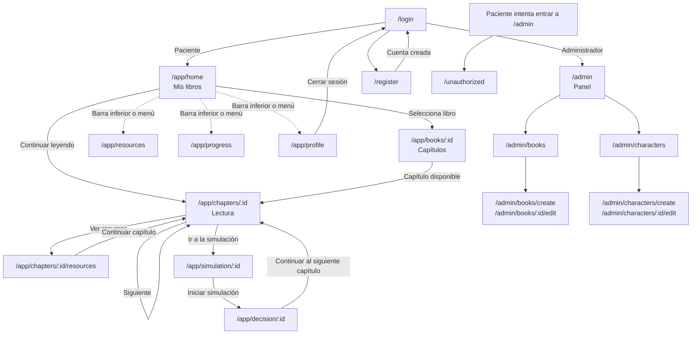
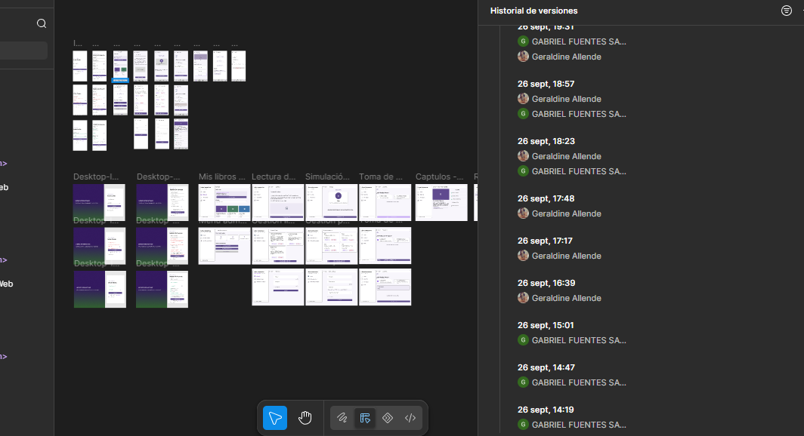
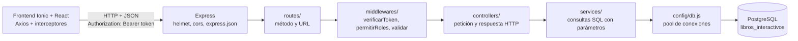
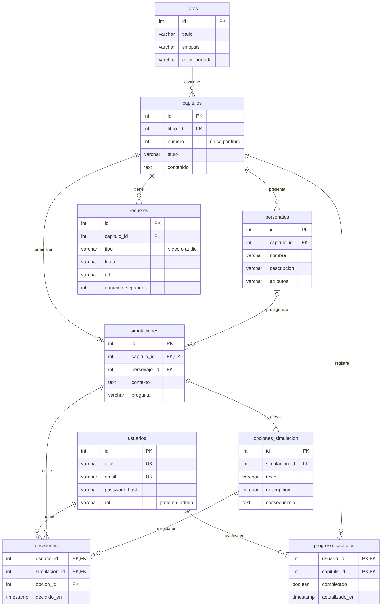
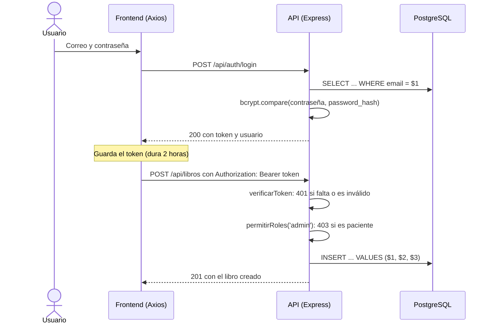
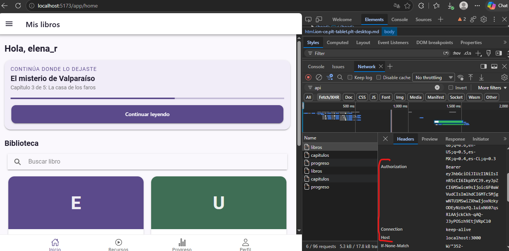
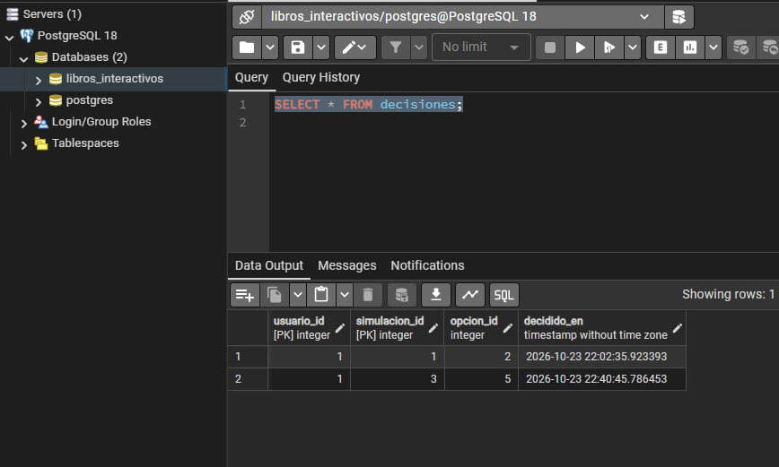
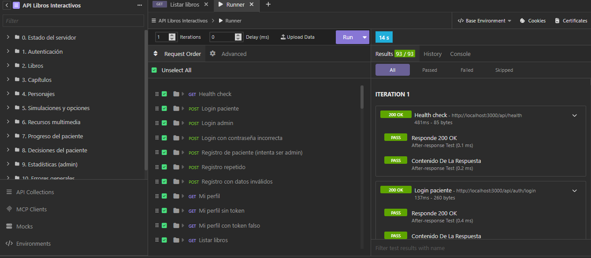
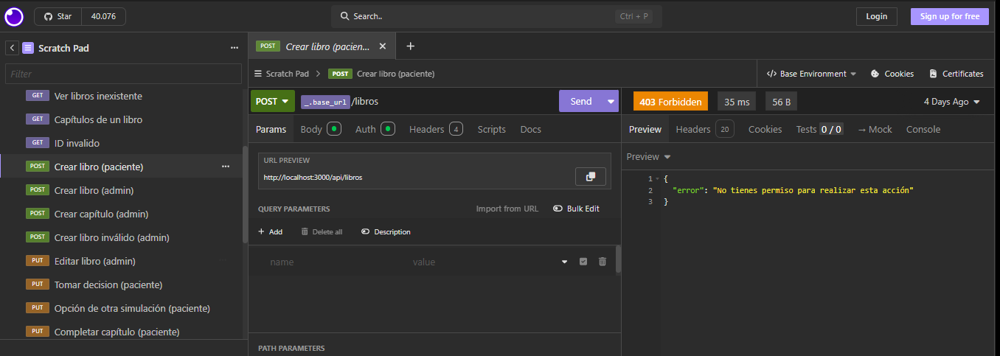

# Sistema de Libros Interactivos de Simulación

# Presentado por:
- Alexis Eduardo Escobar Figueroa — Frontend / Ionic + React
- Geraldine Valentina Allende López — UI/UX y Figma / Documentación
- Gabriel Alejandro Fuentes Sagardia — Frontend / Figma / Documentación y gestión
- Backend / API REST (EP2) — Responsabilidad compartida por todo el equipo

**Distribución de responsabilidades**
- **Frontend (Ionic + React):** estructura de vistas, rutas protegidas, rol y layouts (`routes/`, `layouts/`, `context/`, `hooks/`).
- **UI/UX y Figma:** mockups móvil/web, prototipo navegable, paleta y estilos de la aplicación (`theme/`, `components/`).
- **Backend (EP2):** API REST con Node.js + Express, base de datos PostgreSQL, autenticación JWT con roles y seguridad (`backend/`).
- **Integración (EP2):** conexión del frontend con la API mediante Axios e interceptores (`frontend/src/services/`).
- **Documentación y gestión:** README, documentación de la API, pruebas en Insomnia, ramas y evidencia de avance.

## Índice
1. [Descripción general del sistema](#descripción-general-del-sistema)
    - [Objetivos](#objetivos-del-proyecto)
    - [Principales funcionalidades](#principales-funcionalidades)
2. [Justificación del problema](#justificación-del-problema)
    - [Análisis de soluciones existentes](#análisis-de-soluciones-existentes)
3. [Usuarios](#usuarios-objetivo-quién-usará-la-aplicación)
    - [Roles](#roles-del-sistema)
    - [Proto-personas](#proto-personas)
    - [Supuestos](#supuestos-utilizados)
4. [Requerimientos](#requerimientos)
5. [Arquitectura de la Información/ UX](#arquitectura-de-navegación)
    - [Diferenciación x roles](#diferenciación-de-acceso-según-roles)
    - [Flujos principales Tareas](#flujos-de-tareas)
    - [Puntos críticos de interacción](#puntos-críticos-de-interacción)
    - [Justificación Técnica](#justificación-técnica)
6. [Bocetos UX/UI](#bocetos-uiux)
7. [Backend y API REST (EP2)](#backend-y-api-rest-ep2)
    - [Arquitectura del backend](#arquitectura-del-backend)
    - [Base de datos](#base-de-datos)
    - [API REST](#api-rest)
    - [Autenticación y roles](#autenticación-y-roles)
    - [Seguridad de la API](#seguridad-de-la-api)
    - [Integración con el frontend](#integración-con-el-frontend)
    - [Pruebas con Insomnia](#pruebas-con-insomnia)
8. [Librerías y Tecnologías](#librerías-usadas-con-react-ionic)
9. [Instalación y configuración](#instalación-y-configuración)
    - [Base de datos (PostgreSQL)](#1-base-de-datos-postgresql)
    - [Backend](#2-backend)
    - [Frontend](#3-frontend)
    - [Ejecución y uso](#ejecución-y-uso)
    - [Estructura del proyecto](#estructura-del-proyecto)
10. [Uso de herramientas de IA](#uso-de-herramientas-de-ia)
11. [Referencias](#referencias)

## Descripción general del sistema
El Sistema de Libros Interactivos de Simulación es una aplicación multiplataforma (web y móvil) desarrollada con Ionic + React que acompaña emocionalmente a pacientes en tratamiento oncológico mediante historias narrativas. El paciente lee libros organizados en capítulos, participa en simulaciones donde un personaje enfrenta situaciones cotidianas, toma decisiones que cambian el desenlace, reproduce recursos multimedia de apoyo y revisa su progreso. Los administradores (psicooncólogos) gestionan los libros y los personajes desde un panel propio.

**Alcance de la Entrega Parcial 1:** frontend navegable con rutas públicas y protegidas, separación por roles y versiones móvil y web, con datos simulados.

**Alcance de la Entrega Parcial 2:** backend en Node.js + Express con base de datos PostgreSQL; API REST con CRUD de libros, capítulos, personajes, simulaciones, recursos, progreso y decisiones; autenticación con JWT y control de roles; contraseñas encriptadas con bcrypt, validación de datos y protección contra inyección SQL. El frontend reemplaza los datos simulados por llamadas a la API con Axios e interceptores, y la API se prueba con una colección de Insomnia (ver [Backend y API REST](#backend-y-api-rest-ep2)).

### Objetivos del proyecto
**Objetivo general**

Desarrollar una aplicación web y móvil que centralice el acompañamiento emocional de pacientes oncológicos mediante libros interactivos con simulaciones y toma de decisiones, en un entorno seguro, accesible y confidencial.

**Objetivos específicos**
1. Caracterizar a los usuarios objetivo (pacientes y administradores) a partir de fuentes secundarias y análisis de soluciones existentes.
2. Diseñar un prototipo UI/UX en Figma, en versiones móvil y web, coherente con las necesidades de accesibilidad de los pacientes.
3. Implementar en Ionic + React una arquitectura de navegación con rutas públicas, rutas protegidas y diferenciación de acceso por rol.
4. Permitir que el paciente lea capítulos, participe en simulaciones, tome decisiones, reproduzca recursos multimedia y consulte su propio progreso.
5. Permitir que el administrador gestione el catálogo de libros y los personajes que participan en las simulaciones.
6. Proteger la identidad del paciente mediante el uso de alias, mensajes de error que no revelan información y acceso a estadísticas únicamente propias.

### Principales funcionalidades
| Funcionalidad | Rol | Requerimiento |
| :--- | :--- | :--- |
| Biblioteca con "Continúa donde lo dejaste" y buscador | Paciente | RF-04 |
| Lectura por capítulos con desbloqueo progresivo | Paciente | RF-04 |
| Simulación con personaje y contexto narrativo | Paciente | RF-05 |
| Toma de decisiones con confirmación y consecuencia | Paciente | RF-06 |
| Reproductor de recursos multimedia (audio/video) | Paciente y Administrador | RF-07 |
| Seguimiento de progreso y estadísticas propias | Paciente | RF-08 |
| Resumen global de la plataforma | Administrador | RF-09 |
| Crear, editar y eliminar libros | Administrador | RF-01, RF-02 y RF-03 |
| Crear, editar y eliminar personajes asociados a capítulos | Administrador | RF-10, RF-11 y RF-12 |
| Registro, inicio y cierre de sesión con control por rol | Todos | FT-01 a FT-04 |

---
## Justificación del problema
El tratamiento oncológico supone una carga emocional y psicológica importante. Según la Organización Mundial de la Salud (OMS) el cáncer es una de las principales causas de muerte en el mundo, con cerca de 10 millones de fallecimientos al año [[1]](#referencias). En 2022 hubo más de 4.2 millones de nuevos casos y se proyecta un aumento del 60 % al 2045 [[2]](#referencias). En Chile, el cáncer es una prioridad de salud pública abordada por la ley nacional del cáncer y el plan nacional de cáncer 2022-2027 [[4]](#referencias).

La OMS señala que la atención de estos pacientes no se limita a lo físico y es por eso que, los cuidados paliativos buscan mejorar la calidad de vida de pacientes y familias abordando también problemas psicosociales [[1]](#referencias)[[3]](#referencias). Sin embargo, en la práctica los pacientes suelen enfrentarse a un exceso de información médica (folletos estáticos o videos dispersos) que carece de un seguimiento estructurado. El equipo supone que, sumado a la fatiga propia del tratamiento, buscar y procesar consejos de autocuidado en múltiples plataformas genera frustración y aislamiento ([Supuestos](#supuestos-utilizados)).

Además, la falta de una plataforma centralizada que ofrezca experiencias narrativas interactivas provoca que el paciente se enfrente a su proceso en soledad sin un espacio seguro donde proyectar sus decisiones.

En este contexto, el problema abordado por el proyecto corresponde a la necesidad de centralizar el acompañamiento emocional del paciente a través de experiencias narrativas interactivas que le permitan desarrollar su proceso de tratamiento de forma segura y estructurada.

**Consecuencias de no abordar el problema:** el paciente continúa dependiendo de información dispersa y estática, aumenta la sensación de aislamiento durante los tiempos de espera del tratamiento y los profesionales no cuentan con una herramienta para ofrecer contenido de apoyo de forma continua.

Para ello, se propone un sistema de libros interactivos que transforme la lectura pasiva en una experiencia inmersiva. A través de simulaciones y toma de decisiones, el paciente puede explorar escenarios emocionales y cotidianos en un entorno seguro. Con el fin de centralizar el acompañamiento emocional del paciente, facilitar su consulta desde diferentes dispositivos y proporcionar una experiencia diferenciada.

### Análisis de soluciones existentes
| Solución | Enfoque | Qué aporta a nuestro diseño | Qué no cubre |
| :--- | :--- | :--- | :--- |
| **Untire** [[5]](#referencias) | Programa digital de autoayuda para la fatiga relacionada con el cáncer, con ejercicios y contenido psicoeducativo. | Confirma que los pacientes oncológicos usan apps de apoyo | No ofrece narrativas interactivas ni toma de decisiones. |
| **OWise** [[6]](#referencias) | Registro de síntomas y seguimiento personal para pacientes con cáncer. | Seguimiento de progreso propio y énfasis en privacidad de los datos. | Enfoque clínico de registro. No entrega contenido emocional narrativo. |
| **Headspace** [[7]](#referencias) | Meditación y bienestar general con audios guiados. | Audios breves de relajación y una interfaz calmada. | No es específico para pacientes oncológicos ni tiene historias con seguimiento. |
| **Folletos y videos del centro de salud** | Información estática entregada en papel o enlaces sueltos. | Contenido validado por profesionales. | No hay interacción, seguimiento ni centralización. |

**Conclusión:** las soluciones revisadas cubren el registro de síntomas o el bienestar general, pero ninguna combina **narrativa interactiva, simulación y decisiones** con un panel para que los profesionales publiquen contenido. Esa brecha es la que aborda este proyecto.

---
## Usuarios objetivo (Quién usará la aplicación)
La aplicación considera principalmente dos grupos de usuarios: **Usuario/Paciente y Administrador/Editor de Contenido**.

### Usuario / Paciente
Corresponde a usuarios en diversas etapas del tratamiento oncológico y que utilizan la plataforma principalmente en habitaciones de hospital durante la terapia, en salas de espera o en reposo domiciliario.

#### Necesidades principales
- Consumir contenido que reduzca la ansiedad.
- Registrar su progreso emocional.
- Tener confidencialidad sobre su identidad y su progreso.

#### Posibles dificultades
- Fatiga y baja tolerancia a textos largos.
- Menor precisión motriz (uso con una mano, vía intravenosa en el brazo, etc).
- Conexión a internet inestable en recintos hospitalarios.

#### Objetivos o tareas en el sistema
Leer capítulos, participar en simulaciones, tomar decisiones, escuchar o ver recursos de apoyo y revisar su avance.

#### Nivel estimado de experiencia tecnológica
**Básico a intermedio:** usa aplicaciones de mensajería, redes sociales y videollamadas.

#### Necesidades de accesibilidad, seguridad y privacidad
- Botones grandes (alrededor de 48 px de alto), texto de 16 px o más y alto contraste.
- Navegación con el pulgar (barra inferior en móvil).
- Uso de alias en lugar del nombre real.

### Administrador / Editor de Contenido
Corresponde a psicooncólogos, educadores de salud o personal de fundaciones, los cuales trabajan principalmente desde oficinas clínicas o teletrabajo.

#### Necesidades principales
- Publicar y actualizar contenido de apoyo sin procesos difíciles.
- Asociar personajes a los capítulos donde participan.
- Conocer de forma general el uso de la plataforma.

#### Objetivos o tareas en el sistema
Crear, editar y eliminar libros/personajes.

#### Nivel estimado de experiencia tecnológica
**Intermedio:** usa plataformas web de gestión en computador.

#### Necesidades de seguridad
- Acceso exclusivo al panel de administración.
- Confirmación antes de eliminar contenido.

---
## Roles del Sistema
- **Usuario / Paciente**: Persona que interactúa con los libros interactivos, navega capítulos y realiza el seguimiento de su progreso.
- **Administrador**: Usuario encargado de la gestión de libros y personajes dentro de la plataforma. Además, puede revisar en modo lectura las vistas del paciente.

### Definición de conceptos
**Rol**: Define qué puede hacer un usuario dentro del sistema.
**Proto-persona**: Describe quién podría ser ese usuario, sus características, necesidades, objetivos, dificultades y contexto de uso.

**Por ejemplo**
*Rol*: Usuario/Paciente
*Proto-persona*: Paciente adulto de 45 años que recibe quimioterapia semanal y utiliza principalmente tablet durante sus sesiones de tratamiento.

---
## Proto-personas
*Estos perfiles son caracterizaciones preliminares construidas a partir de fuentes secundarias y supuestos razonados del equipo, no de entrevistas a usuarios reales.*

---
### Proto-persona 1: Paciente en tratamiento oncológico activo

**Nombre ficticio:** Elena Rojas
**Tipo de usuario o rol:** Usuario / Paciente

#### Características generales

Elena tiene 45 años y es profesora con licencia médica. Actualmente se encuentra recibiendo quimioterapia intravenosa de forma semanal. Su nivel de manejo tecnológico es básico/intermedio.

#### Necesidades principales

- Sentirse comprendida sin tener que leer contenido médico extenso.
- Contar con distracciones constructivas durante sus terapias.

#### Objetivos de uso

Leer historias de personajes que atraviesan situaciones similares a la suya y tomar decisiones para ver distintos desenlaces.

#### Dificultades o puntos de frustración

- Se agota rápidamente leyendo pantallas con mucho texto.
- Le frustran las interfaces con botones pequeños.

#### Funcionalidades de la aplicación que utilizaría

- Leer capítulo (RF-04).
- Iniciar simulación (RF-05).
- Tomar decisión (RF-06).
- Reproducir recurso multimedia (RF-07).
- Consultar progreso propio (RF-08).

#### Dispositivo y contexto probable de acceso

Utilizaría principalmente **tablet y teléfono móvil**. Accede recostada en la clínica durante sus sesiones de tratamiento o desde su cama en reposo domiciliario.

---
### Proto-persona 2: Administrador y editor de contenido narrativo

**Nombre ficticio:** Martín Vargas
**Tipo de usuario o rol:** Administrador / Editor de Contenido (Psicooncólogo)

#### Características generales

Martín tiene 38 años y es psicólogo en una fundación oncológica. Está acostumbrado a redactar material de apoyo para sus pacientes. Su nivel de manejo tecnológico es intermedio.

#### Necesidades principales

- Centralizar sus guías de apoyo en una herramienta interactiva.
- Lograr que sus pacientes participen activamente del contenido.

#### Objetivos de uso

Crear un libro, definir los personajes que participan en sus simulaciones y revisar cómo lo ve el paciente.

#### Dificultades o puntos de frustración

- Falta de tiempo.
- Le frustran los sistemas complejos que requieren muchos clics para publicar un texto.

#### Funcionalidades de la aplicación que utilizaría

- Crear, editar y eliminar libros (RF-01, RF-02 y RF-03).
- Reproducir recurso multimedia (RF-07).
- Consultar resumen de la plataforma (RF-09).
- Crear, editar y eliminar personajes (RF-10, RF-11 y RF-12).

#### Dispositivo y contexto probable de acceso

Utilizaría principalmente la **versión web desde un computador de escritorio**, durante horario de oficina.

---
### Supuestos utilizados
Los perfiles anteriores se construyeron a partir de los siguientes supuestos:

1. Los pacientes son adultos (18 años o más) en tratamiento ambulatorio y tienen acceso a un teléfono o tablet propio o de un familiar.
2. Las sesiones de tratamiento incluyen tiempos de espera en los que el paciente puede usar la aplicación.
3. La fatiga asociada al tratamiento reduce la tolerancia a textos largos, por lo que los capítulos deben ser breves.
4. La conexión a internet en recintos hospitalarios puede ser lenta o intermitente.
5. El paciente prefiere no exponer su nombre real ni su diagnóstico dentro de la aplicación.
6. Los administradores son profesionales de salud mental o educación que trabajan desde un computador y validan el contenido que publican.
7. La aplicación es un complemento de apoyo emocional.

## Requerimientos

## Requerimientos Funcionales por Rol

| ID | Nombre | Descripción (producto + verbo + necesidad) | Rol | Precondiciones | Flujo Principal | Resultado Esperado |
| :--- | :--- | :--- | :--- | :--- | :--- | :--- |
| **RF-01** | Crear libro | El sistema deberá permitir al administrador **crear** un libro interactivo con título y sinopsis, para publicar nuevo contenido de apoyo emocional. | Administrador | Estar autenticado como administrador. | 1. Accede a "Gestión de libros".<br>2. Presiona "Nuevo libro".<br>3. Completa título y sinopsis.<br>4. Presiona "Guardar". | El libro aparece en el catálogo y se muestra el mensaje "Libro creado." |
| **RF-02** | Editar libro | El sistema deberá permitir al administrador **editar** el título y la sinopsis de un libro existente, para corregir o actualizar el contenido publicado. | Administrador | Estar autenticado como administrador y que el libro exista. | 1. Accede a "Gestión de libros".<br>2. Presiona "Editar" en el libro.<br>3. Modifica los datos precargados.<br>4. Presiona "Guardar". | El libro se actualiza en el catálogo y se muestra el mensaje "Libro actualizado." |
| **RF-03** | Eliminar libro | El sistema deberá permitir al administrador **eliminar** un libro, previa confirmación, para retirar contenido que ya no corresponde publicar. | Administrador | Estar autenticado como administrador y que el libro exista. | 1. Accede a "Gestión de libros".<br>2. Presiona "Eliminar" en el libro.<br>3. Confirma en el cuadro de diálogo. | El libro deja de estar disponible junto con sus capítulos y simulaciones, y se muestra el mensaje "Libro eliminado." |
| **RF-04** | Leer capítulo | El sistema deberá permitir al paciente **leer** los capítulos de un libro en orden, desbloqueando cada uno al completar el anterior, para avanzar en la historia a su propio ritmo. | Usuario/Paciente | Tener sesión iniciada y un libro seleccionado. | 1. Abre el libro desde "Mis libros".<br>2. Selecciona un capítulo disponible.<br>3. Lee y presiona "Siguiente". | El capítulo queda guardado como última lectura y, al terminarlo, se desbloquea el siguiente. |
| **RF-05** | Iniciar simulación | El sistema deberá permitir al paciente **iniciar** la simulación de un capítulo, mostrando el personaje y el contexto, para situarse en el escenario narrativo antes de decidir. | Usuario/Paciente | Estar en un capítulo que termina en simulación. | 1. Presiona "Ir a la simulación".<br>2. Revisa el personaje y el contexto.<br>3. Presiona "Iniciar simulación". | La interfaz cambia al modo de toma de decisión. |
| **RF-06** | Tomar decisión | El sistema deberá permitir al paciente **registrar** su decisión, eligiendo y confirmando una de las opciones de la simulación, para conocer su consecuencia y explorar escenarios en un entorno seguro. | Usuario/Paciente | Simulación iniciada con opciones en pantalla. | 1. Lee la pregunta.<br>2. Selecciona una tarjeta de opción.<br>3. Presiona "Confirmar decisión". | Se guarda la decisión, se muestra su consecuencia y se desbloquea el siguiente capítulo. |
| **RF-07** | Reproducir recurso multimedia | El sistema deberá permitir al paciente y al administrador **reproducir** los videos y audios de apoyo de cada capítulo, para complementar la lectura con ejercicios de relajación y contenido visual. | Usuario/Paciente y Administrador | Tener sesión iniciada y que el capítulo tenga recursos. | 1. Presiona la pestaña "Recursos" o "Ver recursos del capítulo".<br>2. Selecciona un recurso.<br>3. Presiona reproducir. | El recurso se reproduce mostrando su avance y duración. |
| **RF-08** | Consultar progreso propio | El sistema deberá permitir al paciente **consultar** su propio avance (porcentaje por libro, capítulos completados y pendientes, y decisiones tomadas), para saber cuánto ha avanzado y dónde continuar. | Usuario/Paciente | Tener interacción previa con al menos un libro. | 1. Accede a "Mi progreso".<br>2. El sistema calcula el avance de cada libro. | Se muestran las estadísticas y una barra de avance por libro (por ejemplo, 3 de 5 capítulos completados = 60 %). |
| **RF-09** | Consultar resumen de la plataforma | El sistema deberá permitir al administrador **consultar** un resumen global (cantidad de libros, capítulos, personajes y pacientes registrados), para conocer el uso de la plataforma sin acceder a datos personales de los pacientes. | Administrador | Estar autenticado como administrador. | 1. Inicia sesión como administrador.<br>2. Accede al "Panel de administración". | Se muestran los totales de la plataforma. |
| **RF-10** | Crear personaje | El sistema deberá permitir al administrador **crear** un personaje con nombre, descripción, atributos y capítulo asociado, para que participe en las simulaciones de ese capítulo. | Administrador | Estar autenticado como administrador y que exista al menos un capítulo. | 1. Accede a "Gestión de personajes".<br>2. Presiona "Nuevo personaje".<br>3. Completa los datos y elige el capítulo.<br>4. Presiona "Guardar". | El personaje queda disponible para las simulaciones del capítulo y se muestra el mensaje "Personaje creado." |
| **RF-11** | Editar personaje | El sistema deberá permitir al administrador **editar** los datos o el capítulo asociado de un personaje existente, para mantener coherente la historia. | Administrador | Estar autenticado como administrador y que el personaje exista. | 1. Accede a "Gestión de personajes".<br>2. Presiona "Editar" en el personaje.<br>3. Modifica los datos precargados.<br>4. Presiona "Guardar". | El personaje se actualiza y se muestra el mensaje "Personaje actualizado." |
| **RF-12** | Eliminar personaje | El sistema deberá permitir al administrador **eliminar** un personaje, previa confirmación, para retirarlo de la historia. | Administrador | Estar autenticado como administrador y que el personaje exista. | 1. Accede a "Gestión de personajes".<br>2. Presiona "Eliminar" en el personaje.<br>3. Confirma en el cuadro de diálogo. | El personaje se elimina, las simulaciones donde aparecía muestran un personaje genérico y se muestra el mensaje "Personaje eliminado." |

---

### Funcionalidades Transversales

Las siguientes funcionalidades son necesarias para el funcionamiento general de la aplicación pero no forman parte de los siete requerimientos funcionales principales.

- **FT-01:** El sistema deberá permitir a un visitante **registrarse** como paciente (`/register`), para acceder a los libros con una cuenta propia.
- **FT-02:** El sistema deberá permitir a los usuarios **iniciar sesión** con su correo y contraseña (`/login`), para acceder a las funciones de su rol.
- **FT-03:** El sistema deberá permitir **cerrar** la sesión activa (desde "Perfil" o el menú lateral), para proteger la cuenta en dispositivos compartidos.
- **FT-04:** El sistema deberá **restringir** las funcionalidades según el rol del usuario autenticado (Usuario/Paciente o Administrador), para que cada usuario acceda solo a lo que le corresponde.

---

## Requerimientos No Funcionales

### UX y Usabilidad

#### RNF-UX-01 — Usabilidad

El acceso al último capítulo leído deberá lograrse en un máximo de 3 clics desde el inicio. En la implementación actual se logra en 1 clic con el botón "Continuar leyendo" de `/app/home`.

---

### Accesibilidad

#### RNF-ACC-01 — Accesibilidad visual

La interfaz deberá mantener un contraste de colores WCAG AA (mínimo 4.5:1) [[8]](#referencias) y usar botones de alrededor 48 px de alto. Se validará con herramientas automatizadas como WAVE.

---

### Seguridad

#### RNF-SEG-01 — Autenticación y almacenamiento de contraseñas

El sistema utiliza JWT para el manejo de sesiones (token firmado con `JWT_SECRET` y válido por 2 horas) y guarda las contraseñas encriptadas con bcrypt (costo 10). Se validó con Insomnia (un token alterado o vencido responde 401) y revisando en la base de datos que `password_hash` nunca contiene la contraseña.

#### RNF-SEG-02 — Privacidad de datos del paciente

El sistema no solicitará datos personales innecesarios (RUT, diagnóstico), identificará al paciente mediante un alias, mostrará mensajes de error de inicio de sesión que no revelen qué correos están registrados y permitirá a cada paciente ver solo su propio progreso. En la API, el progreso y las decisiones se obtienen siempre con el id del token, y las estadísticas de administración muestran solo el alias de cada paciente. Se validará mediante revisión de formularios y pruebas de acceso entre cuentas.

---

### Rendimiento

#### RNF-REN-01 — Tiempos de respuesta

La API REST deberá responder solicitudes en menos de 200 ms, e Ionic deberá renderizar las vistas en menos de 1.5 segundos. Mientras se cargan los datos, la interfaz mostrará indicadores de carga (`IonSkeletonText`, `IonSpinner`). Se validará mediante pruebas de carga y auditorías con Lighthouse.

---

### Compatibilidad

#### RNF-COM-01 — Navegadores y dispositivos compatibles

El sistema deberá ejecutarse correctamente en los siguientes navegadores, en la versión indicada o una superior:

| Navegador | Versión mínima | Plataformas |
| :--- | :--- | :--- |
| Google Chrome | 111 | Windows, macOS y Android |
| Microsoft Edge | 111 | Windows |
| Mozilla Firefox | 114 | Windows y macOS |
| Safari | 16.4 | macOS e iOS |

Estas versiones coinciden con el objetivo de compilación por defecto de Vite 8, que es la herramienta con la que se construye el frontend (*Baseline Widely Available*) [[21]](#referencias). Además, la interfaz deberá adaptarse a pantallas de 360 px de ancho (móvil) hasta 1920 px (escritorio).

Se validará abriendo la aplicación en esos navegadores y con el modo dispositivo de DevTools en 360 × 800 (móvil), 768 × 1024 (tablet) y 1366 × 768 (escritorio).

---
## Arquitectura de Navegación
### 1. Rutas principales y secundarias

La aplicación considera rutas públicas, una ruta común y rutas protegidas. Las rutas del paciente usan el prefijo `/app` y las del administrador el prefijo `/admin` (ver [Justificación Técnica](#justificación-técnica)).

#### Rutas públicas

| Ruta | Vista | Descripción |
|---|---|---|
| `/` | Redirección | Redirección automática a `/login`. |
| `/login` | Inicio de sesión | Permite al usuario autenticarse en el sistema. |
| `/register` | Registro | Permite el registro de un nuevo usuario/paciente. |

#### Ruta común

| Ruta | Vista | Descripción |
|---|---|---|
| `/unauthorized` | Acceso denegado | Destino de un usuario que intenta entrar a una sección sin el rol requerido. |

#### Rutas protegidas del Usuario / Paciente

| Ruta | Vista | Descripción |
|---|---|---|
| `/app/home` | Mis libros | Inicio, "Continúa donde lo dejaste" y biblioteca de libros. |
| `/app/books/:id` | Detalle de libro | Portada, sinopsis, avance y lista de capítulos. |
| `/app/chapters/:id` | Lectura de capítulo | Lectura del capítulo. |
| `/app/chapters/:id/resources` | Recursos del capítulo | Recursos multimedia asociados al capítulo. |
| `/app/simulation/:id` | Simulación | Personaje y contexto de la simulación. |
| `/app/decision/:id` | Toma de decisión | Opciones, confirmación y consecuencia. |
| `/app/resources` | Recursos | Todos los recursos multimedia de apoyo. |
| `/app/progress` | Mi progreso | Seguimiento de progreso y estadísticas propias. |
| `/app/profile` | Perfil | Datos de la cuenta y cierre de sesión. |
| `/app/characters` | Personajes | Galería de personajes (planificada; la API ya ofrece `GET /api/personajes`). |

#### Rutas protegidas del Administrador

| Ruta | Vista | Descripción |
|---|---|---|
| `/admin` | Panel de administración | Resumen de contenido y accesos rápidos. |
| `/admin/books` | Gestión de libros | Listado de libros con acciones editar y eliminar. |
| `/admin/books/create` | Crear libro | Creación de un nuevo libro. |
| `/admin/books/:id/edit` | Editar libro | Edición de un libro existente. |
| `/admin/characters` | Gestión de personajes | Listado de personajes con acciones editar y eliminar. |
| `/admin/characters/create` | Crear personaje | Creación de un personaje y asociación a un capítulo. |
| `/admin/characters/:id/edit` | Editar personaje | Edición de un personaje existente. |
| `/admin/chapters` | Gestión de capítulos | Planificada. La API ya ofrece el CRUD en `/api/capitulos`. |
| `/admin/simulations` | Gestión de simulaciones | Planificada. La API ya ofrece el CRUD en `/api/simulaciones`. |
| `/admin/resources` | Gestión de recursos | Planificada. La API ya ofrece el CRUD en `/api/recursos`. |
| `/admin/progress` | Estadísticas | Planificada. La API ya ofrece `GET /api/estadisticas/pacientes`. |

### 2. Relaciones jerárquicas entre vistas
La aplicación se organiza mediante una estructura jerárquica en la que las funcionalidades disponibles dependen del rol del usuario autenticado.

```text
IonApp
└── IonReactRouter
    └── IonSplitPane (menú lateral fijo en web)
        ├── AppMenu (IonMenu con opciones según el rol)
        └── IonRouterOutlet principal
            │
            ├── Rutas públicas
            │   ├── /
            │   ├── /login
            │   └── /register
            │
            ├── Ruta común
            │   └── /unauthorized
            │
            └── Rutas protegidas
                │
                ├── UserLayout — /app/* (Usuario / Paciente)
                │   ├── /app/home
                │   │   └── /app/books/:id
                │   │       └── /app/chapters/:id
                │   │           ├── /app/chapters/:id/resources
                │   │           └── /app/simulation/:id
                │   │               └── /app/decision/:id
                │   ├── /app/resources
                │   ├── /app/progress
                │   └── /app/profile
                │
                └── AdminLayout — /admin/* (Administrador)
                    ├── /admin
                    ├── /admin/books
                    │   ├── /admin/books/create
                    │   └── /admin/books/:id/edit
                    └── /admin/characters
                        ├── /admin/characters/create
                        └── /admin/characters/:id/edit
```

La aplicación utiliza un enfoque de componentes contenedores (Layouts) para encapsular la navegación.

- **UserLayout:** Contenedor principal para pacientes. Contiene un `IonTabs` con su propio `IonRouterOutlet` para las rutas `/app/*` y la barra inferior (`IonTabBar`) con Inicio, Recursos, Progreso y Perfil.
- **AdminLayout:** Contenedor para administradores. Agrupa las rutas `/admin/*` en un `IonRouterOutlet`.
- **AppMenu:** Menú lateral (`IonMenu`) común a ambos roles.
- **Vistas Hoja:** Componentes como `ChapterPage` o `DecisionPage` que se montan dentro del `IonRouterOutlet` del Layout correspondiente.

### 3. Flujo de navegación entre funcionalidades



### 4. Navegación adaptada por dispositivo
El layout detecta el tamaño de pantalla para ajustar la interfaz sin duplicar lógica:
- **Dispositivos Móviles:** Se utiliza `IonTabs` anclado en la parte inferior (`IonTabBar`). El administrador abre el menú lateral con el botón de menú (`IonMenuButton`).
- **Versión Web (Escritorio):** A partir de pantallas grandes (`lg`), `IonSplitPane` deja fijo el `IonMenu` lateral y la barra inferior se oculta.

---
## Diferenciación de acceso según roles

La aplicación controla el acceso a las diferentes funcionalidades de acuerdo con el rol del usuario autenticado. Se consideran dos roles principales: **Usuario/Paciente** y **Administrador**.

- Un usuario no autenticado que intente acceder a una ruta protegida (`/app/*` o `/admin/*`) es redirigido a `/login`.
- Un usuario autenticado que visite `/login` o `/register` es redirigido a `/app/home` o `/admin` según su rol.
- Un paciente que intente acceder a rutas administrativas es redirigido a `/unauthorized`.
- Una ruta inexistente redirige a `/login` (o muestra "Página no encontrada" dentro de `/app`).

### Resumen de acceso por rol

| Funcionalidad | Usuario / Paciente | Administrador |
| :--- | :--- | :--- |
| **RF-01: Crear libro** | Sin acceso | Acceso total |
| **RF-02: Editar libro** | Sin acceso | Acceso total |
| **RF-03: Eliminar libro** | Sin acceso | Acceso total |
| **RF-04: Leer capítulo** | Acceso total (lectura) | Acceso total (revisión) |
| **RF-05: Iniciar simulación** | Acceso total | Acceso de prueba |
| **RF-06: Tomar decisión** | Acceso total | Acceso de prueba |
| **RF-07: Reproducir recurso multimedia** | Acceso total | Acceso total |
| **RF-08: Consultar progreso propio** | Solo métricas propias | Solo métricas propias |
| **RF-09: Consultar resumen de la plataforma** | Sin acceso | Acceso total |
| **RF-10: Crear personaje** | Sin acceso | Acceso total |
| **RF-11: Editar personaje** | Sin acceso | Acceso total |
| **RF-12: Eliminar personaje** | Sin acceso | Acceso total |

---

### Acceso del Usuario / Paciente

El usuario/paciente tendrá acceso a las funcionalidades relacionadas con la lectura y la experiencia narrativa dentro de la plataforma.

Podrá:

- navegar el catálogo de libros y ver el detalle de cada uno
- leer capítulos y avanzar en la narrativa
- participar en simulaciones y tomar decisiones
- reproducir recursos multimedia de apoyo
- consultar su propio progreso
- revisar su perfil y cerrar sesión

---

### Acceso del Administrador

El administrador tendrá acceso a las funcionalidades de gestión de contenido de la plataforma.

Podrá:

- gestionar libros (crear, editar, eliminar)
- gestionar personajes y asociarlos a capítulos
- revisar la navegación de capítulos y probar simulaciones
- reproducir recursos multimedia
- consultar un resumen global de la plataforma (libros, capítulos, personajes y pacientes registrados)

---

### Control de acceso a rutas

La diferenciación por roles se aplica tanto en la interfaz como en las rutas, mediante tres componentes ubicados en `src/routes/`:

| Guardia | Rutas que protege | Comportamiento |
| :--- | :--- | :--- |
| `PublicOnlyRoute` | `/login`, `/register` | Si ya hay sesión, redirige a `/app/home` o `/admin`. |
| `PrivateRoute` | `/app/*` | Sin sesión, redirige a `/login`. |
| `RoleRoute` | `/admin/*` | Sin sesión, redirige a `/login`. Con otro rol, a `/unauthorized`. |

Desde la EP2 el control también se hace en la API: una petición sin token o con un token inválido responde **401**, y una petición con un rol sin permiso responde **403**, aunque alguien intente saltarse la interfaz (ver [Autenticación y roles](#autenticación-y-roles)).

---
## Flujos de Tareas

---

### Task Flow 1: Lectura y toma de decisión

**Rol:** Usuario / Paciente

**Objetivo:** leer la narrativa de un capítulo, participar en la simulación y tomar una decisión que haga avanzar la historia.

```text
Inicio de sesión (/login)
      ↓
Selecciona libro (/app/home)
      ↓
Selecciona capítulo disponible (/app/books/:id)
      ↓
Lee la historia (/app/chapters/:id)
      ↓
Inicia simulación (/app/simulation/:id)
      ↓
Selecciona una opción y confirma (/app/decision/:id)
      ↓
Ve la consecuencia, se guarda el progreso y continúa al siguiente capítulo
```
---

### Task Flow 2: Revisión de progreso

**Rol:** Usuario / Paciente

**Objetivo:** revisar el avance realizado con las lecturas.

```text
Inicio de sesión (/login)
      ↓
Navega con la barra inferior (móvil) o el menú lateral (web)
      ↓
Visualiza estadísticas y avance por libro (/app/progress)
      ↓
Presiona "Continuar leyendo" o vuelve al inicio
```
---

### Task Flow 3: Creación de contenido narrativo

**Rol:** Administrador

**Objetivo:** registrar un nuevo libro y los personajes que participarán en sus simulaciones.

```text
Inicio de sesión (/login)
      ↓
Accede al panel de administración (/admin)
      ↓
Crea el libro base (/admin/books/create)
      ↓
Crea un personaje y lo asocia a un capítulo (/admin/characters/create)
      ↓
Guarda y revisa el resultado en la vista del paciente (/app/home)

```
---
## Puntos críticos de interacción

Para este caso de estudio se identifican los siguientes puntos críticos:

1. **El momento de la decisión en la simulación:**
   * Fricción: Riesgo de toques accidentales.
   * Solución: Opciones como tarjetas amplias (`IonCard`). Tocar una tarjeta solo la selecciona y la resalta. La decisión se registra al presionar el botón "Confirmar decisión" en la parte inferior que está deshabilitado hasta elegir una opción.
2. **Capítulos bloqueados:**
   * Fricción: El paciente podría intentar abrir un capítulo sin haber completado el anterior.
   * Solución: Los capítulos muestran su estado (completado, disponible o bloqueado) con ícono y texto. Al tocar uno bloqueado aparece un `IonToast` explicativo.
3. **Errores de inicio de sesión:**
   * Fricción: Un mensaje que diga "correo no registrado" revela quién usa la aplicación.
   * Solución: Mensaje genérico ("Correo o contraseña incorrectos.") y validaciones de formato antes de enviar.
4. **Conexión inestable o sesión vencida:**
   * Fricción: En recintos hospitalarios la conexión puede fallar ([Supuestos](#supuestos-utilizados)) y el token de sesión dura 2 horas.
   * Solución: Si la API no responde, la aplicación muestra el mensaje "No pudimos conectar con el servidor. Revisa tu conexión e inténtalo de nuevo". Si el token venció, el interceptor de Axios cierra la sesión y lleva al login en vez de dejar la pantalla a medias.
---
### Justificación Técnica

### Usabilidad
Minimizar la carga cognitiva del paciente, manteniendo estructuras predecibles (Layouts constantes), controles al alcance del dedo (`IonTabs`).

### Eficiencia de interacción
El uso de React Router con `IonRouterOutlet` permite mantener el estado de navegación de Ionic sin recargar el DOM. El botón "Continuar leyendo" lleva al último capítulo en un solo clic.

### Claridad estructural
Las vistas se organizan mediante componentes contenedores (Layouts) según el rol del usuario autenticado: `UserLayout` para pacientes y `AdminLayout` para administradores. El código se separa en carpetas `pages`, `components`, `routes`, `services`, `layouts`, `context` y `hooks`.

### Escalabilidad
Encapsular la lógica en Layouts independientes permite hacer crecer el panel de administración sin sobrecargar el área del paciente. Los servicios (`src/services/`) devuelven promesas desde la EP1; en la EP2 se reemplazó su interior por llamadas a la API con Axios y la traducción de los datos quedó en un solo archivo (`mappers.ts`), por lo que las pantallas solo necesitaron ajustes menores. En el backend, cada módulo sigue el mismo patrón (rutas → controlador → servicio), así agregar uno nuevo no afecta a los demás.

### Seguridad
Las validaciones de ruta (`PrivateRoute`, `RoleRoute`, `PublicOnlyRoute`) actúan como primera barrera (frontend). La segunda barrera es la API: cada petición verifica el token y el rol (`verificarToken`, `permitirRoles`), así que saltarse la interfaz no da acceso a nada. Al cerrar sesión la aplicación se recarga para que ninguna vista privada quede montada.

### Decisiones de implementación
- **Prefijo `/app` en las rutas del paciente:** inicialmente el layout con pestañas se puso en la raíz (`/*`), pero en Ionic 9 [[9]](#referencias) esa ruta captura todas las URL y dejaba la página invisible al pasar de `/login` al inicio. Con `/app/*` cada rol tiene su propio prefijo, igual que `/admin/*`.
- **Hook `usePageEnter`:** Este hook recarga los datos cada vez que una página vuelve a estar activa para que el progreso siempre esté actualizado.
- **Nombres en español en la API y en inglés en el frontend:** la API usa los nombres de la base de datos (`titulo`, `sinopsis`) y `frontend/src/services/mappers.ts` los traduce a los tipos de las pantallas (`title`, `synopsis`). Así las pantallas de la EP1 se mantuvieron.
- **Sesión en el navegador:** el token JWT se guarda en `localStorage` para mantener la sesión al recargar la página. Dura 2 horas y, si vence, el interceptor cierra la sesión.

---
## Bocetos UI/UX
[Figma - Prototipo de UI/UX](https://www.figma.com/design/V9QFnXbBVuZYb6xRnxik6c/EP1_Prototipo_Libros_Interactivos?node-id=0-1&t=4Z5sW8yxSsm7sCnD-1)

[Figma - Prototipo navegable](https://www.figma.com/proto/V9QFnXbBVuZYb6xRnxik6c/EP1_Prototipo_Libros_Interactivos?node-id=0-1&p=f&t=4Z5sW8yxSsm7sCnD-0&scaling=contain&content-scaling=fixed&starting-point-node-id=1%3A2&show-proto-sidebar=1)



### Criterios de diseño
- **Paleta de colores:** Tonos tranquilizadores con contraste WCAG AA verificado:

  | Uso | Color | Contraste con blanco |
  | :--- | :--- | :--- |
  | Primario (botones, enlaces) | Violeta `#5B4A8B` | 7.5:1 |
  | Secundario | Verde apagado `#3F6E55` | 5.9:1 |
  | Error | Rojo `#B3261E` | 6.5:1 |
  | Fondo | Lavanda claro `#FAF8FD` | — |
  | Texto | `#1F1B2D` | — |

- **Tipografía:** Sans-serif limpia (Inter o Roboto). Tamaño base de 16px y lectura de capítulos a 18px.
- **Coherencia e Iconografía:** Uso exclusivo de Ionicons [[10]](#referencias). Sistema de espaciado basado en múltiplos de 8px. Botones de alrededor de 48px de alto y esquinas redondeadas.
- **Navegación:** Barra inferior (`IonTabBar`) en móvil y menú lateral fijo (`IonMenu`) en web.

### Justificación de los campos del formulario de registro
El registro solicita solo la información necesaria para crear y proteger la cuenta del paciente:

| Campo | Obligatorio | Formato y validación | Justificación |
| :--- | :--- | :--- | :--- |
| Nombre de usuario (alias) | Sí | 3 a 20 caracteres: letras, números, `_` o `.` | Identifica al paciente dentro de la app sin usar su nombre real (confidencialidad). |
| Correo electrónico | Sí | Formato `nombre@dominio.cl` | Credencial de acceso y futura recuperación de contraseña. No se muestra a otros usuarios. |
| Contraseña | Sí | Mínimo 8 caracteres, una mayúscula y un número (indicador en tiempo real) | Protege el acceso a información sensible sobre el proceso emocional del paciente. |
| Confirmar contraseña | Sí | Debe coincidir con la contraseña | Evita errores de tipeo al crear la cuenta. |
| Aceptación de términos y privacidad | Sí | Casilla marcada | Consentimiento para el tratamiento de los datos de uso. |

Las mismas reglas de alias, correo y contraseña se validan en el backend (`backend/src/validators/auth.validators.js`), así no se pueden saltar enviando la petición directamente a la API.


**Representación en los formularios de inicio de sesión y registro:**
- Campos obligatorios marcados con `*` y la nota "* Campo obligatorio".
- Formato esperado indicado con textos de ayuda bajo el campo.
- Validación al salir de cada campo y al enviar, con mensajes de error en rojo bajo el campo correspondiente.
- Retroalimentación al enviar: indicador de carga en el botón y `IonToast` de éxito al crear la cuenta.
- Reglas de seguridad de la contraseña visibles, con check verde al cumplirse.
- Error de inicio de sesión ("Correo o contraseña incorrectos.") para no revelar qué correos están registrados.

---
## Backend y API REST (EP2)

El backend está en la carpeta `backend/`. Es una API REST hecha con **Node.js 22 + Express 5** [[11]](#referencias) que guarda los datos en **PostgreSQL**. El frontend se comunica con ella mediante **Axios**.

### Arquitectura del backend



| Capa | Carpeta | Responsabilidad |
| :--- | :--- | :--- |
| Rutas | `src/routes/` | Asocian cada método y URL con sus middlewares y su controlador. |
| Middlewares | `src/middlewares/` | Verifican el token (401), el rol (403) y la validación de los datos (400). Manejan los errores en un solo lugar. |
| Validadores | `src/validators/` | Reglas de express-validator para el cuerpo, los ids y los filtros de cada módulo. |
| Controladores | `src/controllers/` | Reciben la petición, llaman al servicio y arman la respuesta con su código HTTP. |
| Servicios | `src/services/` | Hablan con la base de datos. No saben nada de HTTP. |
| Utilidades | `src/utils/` | Errores con código HTTP, traducción de errores de PostgreSQL y transacciones. |
| Configuración | `src/config/db.js` | Pool de conexiones a PostgreSQL con los datos del `.env`. |

Todas las respuestas usan el mismo formato: `{ "data": ... }` si todo salió bien y `{ "error": "mensaje" }` si no.

### Base de datos

La base de datos es PostgreSQL y tiene 9 tablas relacionadas. El script [`backend/database/database.sql`](backend/database/database.sql) crea las tablas y carga los datos de prueba: 2 usuarios, 3 libros, 11 capítulos, 4 personajes, 5 simulaciones con 10 opciones y 4 recursos.



**Reglas de integridad** [[12]](#referencias):
- **Claves foráneas:** al borrar un libro se borran sus capítulos y, con ellos, sus personajes, su simulación, sus recursos y el progreso (`ON DELETE CASCADE`). Si se borra un personaje, la simulación queda sin personaje (`ON DELETE SET NULL`).
- **UNIQUE:** el alias y el correo de cada usuario, el número de capítulo dentro de cada libro y una sola simulación por capítulo.
- **CHECK:** largo mínimo del alias, del título y de la sinopsis; rol `patient` o `admin`; tipo de recurso `video` o `audio`; número de capítulo y duración positivos.
- **Clave foránea compuesta** en `decisiones (opcion_id, simulacion_id)`: garantiza que la opción elegida pertenece a esa simulación.
- **Claves primarias compuestas** en `progreso_capitulos` y `decisiones`: un registro por paciente y capítulo, y una decisión por paciente y simulación.
- Las contraseñas de los usuarios de prueba están guardadas como hash de bcrypt, nunca en texto plano.

### API REST

La URL base es `http://localhost:3000/api`. La documentación completa de cada endpoint (reglas de los campos, ejemplos de petición y respuesta, y códigos de error) está en **[`backend/docs/endpoints.md`](backend/docs/endpoints.md)**.

| Módulo | Endpoints | Acceso |
| :--- | :--- | :--- |
| Estado | `GET /health` | Público |
| Autenticación | `POST /auth/register` · `POST /auth/login` · `GET /auth/me` | Público (`/me` requiere sesión) |
| Libros | `GET /libros` · `GET /libros/:id` · `POST /libros` · `PUT /libros/:id` · `DELETE /libros/:id` | Ver: con sesión. Crear, editar y eliminar: admin |
| Capítulos | Las mismas 5 rutas en `/capitulos` (filtro `?libro_id=`) | Ver: con sesión. Crear, editar y eliminar: admin |
| Personajes | Las mismas 5 rutas en `/personajes` (filtros `?capitulo_id=` y `?libro_id=`) | Ver: con sesión. Crear, editar y eliminar: admin |
| Simulaciones | Las mismas 5 rutas en `/simulaciones`, más `POST /simulaciones/:id/opciones` · `PUT /simulaciones/:id/opciones/:opcionId` · `DELETE /simulaciones/:id/opciones/:opcionId` | Ver: con sesión. Crear, editar y eliminar: admin |
| Recursos | Las mismas 5 rutas en `/recursos` (filtros `?capitulo_id=` y `?libro_id=`) | Ver: con sesión. Crear, editar y eliminar: admin |
| Progreso | `GET /progreso` · `PUT /progreso/capitulos/:id` · `DELETE /progreso/libros/:id` | Cada usuario, solo el suyo |
| Decisiones | `GET /decisiones` · `PUT /decisiones/:simulacionId` · `DELETE /decisiones/:simulacionId` | Cada usuario, solo las suyas |
| Estadísticas | `GET /estadisticas` · `GET /estadisticas/pacientes` | Admin |

**Códigos HTTP usados:** `200` consulta o edición, `201` creado, `204` eliminado, `400` datos inválidos, `401` sin token o con token inválido, `403` rol sin permiso, `404` no encontrado, `409` dato repetido y `500` error inesperado (sin detalles internos).

### Autenticación y roles



- El **registro público solo crea pacientes**: aunque el cuerpo de la petición diga `"rol": "admin"`, la API lo ignora. Los administradores se crean directamente en la base de datos (`UPDATE usuarios SET rol = 'admin' WHERE email = '...';`).
- El token JWT [[13]](#referencias) lleva solo el `id` y el `rol` del usuario, firmados con `JWT_SECRET`. Nunca lleva la contraseña y vence en 2 horas (`JWT_EXPIRES_IN`).
- `verificarToken` responde **401** si el token falta, fue alterado o venció. `permitirRoles('admin')` responde **403** si el rol no corresponde. Estas reglas protegen la API aunque alguien no use la interfaz.

### Seguridad de la API

| Riesgo | Medida aplicada |
| :--- | :--- |
| Robo de contraseñas | bcrypt con costo 10 [[14]](#referencias). La base de datos solo guarda el hash. |
| Suplantación de usuario o de rol | JWT firmado con una clave secreta larga y aleatoria, con vencimiento, aceptando solo el algoritmo `HS256`. |
| Acceso sin permiso | `verificarToken` (401) y `permitirRoles` (403) en cada ruta protegida. |
| Inyección SQL | Todas las consultas usan parámetros (`$1`, `$2`...) [[15]](#referencias)[[19]](#referencias), y los ids y filtros se validan como números antes de llegar a la base de datos. |
| Datos inválidos | express-validator en cada cuerpo, id y filtro [[16]](#referencias). Las reglas coinciden con las restricciones de las tablas. |
| Ver o modificar datos de otro paciente | El progreso y las decisiones usan el id que viene en el token, nunca uno enviado por el cliente. |
| Campos no permitidos | Los servicios solo guardan los campos esperados (por ejemplo, el registro ignora `rol`). |
| Filtración de información | Los errores 500 no muestran detalles internos, el login usa un mensaje genérico y las estadísticas de pacientes muestran solo el alias. |
| Cabeceras y orígenes | helmet agrega cabeceras HTTP de seguridad [[20]](#referencias), y CORS solo acepta peticiones del frontend (`CORS_ORIGIN`). |
| Operaciones a medias | Se usan transacciones al crear una simulación con sus opciones y al reiniciar el progreso de un libro. |
| Secretos en el repositorio | `.env` está en `.gitignore`. Solo se sube `.env.example`, con valores de ejemplo. |

### Integración con el frontend

- **`frontend/src/services/api.ts`:** cliente Axios con la URL base (`VITE_API_URL`, por defecto `http://localhost:3000/api`) y dos interceptores [[17]](#referencias):
  - **De petición:** agrega `Authorization: Bearer <token>` a cada llamada.
  - **De respuesta:** convierte los errores de la API en mensajes para el usuario (por ejemplo, el primer error de validación). Si recibe un **401** en una petición con sesión, cierra la sesión y vuelve a `/login`.
- **`session.ts`** guarda el token y el usuario en el navegador. **`mappers.ts`** traduce los datos de la API a los tipos que usan las pantallas.
- Los servicios mantienen las mismas funciones que en la EP1, ahora conectadas a la API. Los datos simulados (`data/mockData.ts`) se eliminaron.

| Pantalla | Endpoints que usa |
| :--- | :--- |
| Inicio de sesión / Registro | `POST /auth/login` · `POST /auth/register` |
| Mis libros (`/app/home`) | `GET /libros` · `GET /capitulos` · `GET /progreso` |
| Detalle de libro | `GET /libros/:id` · `GET /capitulos?libro_id=` · `GET /progreso` |
| Lectura de capítulo | `GET /capitulos/:id` · `GET /capitulos?libro_id=` · `GET /progreso` · `PUT /progreso/capitulos/:id` |
| Simulación | `GET /simulaciones/:id` · `GET /capitulos/:id` · `GET /personajes/:id` |
| Toma de decisión | `GET /simulaciones/:id` · `GET /simulaciones?libro_id=` · `GET /capitulos?libro_id=` · `PUT /decisiones/:simulacionId` · `PUT /progreso/capitulos/:id` |
| Recursos | `GET /recursos` (o `?capitulo_id=`) |
| Mi progreso | `GET /libros` · `GET /capitulos` · `GET /progreso` |
| Panel de administración | `GET /estadisticas` |
| Gestión de libros | `GET`, `POST`, `PUT` y `DELETE` en `/libros` |
| Gestión de personajes | `GET`, `POST`, `PUT` y `DELETE` en `/personajes` · `GET /capitulos` |

**Evidencia de integración:** peticiones del frontend a la API con el token JWT (DevTools → Network) y una decisión tomada en la aplicación guardada en PostgreSQL.





### Pruebas con Insomnia

La colección [`backend/docs/insomnia-libros-interactivos.json`](backend/docs/insomnia-libros-interactivos.json) se importa en Insomnia [[18]](#referencias). Tiene **79 peticiones** en 11 carpetas, con los casos correctos y los de error de cada módulo, y **93 pruebas automáticas** que revisan el código HTTP y, en algunas, el contenido de la respuesta.

- Las peticiones obtienen el token solas desde **Login paciente** o **Login admin**, así que no hay que copiarlo a mano.
- Las peticiones de editar y eliminar usan el id del registro creado en la misma carpeta.
- Al terminar, los datos quedan como estaban: lo que una carpeta crea, lo elimina al final de esa misma carpeta.

| Carpeta | Qué prueba |
| :--- | :--- |
| 0. Estado del servidor | Que la API y la base de datos responden. |
| 1. Autenticación | Login, registro (que no permite crear administradores), contraseña incorrecta, perfil sin token y token falso. |
| 2 a 6. Libros, capítulos, personajes, simulaciones y recursos | CRUD completo, 403 para el paciente, validaciones (400), no encontrado (404), datos repetidos (409) y la transacción de simulación con opciones. |
| 7 y 8. Progreso y decisiones | Datos propios del paciente, opción de otra simulación y reinicio de un libro. |
| 9. Estadísticas | Solo administrador (403 para el paciente). |
| 10. Errores generales | Ruta inexistente, JSON mal formado e intento de inyección SQL en el id. |

**Cómo ejecutarla:** en Insomnia, **Import** → elegir el archivo. Después, desde el menú de la colección, **Run** (Collection Runner) ejecuta todas las peticiones en orden y muestra cuántas pruebas pasaron.





El frontend también tiene pruebas automáticas: una prueba unitaria con Vitest y pruebas end-to-end de rutas y roles con Cypress (`npm run test.e2e`, con el backend y el frontend corriendo).

---
## Librerías usadas con React (Ionic)

### Librerías principales

| Librería | Versión | Propósito |
|---|---|---|
| `react` / `react-dom` | 19.0.0 | Construcción de la interfaz mediante componentes. |
| `@ionic/react` | ^9.0.0 | Estructura de vistas y componentes de interfaz de Ionic. |
| `@ionic/react-router` | ^9.0.0 | Integración de Ionic con React Router (`IonReactRouter`, `IonRouterOutlet`). |
| `react-router-dom` | ^6.30.0 | Navegación entre las diferentes vistas de la aplicación. |
| `ionicons` | ^8.1.0 | Íconos de la interfaz. |
| `axios` | ^1.20.0 | Cliente HTTP para llamar a la API, con interceptores para el token y los errores. |

### Backend (Node.js + Express)

| Librería | Versión | Propósito |
|---|---|---|
| `express` | ^5.3.0 | Servidor HTTP y rutas de la API REST [[11]](#referencias). |
| `pg` | ^8.23.1 | Conexión a PostgreSQL y consultas con parámetros [[19]](#referencias). |
| `bcryptjs` | ^3.0.3 | Encriptación de contraseñas [[14]](#referencias). |
| `jsonwebtoken` | ^9.0.3 | Creación y verificación de los tokens JWT [[13]](#referencias). |
| `express-validator` | ^7.3.2 | Validación de los datos de entrada [[16]](#referencias). |
| `helmet` | ^8.3.0 | Cabeceras HTTP de seguridad [[20]](#referencias). |
| `cors` | ^2.8.6 | Permite que solo el frontend llame a la API. |
| `dotenv` | ^18.0.8 | Carga las variables del archivo `.env`. |

### Herramientas de desarrollo

| Herramienta | Propósito |
|---|---|
| TypeScript ~5.9 | Tipado estático del código. |
| Vite | Servidor de desarrollo y compilación. |
| Vitest y Testing Library | Pruebas unitarias. |
| Cypress | Pruebas end-to-end de rutas y roles. |
| ESLint | Revisión de estilo del código. |
| PostgreSQL 18 y pgAdmin 4 | Base de datos y su administración. |
| Insomnia 13 | Pruebas de la API REST [[18]](#referencias). |
| `node --watch` | Reinicia el backend al guardar un archivo (`npm run dev`). |

## Tecnologías
- **Ionic Framework 9**
- **React 19 + TypeScript**
- **React Router 6**
- **Axios** (cliente HTTP con interceptores)
- **Node.js 22 + Express 5** (API REST)
- **PostgreSQL** (base de datos relacional)
- **JWT + bcrypt** (autenticación y contraseñas)
- **Insomnia** (pruebas de la API)
- **Figma** (prototipo UI/UX)
- **Capacitor** (empaquetado móvil proyectado, Android 10+ / iOS 16.4+)

---

## Instalación y configuración

**Requisitos:**

| Herramienta | Versión | Uso |
| :--- | :--- | :--- |
| Node.js y npm | 22 LTS (o 20.19 o superior) | Ejecutar el backend y el frontend |
| PostgreSQL | 16 o superior (el equipo usa la 18) | Base de datos |
| pgAdmin 4 | Opcional | Crear y revisar la base de datos |
| Insomnia | Opcional | Probar la API |

La versión de la EP2 (backend, frontend integrado y script SQL) está en la rama `backend`:

```bash
git clone https://github.com/Al3xiiss/API-del-Sistema-de-Libros-Interactivos-de-Simulacion.git
cd API-del-Sistema-de-Libros-Interactivos-de-Simulacion
git checkout backend
```

### 1. Base de datos (PostgreSQL)

**Con pgAdmin:**
1. Clic derecho en **Databases → Create → Database...**, nombre `libros_interactivos` → **Save**.
2. Clic derecho en `libros_interactivos` → **Query Tool**. Abre el archivo `backend/database/database.sql` (ícono de carpeta) y ejecútalo con `F5`.
3. Para comprobarlo, ejecuta `SELECT COUNT(*) FROM libros;`. Debe dar `3`.

**Con la terminal (psql):**

```bash
psql -U postgres -c "CREATE DATABASE libros_interactivos;"
psql -U postgres -d libros_interactivos -f backend/database/database.sql
```

El script se puede volver a ejecutar cuando se quiera: borra las tablas y vuelve a cargar los datos de prueba.

### 2. Backend

```bash
cd backend
npm install
cp .env.example .env        # en Windows (CMD o PowerShell): copy .env.example .env
```

Luego hay que completar el archivo `.env`:

| Variable | Descripción | Ejemplo |
| :--- | :--- | :--- |
| `PORT` | Puerto de la API | `3000` |
| `DB_HOST` | Servidor de PostgreSQL | `localhost` |
| `DB_PORT` | Puerto de PostgreSQL | `5432` |
| `DB_NAME` | Nombre de la base de datos | `libros_interactivos` |
| `DB_USER` | Usuario de PostgreSQL | `postgres` |
| `DB_PASSWORD` | Contraseña de ese usuario | La de tu instalación de PostgreSQL |
| `CORS_ORIGIN` | URL del frontend que puede llamar a la API | `http://localhost:5173` |
| `JWT_SECRET` | Clave secreta para firmar los tokens | Una cadena larga y aleatoria (ver abajo) |
| `JWT_EXPIRES_IN` | Duración del token | `2h` |

Para generar `JWT_SECRET`:

```bash
node -e "console.log(require('crypto').randomBytes(32).toString('hex'))"
```

El archivo `.env` no se sube al repositorio, porque está en `.gitignore`. Cada integrante tiene el suyo.

Para iniciar la API:

```bash
npm run dev
```

Si todo está bien, la terminal muestra `Conectado a PostgreSQL` y `API escuchando en http://localhost:3000/api`. Para comprobarlo, abre `http://localhost:3000/api/health`.

| Comando (en `backend/`) | Qué hace |
|---|---|
| `npm run dev` | Inicia la API y la reinicia cada vez que se guarda un archivo |
| `npm start` | Inicia la API sin reinicio automático |

### 3. Frontend

En **otra terminal**, sin cerrar la del backend:

```bash
cd frontend
npm install
npm run dev
```

La aplicación queda disponible en `http://localhost:5173`. Por defecto usa la API en `http://localhost:3000/api`. Si la API está en otra dirección, copia `frontend/.env.example` como `frontend/.env` y cambia `VITE_API_URL`.

## Ejecución y uso

Para usar la aplicación tienen que estar listas las tres partes: la base de datos creada, el backend corriendo (`localhost:3000`) y el frontend corriendo (`localhost:5173`).

| Comando (en `frontend/`) | Qué hace |
|---|---|
| `npm run dev` | Servidor de desarrollo en `http://localhost:5173` |
| `npm run build` | Compila TypeScript y genera la versión de producción en `dist/` |
| `npm run test.unit` | Pruebas unitarias (Vitest) |
| `npm run test.e2e` | Pruebas end-to-end (Cypress; requieren el backend y el frontend corriendo) |
| `npm run lint` | Revisión de estilo con ESLint |

### Cuentas de prueba

Las cuentas vienen incluidas en `database.sql`:

| Rol | Correo | Contraseña |
|---|---|---|
| Paciente | `paciente@demo.cl` | `Paciente123` |
| Administrador | `admin@demo.cl` | `Admin12345` |

También se puede registrar un paciente nuevo en `/register`. Para volver a los datos iniciales, ejecuta de nuevo `database.sql`.

Para crear otro administrador, primero hay que registrarlo como paciente y luego cambiar su rol en la base de datos: `UPDATE usuarios SET rol = 'admin' WHERE email = 'correo@ejemplo.cl';`. Después tiene que volver a iniciar sesión, porque el rol viaja dentro del token.

### Cómo probar la separación por roles
1. Sin sesión, abrir `http://localhost:5173/app/home` → redirige a `/login`.
2. Iniciar sesión como paciente → llega a `/app/home` con la barra inferior (móvil) o el menú lateral (web).
3. Como paciente, escribir `/admin` en la barra de direcciones → redirige a `/unauthorized`.
4. Cerrar sesión e iniciar como administrador → llega a `/admin` con el menú de gestión.
5. Para ver la versión móvil en el computador, usar el modo dispositivo de DevTools (`F12` → ícono de celular).
6. En la API, con la colección de Insomnia: **Crear libro como paciente** responde `403` y **Mi perfil sin token** responde `401`.

## Estructura del proyecto

```text
.
├── README.md
├── img/                         Imágenes del README
├── backend/
│   ├── database/
│   │   └── database.sql         Tablas, restricciones y datos de prueba
│   ├── docs/
│   │   ├── endpoints.md         Documentación de la API
│   │   ├── insomnia-libros-interactivos.json   Colección de pruebas
│   │   └── evidencias/          Capturas de las pruebas
│   ├── src/
│   │   ├── server.js            Punto de entrada: carga el .env, prueba la BD y levanta el servidor
│   │   ├── app.js               Express: helmet, CORS, JSON, rutas y manejo de errores
│   │   ├── config/              db.js (pool de conexiones a PostgreSQL)
│   │   ├── routes/              Rutas de cada módulo e index.js, que las une bajo /api
│   │   ├── middlewares/         auth.js (verificarToken, permitirRoles), validate.js, errorHandler.js
│   │   ├── validators/          Reglas de validación de cada módulo
│   │   ├── controllers/         Reciben la petición y arman la respuesta
│   │   ├── services/            Consultas SQL con parámetros
│   │   └── utils/               httpError, pgErrors (errores de PostgreSQL), transaccion
│   ├── .env.example             Plantilla de variables de entorno
│   └── package.json
└── frontend/
    ├── .env.example             URL de la API (opcional)
    ├── cypress/                 Pruebas end-to-end
    └── src/
        ├── App.tsx              IonApp + IonReactRouter + IonSplitPane (menú lateral en web)
        ├── routes/              AppRoutes (mapa de rutas) y guardias: PrivateRoute, RoleRoute, PublicOnlyRoute
        ├── layouts/             UserLayout (IonTabs del paciente) y AdminLayout (rutas /admin/*)
        ├── pages/
        │   ├── public/          LoginPage, RegisterPage
        │   ├── user/            Home, BookDetail, Chapter, Simulation, Decision, Resources, Progress, Profile
        │   ├── admin/           AdminHome, AdminBooks, AdminBookForm, AdminCharacters, AdminCharacterForm
        │   └── common/          Unauthorized, NotFound
        ├── components/          AppMenu, PageHeader, BookCard, ChapterListItem, DecisionOptionCard,
        │                        MediaPlayer, AdminItemCard, EmptyState
        ├── context/             AuthContext (usuario y rol en sesión)
        ├── services/            api (Axios e interceptores), session, mappers, authService, bookService,
        │                        characterService, progressService, statsService, storage
        ├── hooks/               usePageEnter (recarga datos al volver a una página)
        ├── types/               Tipos del dominio
        ├── utils/               Validaciones de formularios
        └── theme/               Paleta (variables.css) y estilos globales (global.css)
```

---
## Uso de herramientas de IA
Conforme a lo permitido por la pauta, el equipo utilizó asistentes de inteligencia artificial como **apoyo**:

- **EP1:** para revisar la documentación frente a la rúbrica y generar una base inicial del código del frontend.
- **EP2:** para guiar paso a paso la construcción del backend (servidor, base de datos, autenticación y CRUD) y generar una base del código de los módulos, de la integración con Axios, de la colección de Insomnia y de la documentación de la API.

El código fue revisado, adaptado, probado y modificado por el equipo, que también ejecutó las pruebas en Insomnia y en el navegador. Los bocetos y prototipos de Figma se construyeron manualmente.

---
## Referencias
1. Organización Mundial de la Salud. *Cáncer* (nota descriptiva). https://www.who.int/es/news-room/fact-sheets/detail/cancer
2. Organización Panamericana de la Salud. *Cáncer*. https://www.paho.org/es/temas/cancer
3. Organización Panamericana de la Salud. *Cuidados paliativos: guías para el manejo clínico*. https://www.paho.org/es/documentos/cuidados-paliativos-guias-para-manejo-clinico
4. Ministerio de Salud de Chile. *Plan Nacional de Cáncer 2022-2027*. https://www.minsal.cl/plan-nacional-de-cancer/
5. Tired of Cancer. *Untire: digital therapy for cancer-related fatigue*. https://tiredofcancerapp.com/ — Protocolo de estudio: https://pubmed.ncbi.nlm.nih.gov/32130185/
6. OWise. *OWise – Cancer support app*. https://owise.uk/
7. Headspace. *Meditación y mindfulness*. https://www.headspace.com/
8. W3C. *Web Content Accessibility Guidelines (WCAG) 2.1 — Contrast (Minimum)*. https://www.w3.org/TR/WCAG21/#contrast-minimum
9. Ionic Framework. *React Navigation*. https://ionicframework.com/docs/react/navigation
10. Ionic. *Ionicons*. https://ionic.io/ionicons
11. Express. *Express: framework web para Node.js*. https://expressjs.com/
12. PostgreSQL. *Constraints* (documentación oficial). https://www.postgresql.org/docs/current/ddl-constraints.html
13. IETF. *RFC 7519: JSON Web Token (JWT)*. https://datatracker.ietf.org/doc/html/rfc7519
14. OWASP. *Password Storage Cheat Sheet*. https://cheatsheetseries.owasp.org/cheatsheets/Password_Storage_Cheat_Sheet.html
15. OWASP. *SQL Injection Prevention Cheat Sheet*. https://cheatsheetseries.owasp.org/cheatsheets/SQL_Injection_Prevention_Cheat_Sheet.html
16. express-validator. *Documentación*. https://express-validator.github.io/docs/
17. Axios. *Interceptors*. https://axios-http.com/docs/interceptors
18. Insomnia. *Documentación*. https://docs.insomnia.rest/
19. node-postgres. *Queries* (consultas con parámetros). https://node-postgres.com/features/queries
20. Helmet. *Helmet.js*. https://helmetjs.github.io/
21. Vite. *Build Options: build.target*. https://vite.dev/config/build-options#build-target
