# Sistema de Libros Interactivos de Simulación

# Presentado por:
- Alexis Eduardo Escobar Figueroa — Frontend / Ionic + React
- Geraldine Valentina Allende López — UI/UX y Figma / Documentación
- Gabriel Alejandro Fuentes Sagardia — Backend / Docker / Figma / Documentación y gestión
- Backend / API REST (EP2) — Responsabilidad compartida por todo el equipo

**Distribución de responsabilidades**
- **Frontend (Ionic + React):** estructura de vistas, rutas protegidas, rol y layouts (`routes/`, `layouts/`, `context/`, `hooks/`).
- **UI/UX y Figma:** mockups móvil/web, prototipo navegable, paleta y estilos de la aplicación (`theme/`, `components/`).
- **Backend (EP2):** API REST con Node.js + Express, base de datos PostgreSQL, autenticación JWT con roles y seguridad (`backend/`).
- **Integración (EP2):** conexión del frontend con la API mediante Axios e interceptores (`frontend/src/services/`).
- **Seguridad de la API (EF):** correcciones de la EP2: restricciones `CHECK` en la base de datos, desbloqueo progresivo de capítulos validado en la API (409), rol vigente en cada petición, límite de intentos de inicio de sesión (429) y `JWT_SECRET` de al menos 32 caracteres (`backend/src/`).
- **Despliegue con Docker (EF):** Dockerfiles del backend y del frontend, nginx como servidor y proxy de la API, y `docker-compose.yml` para levantar base de datos, API y frontend.
- **Frontend (EF):** pantallas de administración de capítulos, simulaciones (con sus opciones) y recursos, y pruebas de los interceptores de Axios con Vitest (frontend/src/services/api.test.ts).
- **Servicio externo (EF5):** integración con la YouTube Data API para verificar los videos y obtener su duración, y botón *Completar con YouTube* en el formulario de recursos.
- **Documentación y gestión:** README, documentación de la API, pruebas en Insomnia, ramas y evidencia de avance.
- **Notificaciones y almacenamiento local (EF1):** recordatorio diario de lectura, aviso de capítulo desbloqueado, aviso sin conexión y lectura sin conexión de los capítulos ya abiertos (`frontend/src/services/offlineCache.ts` y `reminderService.ts`).
- **UI/UX y rendimiento (EF2):** auditoría con Lighthouse antes y después, correcciones de accesibilidad (contraste, zoom e idioma), revisión responsive de 360 a 1920 px y carga diferida de las secciones de la aplicación.
- **Optimización de consultas (EF4):** 7 índices en las claves foráneas y medición con `EXPLAIN ANALYZE` antes y después (`backend/database/rendimiento-ef4.sql`).
- **Seguridad avanzada (EF3):** CORS solo para los orígenes configurados, límites de cuentas nuevas y de tamaño de las peticiones, enlaces externos solo con https, y política CSP y cabeceras de seguridad en nginx (`backend/src/app.js`, `frontend/security-headers.conf`).
- **Documentación final (EF):** requerimientos RF-13 a RF-23, matriz de trazabilidad y evolución del proyecto entre entregas.


## Índice
1. [Descripción general del sistema](#descripción-general-del-sistema)
    - [Objetivos](#objetivos-del-proyecto)
    - [Principales funcionalidades](#principales-funcionalidades)
    - [Evolución del proyecto entre entregas](#evolución-del-proyecto-cambios-y-correcciones-entre-entregas)
2. [Justificación del problema](#justificación-del-problema)
    - [Análisis de soluciones existentes](#análisis-de-soluciones-existentes)
3. [Usuarios](#usuarios-objetivo-quién-usará-la-aplicación)
    - [Roles](#roles-del-sistema)
    - [Proto-personas](#proto-personas)
    - [Supuestos](#supuestos-utilizados)
4. [Requerimientos](#requerimientos)
    - [Matriz de trazabilidad](#matriz-de-trazabilidad)
5. [Arquitectura de la Información/ UX](#arquitectura-de-navegación)
    - [Diferenciación x roles](#diferenciación-de-acceso-según-roles)
    - [Flujos principales Tareas](#flujos-de-tareas)
    - [Puntos críticos de interacción](#puntos-críticos-de-interacción)
    - [Justificación Técnica](#justificación-técnica)
6. [Bocetos UX/UI](#bocetos-uiux)
    - [Mejoras de UI/UX y rendimiento (EF2)](#mejoras-de-uiux-y-rendimiento-ef2)
7. [Backend y API REST (EP2)](#backend-y-api-rest-ep2)
    - [Arquitectura del backend](#arquitectura-del-backend)
    - [Base de datos](#base-de-datos)
    - [Optimización de consultas (EF4)](#optimización-de-consultas-ef4)
    - [API REST](#api-rest)
    - [Autenticación y roles](#autenticación-y-roles)
    - [Seguridad de la API](#seguridad-de-la-api)
    - [Integración con el frontend](#integración-con-el-frontend)
    - [Servicio externo: YouTube Data API (EF5)](#servicio-externo-youtube-data-api-ef5)
    - [Notificaciones y almacenamiento local (EF1)](#notificaciones-y-almacenamiento-local-ef1)
    - [Pruebas con Insomnia](#pruebas-con-insomnia)
8. [Librerías y Tecnologías](#librerías-usadas-con-react-ionic)
9. [Instalación y configuración](#instalación-y-configuración)
    - [Base de datos (PostgreSQL)](#1-base-de-datos-postgresql)
    - [Backend](#2-backend)
    - [Frontend](#3-frontend)
    - [Ejecución y uso](#ejecución-y-uso)
    - [Despliegue con Docker](#despliegue-con-docker)
    - [Estructura del proyecto](#estructura-del-proyecto)
10. [Uso de herramientas de IA](#uso-de-herramientas-de-ia)
11. [Referencias](#referencias)

## Descripción general del sistema
El Sistema de Libros Interactivos de Simulación es una aplicación multiplataforma (web y móvil) desarrollada con Ionic + React que acompaña emocionalmente a pacientes en tratamiento oncológico mediante historias narrativas. El paciente lee libros organizados en capítulos, participa en simulaciones donde un personaje enfrenta situaciones cotidianas, toma decisiones que cambian el desenlace, reproduce recursos multimedia de apoyo y revisa su progreso. Los administradores (psicooncólogos) gestionan los libros, capítulos, personajes, simulaciones y recursos multimedia desde un panel propio.

**Alcance de la Entrega Parcial 1:** frontend navegable con rutas públicas y protegidas, separación por roles y versiones móvil y web, con datos simulados.

**Alcance de la Entrega Parcial 2:** backend en Node.js + Express con base de datos PostgreSQL; API REST con CRUD de libros, capítulos, personajes, simulaciones, recursos, progreso y decisiones; autenticación con JWT y control de roles; contraseñas encriptadas con bcrypt, validación de datos y protección contra inyección SQL. El frontend reemplaza los datos simulados por llamadas a la API con Axios e interceptores, y la API se prueba con una colección de Insomnia (ver [Backend y API REST](#backend-y-api-rest-ep2)).

**Alcance de la Entrega Final:** panel de administración completo (capítulos, simulaciones con sus opciones y recursos multimedia); notificaciones y lectura sin conexión (EF1); mejoras de accesibilidad y rendimiento medidas con Lighthouse (EF2); seguridad avanzada con CORS restringido, límites de peticiones y política CSP (EF3); índices en la base de datos medidos con `EXPLAIN ANALYZE` (EF4); integración con la YouTube Data API (EF5) y despliegue con Docker. Los cambios entre entregas se resumen en [Evolución del proyecto](#evolución-del-proyecto-cambios-y-correcciones-entre-entregas).

### Objetivos del proyecto
**Objetivo general**

Desarrollar una aplicación web y móvil que centralice el acompañamiento emocional de pacientes oncológicos mediante libros interactivos con simulaciones y toma de decisiones, en un entorno seguro, accesible y confidencial.

**Objetivos específicos**
1. Caracterizar a los usuarios objetivo (pacientes y administradores) a partir de fuentes secundarias y análisis de soluciones existentes.
2. Diseñar un prototipo UI/UX en Figma, en versiones móvil y web, coherente con las necesidades de accesibilidad de los pacientes.
3. Implementar en Ionic + React una arquitectura de navegación con rutas públicas, rutas protegidas y diferenciación de acceso por rol.
4. Permitir que el paciente lea capítulos, participe en simulaciones, tome decisiones, reproduzca recursos multimedia y consulte su propio progreso.
5. Permitir que el administrador gestione el catálogo de libros, sus capítulos, los personajes, las simulaciones con sus opciones de decisión y los recursos multimedia de apoyo.
6. Proteger la identidad del paciente mediante el uso de alias, mensajes de error que no revelan información y acceso a estadísticas únicamente propias.

### Principales funcionalidades
| Funcionalidad | Rol | Requerimiento |
| :--- | :--- | :--- |
| Biblioteca con "Continúa donde lo dejaste" y buscador | Paciente | RF-04 |
| Lectura por capítulos con desbloqueo progresivo y aviso del capítulo desbloqueado | Paciente | RF-04 |
| Simulación con personaje y contexto narrativo | Paciente | RF-05 |
| Toma de decisiones con confirmación y consecuencia | Paciente | RF-06 |
| Reproductor de recursos multimedia (audio/video) | Paciente y Administrador | RF-07 |
| Seguimiento de progreso y estadísticas propias | Paciente | RF-08 |
| Resumen global de la plataforma | Administrador | RF-09 |
| Crear, editar y eliminar libros | Administrador | RF-01, RF-02 y RF-03 |
| Crear, editar y eliminar personajes asociados a capítulos | Administrador | RF-10, RF-11 y RF-12 |
| Crear, editar y eliminar capítulos de un libro | Administrador | RF-13, RF-14 y RF-15 |
| Crear, editar y eliminar simulaciones con sus opciones de decisión | Administrador | RF-16, RF-17 y RF-18 |
| Crear, editar y eliminar recursos multimedia, con verificación de los videos de YouTube | Administrador | RF-19, RF-20 y RF-21 |
| Recordatorio diario de lectura | Paciente | RF-22 |
| Lectura sin conexión de los capítulos ya abiertos | Paciente | RF-23 |
| Registro, inicio y cierre de sesión con control por rol | Todos | FT-01 a FT-04 |

### Evolución del proyecto: cambios y correcciones entre entregas

El proyecto se construyó en tres entregas. Cada una partió de la anterior y corrigió lo observado en la retroalimentación o en las pruebas del equipo. El historial completo está en los commits de la rama `backend`.

| Entrega | Fecha | Qué se entregó |
| :--- | :--- | :--- |
| Entrega Parcial 1 (EP1) | Septiembre de 2026 | Frontend en Ionic + React con datos simulados, rutas públicas y protegidas, separación por rol, versiones móvil y web, y bocetos en Figma. Siete requerimientos funcionales agrupados (por ejemplo, *Gestión de libros*). |
| Entrega Parcial 2 (EP2) | Octubre de 2026 | API REST con Node.js + Express y PostgreSQL (9 tablas), autenticación con JWT y roles, CRUD de todos los módulos, colección de Insomnia y `endpoints.md`. El frontend dejó los datos simulados y pasó a usar la API con Axios e interceptores. Recursos con videos de YouTube. |
| Entrega Final (EF) | Noviembre de 2026 | Correcciones de seguridad de la EP2, pantallas de administración que faltaban, despliegue con Docker y las mejoras EF1 a EF5. |

**De la EP1 a la EP2: correcciones según la retroalimentación de la EP1** (commit `fb52672`)

| Observación | Corrección |
| :--- | :--- |
| Cada requerimiento agrupaba varias funcionalidades. Por ejemplo, *RF-01 Gestión de libros* incluía crear, editar y eliminar. | Se reescribieron con una sola funcionalidad cada uno y la estructura producto + verbo + necesidad. Los 7 requerimientos pasaron a 12: libros quedó como RF-01 Crear, RF-02 Editar y RF-03 Eliminar; personajes como RF-10, RF-11 y RF-12; y la consulta de progreso se separó en RF-08 (avance propio del paciente) y RF-09 (resumen de la plataforma para el administrador). Los comentarios del código se actualizaron a la nueva numeración. |
| La compatibilidad (RNF-COM-01) solo decía "web adaptable a móvil y escritorio", sin navegadores ni versiones. | RNF-COM-01 indica la versión mínima de cada navegador (Chrome y Edge 111, Firefox 114, Safari 16.4), que coincide con el objetivo de compilación de Vite, y el ancho mínimo de pantalla. |

**De la EP2 a la EF: correcciones de seguridad y de alcance**

Al revisar la EP2 se encontraron casos en que la API confiaba en el frontend o en el token. Se corrigieron antes de agregar funciones nuevas:

| Problema | Corrección | Commit |
| :--- | :--- | :--- |
| La base de datos aceptaba un correo o un color de portada con formato inválido si alguien se saltaba la API. | Restricciones `CHECK` en `usuarios.email` y `libros.color_portada`. | `5fa602e` |
| El desbloqueo progresivo de capítulos se controlaba solo en el frontend: con Insomnia se podía completar un capítulo sin haber terminado el anterior. | La API responde `409` si el capítulo anterior no está completado. | `2d93ac9` |
| El rol se leía del token: si un administrador pasaba a paciente, mantenía sus permisos hasta que el token vencía. | `verificarToken` lee el rol vigente desde la base de datos en cada petición. | `6bc8c0b` |
| El login aceptaba intentos ilimitados, lo que permitía adivinar contraseñas por fuerza bruta. | Después de 5 intentos fallidos con el mismo correo desde la misma IP, la API responde `429` durante 15 minutos. | `18b610b` |
| Un `JWT_SECRET` corto o el valor de ejemplo permitían falsificar tokens. | La API no inicia si `JWT_SECRET` tiene menos de 32 caracteres o es el valor de ejemplo. | `98aceac` |
| La colección de Insomnia no probaba estos casos. | Pruebas de `409` y `429`. | `f883b2a` |
| Las rutas de administración de capítulos, simulaciones y recursos estaban planificadas, pero no tenían pantallas. Además, `/app/characters` y `/admin/progress` no correspondían a ningún requerimiento. | Se implementaron las pantallas de capítulos, simulaciones (con sus opciones) y recursos (RF-13 a RF-21). `/app/characters` y `/admin/progress` pasaron a trabajo futuro. | `c62892a`, `edb7fde`, `dc32680` |

**Entrega Final: funciones y mejoras nuevas**

| Mejora | Qué agrega | Detalle |
| :--- | :--- | :--- |
| Pantallas de administración | Gestión de capítulos, simulaciones y recursos (RF-13 a RF-21) y pruebas de los interceptores de Axios con Vitest | [Rutas del administrador](#rutas-protegidas-del-administrador) |
| Despliegue | Base de datos, API y frontend con Docker Compose; nginx sirve el frontend y reenvía `/api` | [Despliegue con Docker](#despliegue-con-docker) |
| EF1: Notificaciones y almacenamiento local | Recordatorio diario de lectura, aviso de capítulo desbloqueado, aviso sin conexión y lectura sin conexión (RF-22 y RF-23) | [EF1](#notificaciones-y-almacenamiento-local-ef1) |
| EF2: UI/UX y rendimiento | Accesibilidad y SEO de Lighthouse en 100, carga diferida por sección y 21 % menos JavaScript en el login | [EF2](#mejoras-de-uiux-y-rendimiento-ef2) |
| EF3: Seguridad avanzada | CORS solo para los orígenes configurados, límites de cuentas nuevas (`429`) y de tamaño de las peticiones (`413`), enlaces externos solo con https, y política CSP y cabeceras de seguridad en nginx | [EF3](#seguridad-de-la-api) |
| EF4: Optimización de consultas | 7 índices en las claves foráneas; consultas hasta 153 veces más rápidas con datos a mayor escala | [EF4](#optimización-de-consultas-ef4) |
| EF5: Servicio externo | YouTube Data API para verificar los videos y completar su título y duración | [EF5](#servicio-externo-youtube-data-api-ef5) |
| Documentación | 23 requerimientos funcionales (RF-13 a RF-23 son nuevos) y una matriz de trazabilidad | [Matriz de trazabilidad](#matriz-de-trazabilidad) |

---
## Justificación del problema
El tratamiento oncológico supone una carga emocional y psicológica importante. Según la Organización Mundial de la Salud (OMS) el cáncer es una de las principales causas de muerte en el mundo, con cerca de 10 millones de fallecimientos al año [[1]](#referencias). En 2022 hubo más de 4.2 millones de nuevos casos y se proyecta un aumento del 60 % al 2045 [[2]](#referencias). En Chile, el cáncer es una prioridad de salud pública abordada por la ley nacional del cáncer y el plan nacional de cáncer 2022-2027 [[4]](#referencias).

La OMS señala que la atención de estos pacientes no se limita a lo físico y es por eso que, los cuidados paliativos buscan mejorar la calidad de vida de pacientes y familias abordando también problemas psicosociales [[1]](#referencias)[[3]](#referencias). Sin embargo, en la práctica los pacientes suelen enfrentarse a un exceso de información médica (folletos estáticos o videos dispersos) que carece de un seguimiento estructurado. El equipo supone que, sumado a la fatiga propia del tratamiento, buscar y procesar consejos de autocuidado en múltiples plataformas genera frustración y aislamiento ([Supuestos](#supuestos-utilizados)).

Además, la falta de una plataforma centralizada que ofrezca experiencias narrativas interactivas provoca que el paciente se enfrente a su proceso en soledad sin un espacio seguro donde proyectar sus decisiones.

En este contexto, el problema abordado por el proyecto corresponde a la necesidad de centralizar el acompañamiento emocional del paciente a través de experiencias narrativas interactivas que le permitan desarrollar su proceso de tratamiento de forma segura y estructurada.

**Consecuencias de no abordar el problema:** el paciente continúa dependiendo de información dispersa y estática, aumenta la sensación de aislamiento durante los tiempos de espera del tratamiento y los profesionales no cuentan con una herramienta para ofrecer contenido de apoyo de forma continua.

Para ello, se propone un sistema de libros interactivos que transforme la lectura pasiva en una experiencia inmersiva. A través de simulaciones y toma de decisiones, el paciente puede explorar escenarios emocionales y cotidianos en un entorno seguro. Con el fin de centralizar el acompañamiento emocional del paciente, facilitar su consulta desde diferentes dispositivos y proporcionar una experiencia diferenciada.

### Análisis de soluciones existentes
| Solución | Enfoque | Qué aporta a nuestro diseño | Qué no cubre |
| :--- | :--- | :--- | :--- |
| **Untire** [[5]](#referencias) | Programa digital de autoayuda para la fatiga relacionada con el cáncer, con ejercicios y contenido psicoeducativo. | Confirma que los pacientes oncológicos usan apps de apoyo | No ofrece narrativas interactivas ni toma de decisiones. |
| **OWise** [[6]](#referencias) | Registro de síntomas y seguimiento personal para pacientes con cáncer. | Seguimiento de progreso propio y énfasis en privacidad de los datos. | Enfoque clínico de registro. No entrega contenido emocional narrativo. |
| **Headspace** [[7]](#referencias) | Meditación y bienestar general con audios guiados. | Audios breves de relajación y una interfaz calmada. | No es específico para pacientes oncológicos ni tiene historias con seguimiento. |
| **Folletos y videos del centro de salud** | Información estática entregada en papel o enlaces sueltos. | Contenido validado por profesionales. | No hay interacción, seguimiento ni centralización. |

**Conclusión:** las soluciones revisadas cubren el registro de síntomas o el bienestar general, pero ninguna combina **narrativa interactiva, simulación y decisiones** con un panel para que los profesionales publiquen contenido. Esa brecha es la que aborda este proyecto.

---
## Usuarios objetivo (Quién usará la aplicación)
La aplicación considera principalmente dos grupos de usuarios: **Usuario/Paciente y Administrador/Editor de Contenido**.

### Usuario / Paciente
Corresponde a usuarios en diversas etapas del tratamiento oncológico y que utilizan la plataforma principalmente en habitaciones de hospital durante la terapia, en salas de espera o en reposo domiciliario.

#### Necesidades principales
- Consumir contenido que reduzca la ansiedad.
- Registrar su progreso emocional.
- Tener confidencialidad sobre su identidad y su progreso.

#### Posibles dificultades
- Fatiga y baja tolerancia a textos largos.
- Menor precisión motriz (uso con una mano, vía intravenosa en el brazo, etc).
- Conexión a internet inestable en recintos hospitalarios.

#### Objetivos o tareas en el sistema
Leer capítulos, participar en simulaciones, tomar decisiones, escuchar o ver recursos de apoyo y revisar su avance.

#### Nivel estimado de experiencia tecnológica
**Básico a intermedio:** usa aplicaciones de mensajería, redes sociales y videollamadas.

#### Necesidades de accesibilidad, seguridad y privacidad
- Botones grandes (alrededor de 48 px de alto), texto de 16 px o más y alto contraste.
- Navegación con el pulgar (barra inferior en móvil).
- Uso de alias en lugar del nombre real.

### Administrador / Editor de Contenido
Corresponde a psicooncólogos, educadores de salud o personal de fundaciones, los cuales trabajan principalmente desde oficinas clínicas o teletrabajo.

#### Necesidades principales
- Publicar y actualizar contenido de apoyo sin procesos difíciles.
- Asociar personajes a los capítulos donde participan.
- Conocer de forma general el uso de la plataforma.

#### Objetivos o tareas en el sistema
Crear, editar y eliminar libros/personajes.

#### Nivel estimado de experiencia tecnológica
**Intermedio:** usa plataformas web de gestión en computador.

#### Necesidades de seguridad
- Acceso exclusivo al panel de administración.
- Confirmación antes de eliminar contenido.

---
## Roles del Sistema
- **Usuario / Paciente**: Persona que interactúa con los libros interactivos, navega capítulos y realiza el seguimiento de su progreso.
- **Administrador**: Usuario encargado de la gestión de libros y personajes dentro de la plataforma. Además, puede revisar en modo lectura las vistas del paciente.

### Definición de conceptos
**Rol**: Define qué puede hacer un usuario dentro del sistema.
**Proto-persona**: Describe quién podría ser ese usuario, sus características, necesidades, objetivos, dificultades y contexto de uso.

**Por ejemplo**
*Rol*: Usuario/Paciente
*Proto-persona*: Paciente adulto de 45 años que recibe quimioterapia semanal y utiliza principalmente tablet durante sus sesiones de tratamiento.

---
## Proto-personas
*Estos perfiles son caracterizaciones preliminares construidas a partir de fuentes secundarias y supuestos razonados del equipo, no de entrevistas a usuarios reales.*

---
### Proto-persona 1: Paciente en tratamiento oncológico activo

**Nombre ficticio:** Elena Rojas
**Tipo de usuario o rol:** Usuario / Paciente

#### Características generales

Elena tiene 45 años y es profesora con licencia médica. Actualmente se encuentra recibiendo quimioterapia intravenosa de forma semanal. Su nivel de manejo tecnológico es básico/intermedio.

#### Necesidades principales

- Sentirse comprendida sin tener que leer contenido médico extenso.
- Contar con distracciones constructivas durante sus terapias.

#### Objetivos de uso

Leer historias de personajes que atraviesan situaciones similares a la suya y tomar decisiones para ver distintos desenlaces.

#### Dificultades o puntos de frustración

- Se agota rápidamente leyendo pantallas con mucho texto.
- Le frustran las interfaces con botones pequeños.

#### Funcionalidades de la aplicación que utilizaría

- Leer capítulo (RF-04).
- Iniciar simulación (RF-05).
- Tomar decisión (RF-06).
- Reproducir recurso multimedia (RF-07).
- Consultar progreso propio (RF-08).
- Programar recordatorio de lectura (RF-22).
- Leer sin conexión (RF-23).

#### Dispositivo y contexto probable de acceso

Utilizaría principalmente **tablet y teléfono móvil**. Accede recostada en la clínica durante sus sesiones de tratamiento o desde su cama en reposo domiciliario.

---
### Proto-persona 2: Administrador y editor de contenido narrativo

**Nombre ficticio:** Martín Vargas
**Tipo de usuario o rol:** Administrador / Editor de Contenido (Psicooncólogo)

#### Características generales

Martín tiene 38 años y es psicólogo en una fundación oncológica. Está acostumbrado a redactar material de apoyo para sus pacientes. Su nivel de manejo tecnológico es intermedio.

#### Necesidades principales

- Centralizar sus guías de apoyo en una herramienta interactiva.
- Lograr que sus pacientes participen activamente del contenido.

#### Objetivos de uso

Crear un libro, definir los personajes que participan en sus simulaciones y revisar cómo lo ve el paciente.

#### Dificultades o puntos de frustración

- Falta de tiempo.
- Le frustran los sistemas complejos que requieren muchos clics para publicar un texto.

#### Funcionalidades de la aplicación que utilizaría

- Crear, editar y eliminar libros (RF-01, RF-02 y RF-03).
- Reproducir recurso multimedia (RF-07).
- Consultar resumen de la plataforma (RF-09).
- Crear, editar y eliminar personajes (RF-10, RF-11 y RF-12).
- Crear, editar y eliminar capítulos (RF-13, RF-14 y RF-15).
- Crear, editar y eliminar simulaciones (RF-16, RF-17 y RF-18).
- Crear, editar y eliminar recursos multimedia (RF-19, RF-20 y RF-21).

#### Dispositivo y contexto probable de acceso

Utilizaría principalmente la **versión web desde un computador de escritorio**, durante horario de oficina.

---
### Supuestos utilizados
Los perfiles anteriores se construyeron a partir de los siguientes supuestos:

1. Los pacientes son adultos (18 años o más) en tratamiento ambulatorio y tienen acceso a un teléfono o tablet propio o de un familiar.
2. Las sesiones de tratamiento incluyen tiempos de espera en los que el paciente puede usar la aplicación.
3. La fatiga asociada al tratamiento reduce la tolerancia a textos largos, por lo que los capítulos deben ser breves.
4. La conexión a internet en recintos hospitalarios puede ser lenta o intermitente.
5. El paciente prefiere no exponer su nombre real ni su diagnóstico dentro de la aplicación.
6. Los administradores son profesionales de salud mental o educación que trabajan desde un computador y validan el contenido que publican.
7. La aplicación es un complemento de apoyo emocional.

## Requerimientos

## Requerimientos Funcionales por Rol

| ID | Nombre | Descripción (producto + verbo + necesidad) | Rol | Precondiciones | Flujo Principal | Resultado Esperado |
| :--- | :--- | :--- | :--- | :--- | :--- | :--- |
| **RF-01** | Crear libro | El sistema deberá permitir al administrador **crear** un libro interactivo con título y sinopsis, para publicar nuevo contenido de apoyo emocional. | Administrador | Estar autenticado como administrador. | 1. Accede a "Gestión de libros".<br>2. Presiona "Nuevo libro".<br>3. Completa título y sinopsis.<br>4. Presiona "Guardar". | El libro aparece en el catálogo y se muestra el mensaje "Libro creado." |
| **RF-02** | Editar libro | El sistema deberá permitir al administrador **editar** el título y la sinopsis de un libro existente, para corregir o actualizar el contenido publicado. | Administrador | Estar autenticado como administrador y que el libro exista. | 1. Accede a "Gestión de libros".<br>2. Presiona "Editar" en el libro.<br>3. Modifica los datos precargados.<br>4. Presiona "Guardar". | El libro se actualiza en el catálogo y se muestra el mensaje "Libro actualizado." |
| **RF-03** | Eliminar libro | El sistema deberá permitir al administrador **eliminar** un libro, previa confirmación, para retirar contenido que ya no corresponde publicar. | Administrador | Estar autenticado como administrador y que el libro exista. | 1. Accede a "Gestión de libros".<br>2. Presiona "Eliminar" en el libro.<br>3. Confirma en el cuadro de diálogo. | El libro deja de estar disponible junto con sus capítulos y simulaciones, y se muestra el mensaje "Libro eliminado." |
| **RF-04** | Leer capítulo | El sistema deberá permitir al paciente **leer** los capítulos de un libro en orden, desbloqueando cada uno al completar el anterior, para avanzar en la historia a su propio ritmo. | Usuario/Paciente | Tener sesión iniciada y un libro seleccionado. | 1. Abre el libro desde "Mis libros".<br>2. Selecciona un capítulo disponible.<br>3. Lee y presiona "Siguiente". | El capítulo queda guardado como última lectura y, al terminarlo, se desbloquea el siguiente y se muestra el aviso "Desbloqueaste el capítulo N: título". |
| **RF-05** | Iniciar simulación | El sistema deberá permitir al paciente **iniciar** la simulación de un capítulo, mostrando el personaje y el contexto, para situarse en el escenario narrativo antes de decidir. | Usuario/Paciente | Estar en un capítulo que termina en simulación. | 1. Presiona "Ir a la simulación".<br>2. Revisa el personaje y el contexto.<br>3. Presiona "Iniciar simulación". | La interfaz cambia al modo de toma de decisión. |
| **RF-06** | Tomar decisión | El sistema deberá permitir al paciente **registrar** su decisión, eligiendo y confirmando una de las opciones de la simulación, para conocer su consecuencia y explorar escenarios en un entorno seguro. | Usuario/Paciente | Simulación iniciada con opciones en pantalla. | 1. Lee la pregunta.<br>2. Selecciona una tarjeta de opción.<br>3. Presiona "Confirmar decisión". | Se guarda la decisión, se muestra su consecuencia y se desbloquea el siguiente capítulo. |
| **RF-07** | Reproducir recurso multimedia | El sistema deberá permitir al paciente y al administrador **reproducir** los videos y audios de apoyo de cada capítulo, para complementar la lectura con ejercicios de relajación y contenido visual. | Usuario/Paciente y Administrador | Tener sesión iniciada y que el capítulo tenga recursos. | 1. Presiona la pestaña "Recursos" o "Ver recursos del capítulo".<br>2. Selecciona un recurso.<br>3. Presiona reproducir. | El recurso se reproduce mostrando su avance y duración. |
| **RF-08** | Consultar progreso propio | El sistema deberá permitir al paciente **consultar** su propio avance (porcentaje por libro, capítulos completados y pendientes, y decisiones tomadas), para saber cuánto ha avanzado y dónde continuar. | Usuario/Paciente | Tener interacción previa con al menos un libro. | 1. Accede a "Mi progreso".<br>2. El sistema calcula el avance de cada libro. | Se muestran las estadísticas y una barra de avance por libro (por ejemplo, 3 de 5 capítulos completados = 60 %). |
| **RF-09** | Consultar resumen de la plataforma | El sistema deberá permitir al administrador **consultar** un resumen global (cantidad de libros, capítulos, personajes y pacientes registrados), para conocer el uso de la plataforma sin acceder a datos personales de los pacientes. | Administrador | Estar autenticado como administrador. | 1. Inicia sesión como administrador.<br>2. Accede al "Panel de administración". | Se muestran los totales de la plataforma. |
| **RF-10** | Crear personaje | El sistema deberá permitir al administrador **crear** un personaje con nombre, descripción, atributos y capítulo asociado, para que participe en las simulaciones de ese capítulo. | Administrador | Estar autenticado como administrador y que exista al menos un capítulo. | 1. Accede a "Gestión de personajes".<br>2. Presiona "Nuevo personaje".<br>3. Completa los datos y elige el capítulo.<br>4. Presiona "Guardar". | El personaje queda disponible para las simulaciones del capítulo y se muestra el mensaje "Personaje creado." |
| **RF-11** | Editar personaje | El sistema deberá permitir al administrador **editar** los datos o el capítulo asociado de un personaje existente, para mantener coherente la historia. | Administrador | Estar autenticado como administrador y que el personaje exista. | 1. Accede a "Gestión de personajes".<br>2. Presiona "Editar" en el personaje.<br>3. Modifica los datos precargados.<br>4. Presiona "Guardar". | El personaje se actualiza y se muestra el mensaje "Personaje actualizado." |
| **RF-12** | Eliminar personaje | El sistema deberá permitir al administrador **eliminar** un personaje, previa confirmación, para retirarlo de la historia. | Administrador | Estar autenticado como administrador y que el personaje exista. | 1. Accede a "Gestión de personajes".<br>2. Presiona "Eliminar" en el personaje.<br>3. Confirma en el cuadro de diálogo. | El personaje se elimina, las simulaciones donde aparecía muestran un personaje genérico y se muestra el mensaje "Personaje eliminado." |
| **RF-13** | Crear capítulo | El sistema deberá permitir al administrador **crear** un capítulo de un libro con número, título y contenido, para ampliar la historia que leen los pacientes. | Administrador | Estar autenticado como administrador y que exista al menos un libro. | 1. Accede a "Gestión de capítulos" y elige el libro.<br>2. Presiona "Nuevo capítulo".<br>3. Completa título y contenido; si deja vacío el número, se usa el siguiente del libro.<br>4. Presiona "Guardar". | El capítulo aparece en la lista del libro y se muestra el mensaje "Capítulo creado." Si el libro ya tiene un capítulo con ese número, se muestra un mensaje de error y no se guarda. |
| **RF-14** | Editar capítulo | El sistema deberá permitir al administrador **editar** el número, el título o el contenido de un capítulo existente, para corregir o mejorar el texto de la historia. | Administrador | Estar autenticado como administrador y que el capítulo exista. | 1. Accede a "Gestión de capítulos" y elige el libro.<br>2. Presiona "Editar" en el capítulo.<br>3. Modifica los datos precargados.<br>4. Presiona "Guardar". | El capítulo se actualiza y se muestra el mensaje "Capítulo actualizado." |
| **RF-15** | Eliminar capítulo | El sistema deberá permitir al administrador **eliminar** un capítulo, previa confirmación, para retirarlo de la historia. | Administrador | Estar autenticado como administrador y que el capítulo exista. | 1. Accede a "Gestión de capítulos" y elige el libro.<br>2. Presiona "Eliminar" en el capítulo.<br>3. Confirma en el cuadro de diálogo, que advierte qué más se eliminará. | El capítulo se elimina junto con sus personajes, su simulación, sus recursos y el progreso de los pacientes en él, y se muestra el mensaje "Capítulo eliminado." |
| **RF-16** | Crear simulación | El sistema deberá permitir al administrador **crear** la simulación de un capítulo, con contexto, pregunta, un personaje opcional y entre 2 y 4 opciones con su consecuencia, para que el paciente tome una decisión al final del capítulo. | Administrador | Estar autenticado como administrador y que el capítulo todavía no tenga simulación (máximo una por capítulo). | 1. Accede a "Gestión de simulaciones".<br>2. Presiona "Nueva simulación".<br>3. Elige el capítulo y, si quiere, el personaje.<br>4. Escribe el contexto, la pregunta y de 2 a 4 opciones con su consecuencia.<br>5. Presiona "Guardar". | La simulación y sus opciones se guardan juntas, en una sola transacción, y se muestra el mensaje "Simulación creada." Si el capítulo ya tiene una simulación, se muestra un mensaje de error y no se guarda nada. |
| **RF-17** | Editar simulación | El sistema deberá permitir al administrador **editar** el contexto, la pregunta, el personaje y las opciones de una simulación (modificar, agregar o quitar opciones, siempre entre 2 y 4), para ajustar el escenario de decisión. | Administrador | Estar autenticado como administrador y que la simulación exista. | 1. Accede a "Gestión de simulaciones".<br>2. Presiona "Editar" en la simulación.<br>3. Modifica los datos precargados y, si quiere, presiona "Agregar opción" o "Quitar".<br>4. Presiona "Guardar". | La simulación y sus opciones se actualizan y se muestra el mensaje "Simulación actualizada." |
| **RF-18** | Eliminar simulación | El sistema deberá permitir al administrador **eliminar** una simulación, previa confirmación, para retirar un escenario de decisión que ya no corresponde. | Administrador | Estar autenticado como administrador y que la simulación exista. | 1. Accede a "Gestión de simulaciones".<br>2. Presiona "Eliminar" en la simulación.<br>3. Confirma en el cuadro de diálogo. | La simulación se elimina junto con sus opciones y las decisiones que tomaron los pacientes, y se muestra el mensaje "Simulación eliminada." |
| **RF-19** | Crear recurso multimedia | El sistema deberá permitir al administrador **crear** un video o audio de apoyo asociado a un capítulo, con título, descripción, enlace y duración, para complementar la lectura con ejercicios y contenido visual. | Administrador | Estar autenticado como administrador y que exista al menos un capítulo. | 1. Accede a "Gestión de recursos".<br>2. Presiona "Nuevo recurso".<br>3. Elige el tipo (video o audio) y el capítulo, y completa el título y el enlace.<br>4. Si el enlace es de YouTube, puede presionar "Completar con YouTube" para obtener el título y la duración.<br>5. Presiona "Guardar". | El recurso aparece en la lista y en los recursos del capítulo, y se muestra el mensaje "Recurso creado." Si el video de YouTube no existe, es privado o no se puede reproducir fuera de YouTube, se muestra un mensaje de error y no se guarda. |
| **RF-20** | Editar recurso multimedia | El sistema deberá permitir al administrador **editar** los datos o el capítulo de un recurso existente, para reemplazar un enlace o corregir su información. | Administrador | Estar autenticado como administrador y que el recurso exista. | 1. Accede a "Gestión de recursos".<br>2. Presiona "Editar" en el recurso.<br>3. Modifica los datos precargados.<br>4. Presiona "Guardar". | El recurso se actualiza y se muestra el mensaje "Recurso actualizado." Un video de YouTube se vuelve a verificar al guardar. |
| **RF-21** | Eliminar recurso multimedia | El sistema deberá permitir al administrador **eliminar** un recurso, previa confirmación, para retirar contenido que ya no corresponde publicar. | Administrador | Estar autenticado como administrador y que el recurso exista. | 1. Accede a "Gestión de recursos".<br>2. Presiona "Eliminar" en el recurso.<br>3. Confirma en el cuadro de diálogo. | El recurso deja de aparecer en el capítulo y se muestra el mensaje "Recurso eliminado." |
| **RF-22** | Programar recordatorio de lectura | El sistema deberá permitir al paciente **programar** un recordatorio diario de lectura a la hora que elija, para retomar la historia aunque pase días sin abrir la aplicación. | Usuario/Paciente | Tener sesión iniciada y un navegador que permita notificaciones. | 1. Accede a "Perfil".<br>2. Activa "Recordarme leer cada día" y permite las notificaciones del navegador.<br>3. Elige la "Hora del aviso". | Se muestra el mensaje "Te recordaremos leer todos los días a las HH:MM." y cada día, a esa hora, llega la notificación "¿Seguimos con la historia?" mientras la aplicación esté abierta. |
| **RF-23** | Leer sin conexión | El sistema deberá permitir al paciente **leer** sin conexión los libros y capítulos que ya abrió, para continuar la lectura cuando se corta el internet, por ejemplo en el hospital. | Usuario/Paciente | Tener sesión iniciada y haber abierto antes el capítulo con conexión. | 1. Pierde la conexión a internet.<br>2. Abre un libro o un capítulo que ya había abierto. | Se muestra el aviso "Sin conexión. Puedes seguir leyendo los capítulos que ya abriste." y el capítulo se lee desde la copia guardada en el dispositivo. Si nunca lo abrió, se indica que todavía no está guardado. La copia se borra al cerrar sesión. |

---

### Funcionalidades Transversales

Las siguientes funcionalidades son necesarias para el funcionamiento general de la aplicación pero no forman parte de los requerimientos funcionales principales.

- **FT-01:** El sistema deberá permitir a un visitante **registrarse** como paciente (`/register`), para acceder a los libros con una cuenta propia.
- **FT-02:** El sistema deberá permitir a los usuarios **iniciar sesión** con su correo y contraseña (`/login`), para acceder a las funciones de su rol.
- **FT-03:** El sistema deberá permitir **cerrar** la sesión activa (desde "Perfil" o el menú lateral), para proteger la cuenta en dispositivos compartidos.
- **FT-04:** El sistema deberá **restringir** las funcionalidades según el rol del usuario autenticado (Usuario/Paciente o Administrador), para que cada usuario acceda solo a lo que le corresponde.

### Matriz de trazabilidad

Relaciona cada requerimiento con la pantalla que lo cumple, el endpoint de la API que usa y la prueba que lo verifica. Los números de Insomnia son las carpetas de la colección (ver [Pruebas con Insomnia](#pruebas-con-insomnia)); los endpoints van después de `/api`.

| Requerimiento | Pantalla (ruta) | Endpoint de la API | Prueba |
| :--- | :--- | :--- | :--- |
| RF-01 Crear libro | `/admin/books/create` | `POST /libros` | Insomnia 2 |
| RF-02 Editar libro | `/admin/books/:id/edit` | `PUT /libros/:id` | Insomnia 2 |
| RF-03 Eliminar libro | `/admin/books` | `DELETE /libros/:id` | Insomnia 2 |
| RF-04 Leer capítulo | `/app/home`, `/app/books/:id`, `/app/chapters/:id` | `GET /libros`, `GET /capitulos/:id`, `PUT /progreso/capitulos/:id` | Insomnia 3 y 7 (`409` si el capítulo anterior no está completado) |
| RF-05 Iniciar simulación | `/app/simulation/:id` | `GET /simulaciones/:id` | Insomnia 5 |
| RF-06 Tomar decisión | `/app/decision/:id` | `PUT /decisiones/:simulacionId` | Insomnia 8 |
| RF-07 Reproducir recurso multimedia | `/app/resources`, `/app/chapters/:id/resources` | `GET /recursos` | Insomnia 6 |
| RF-08 Consultar progreso propio | `/app/progress` | `GET /progreso` | Insomnia 7 |
| RF-09 Consultar resumen de la plataforma | `/admin` | `GET /estadisticas` | Insomnia 9 |
| RF-10 Crear personaje | `/admin/characters/create` | `POST /personajes` | Insomnia 4 |
| RF-11 Editar personaje | `/admin/characters/:id/edit` | `PUT /personajes/:id` | Insomnia 4 |
| RF-12 Eliminar personaje | `/admin/characters` | `DELETE /personajes/:id` | Insomnia 4 |
| RF-13 Crear capítulo | `/admin/chapters/create` | `POST /capitulos` | Insomnia 3 |
| RF-14 Editar capítulo | `/admin/chapters/:id/edit` | `PUT /capitulos/:id` | Insomnia 3 |
| RF-15 Eliminar capítulo | `/admin/chapters` | `DELETE /capitulos/:id` | Insomnia 3 |
| RF-16 Crear simulación | `/admin/simulations/create` | `POST /simulaciones` (con sus opciones, en una transacción) | Insomnia 5 |
| RF-17 Editar simulación | `/admin/simulations/:id/edit` | `PUT /simulaciones/:id` y `POST`, `PUT` o `DELETE /simulaciones/:id/opciones` | Insomnia 5 |
| RF-18 Eliminar simulación | `/admin/simulations` | `DELETE /simulaciones/:id` | Insomnia 5 |
| RF-19 Crear recurso multimedia | `/admin/resources/create` | `POST /recursos`, `GET /youtube/video` | Insomnia 6, 12 y 13 |
| RF-20 Editar recurso multimedia | `/admin/resources/:id/edit` | `PUT /recursos/:id`, `GET /youtube/video` | Insomnia 6 y 12 |
| RF-21 Eliminar recurso multimedia | `/admin/resources` | `DELETE /recursos/:id` | Insomnia 6 |
| RF-22 Programar recordatorio de lectura | `/app/profile` | No usa la API: la preferencia se guarda en el dispositivo | Vitest `reminderService.test.ts` |
| RF-23 Leer sin conexión | `/app/books/:id`, `/app/chapters/:id` | Copia local de las respuestas de `GET /libros`, `/capitulos`, `/simulaciones`, `/personajes` y `/progreso` | Vitest `offlineCache.test.ts` |
| FT-01 Registrarse | `/register` | `POST /auth/register` | Insomnia 1 |
| FT-02 Iniciar sesión | `/login` | `POST /auth/login` | Insomnia 1 y 11, Cypress |
| FT-03 Cerrar sesión | `/app/profile` y menú lateral | No usa la API: borra el token y la copia local | Vitest `api.test.ts` y `offlineCache.test.ts` |
| FT-04 Restringir por rol | Guardias `PrivateRoute`, `RoleRoute` y `PublicOnlyRoute` | `verificarToken` y `permitirRoles` en las rutas de la API | Insomnia 1 a 7, 9 y 13 (`401` y `403`), Cypress |

---

## Requerimientos No Funcionales

### UX y Usabilidad

#### RNF-UX-01 — Usabilidad

El acceso al último capítulo leído deberá lograrse en un máximo de 3 clics desde el inicio. En la implementación actual se logra en 1 clic con el botón "Continuar leyendo" de `/app/home`.

---

### Accesibilidad

#### RNF-ACC-01 — Accesibilidad visual

La interfaz deberá mantener un contraste de colores WCAG AA (mínimo 4.5:1) [[8]](#referencias) y usar botones de alrededor 48 px de alto. Se validará con herramientas automatizadas como WAVE.

**Validación (EF2):** Lighthouse da 100 en accesibilidad en las 5 pantallas medidas. Ver [Mejoras de UI/UX y rendimiento (EF2)](#mejoras-de-uiux-y-rendimiento-ef2).

---

### Seguridad

#### RNF-SEG-01 — Autenticación y almacenamiento de contraseñas

El sistema utiliza JWT para el manejo de sesiones (token firmado con `JWT_SECRET` de al menos 32 caracteres y válido por 2 horas) y guarda las contraseñas encriptadas con bcrypt (costo 10). El rol se vuelve a leer desde la base de datos en cada petición protegida, y el inicio de sesión se bloquea por 15 minutos después de 5 intentos fallidos. Se validó con Insomnia (un token alterado o vencido responde 401, el sexto intento fallido responde 429) y revisando en la base de datos que `password_hash` nunca contiene la contraseña.

#### RNF-SEG-02 — Privacidad de datos del paciente

El sistema no solicitará datos personales innecesarios (RUT, diagnóstico), identificará al paciente mediante un alias, mostrará mensajes de error de inicio de sesión que no revelen qué correos están registrados y permitirá a cada paciente ver solo su propio progreso. En la API, el progreso y las decisiones se obtienen siempre con el id del token, y las estadísticas de administración muestran solo el alias de cada paciente. Se validará mediante revisión de formularios y pruebas de acceso entre cuentas.

---

### Rendimiento

#### RNF-REN-01 — Tiempos de respuesta

La API REST deberá responder solicitudes en menos de 200 ms, e Ionic deberá renderizar las vistas en menos de 1.5 segundos. Mientras se cargan los datos, la interfaz mostrará indicadores de carga (`IonSkeletonText`, `IonSpinner`). Se validará mediante pruebas de carga y auditorías con Lighthouse.

---

### Compatibilidad

#### RNF-COM-01 — Navegadores y dispositivos compatibles

El sistema deberá ejecutarse correctamente en los siguientes navegadores, en la versión indicada o una superior:

| Navegador | Versión mínima | Plataformas |
| :--- | :--- | :--- |
| Google Chrome | 111 | Windows, macOS y Android |
| Microsoft Edge | 111 | Windows |
| Mozilla Firefox | 114 | Windows y macOS |
| Safari | 16.4 | macOS e iOS |

Estas versiones coinciden con el objetivo de compilación por defecto de Vite 8, que es la herramienta con la que se construye el frontend (*Baseline Widely Available*) [[21]](#referencias). Además, la interfaz deberá adaptarse a pantallas de 360 px de ancho (móvil) hasta 1920 px (escritorio).

---
## Arquitectura de Navegación
### 1. Rutas principales y secundarias

La aplicación considera rutas públicas, una ruta común y rutas protegidas. Las rutas del paciente usan el prefijo `/app` y las del administrador el prefijo `/admin` (ver [Justificación Técnica](#justificación-técnica)).

#### Rutas públicas

| Ruta | Vista | Descripción |
|---|---|---|
| `/` | Redirección | Redirección automática a `/login`. |
| `/login` | Inicio de sesión | Permite al usuario autenticarse en el sistema. |
| `/register` | Registro | Permite el registro de un nuevo usuario/paciente. |

#### Ruta común

| Ruta | Vista | Descripción |
|---|---|---|
| `/unauthorized` | Acceso denegado | Destino de un usuario que intenta entrar a una sección sin el rol requerido. |

#### Rutas protegidas del Usuario / Paciente

| Ruta | Vista | Descripción |
|---|---|---|
| `/app/home` | Mis libros | Inicio, "Continúa donde lo dejaste" y biblioteca de libros. |
| `/app/books/:id` | Detalle de libro | Portada, sinopsis, avance y lista de capítulos. |
| `/app/chapters/:id` | Lectura de capítulo | Lectura del capítulo. |
| `/app/chapters/:id/resources` | Recursos del capítulo | Recursos multimedia asociados al capítulo. |
| `/app/simulation/:id` | Simulación | Personaje y contexto de la simulación. |
| `/app/decision/:id` | Toma de decisión | Opciones, confirmación y consecuencia. |
| `/app/resources` | Recursos | Todos los recursos multimedia de apoyo. |
| `/app/progress` | Mi progreso | Seguimiento de progreso y estadísticas propias. |
| `/app/profile` | Perfil | Datos de la cuenta y cierre de sesión. |

#### Rutas protegidas del Administrador

| Ruta | Vista | Descripción |
|---|---|---|
| `/admin` | Panel de administración | Resumen de contenido y accesos rápidos. |
| `/admin/books` | Gestión de libros | Listado de libros con acciones editar y eliminar. |
| `/admin/books/create` | Crear libro | Creación de un nuevo libro. |
| `/admin/books/:id/edit` | Editar libro | Edición de un libro existente. |
| `/admin/characters` | Gestión de personajes | Listado de personajes con acciones editar y eliminar. |
| `/admin/characters/create` | Crear personaje | Creación de un personaje y asociación a un capítulo. |
| `/admin/characters/:id/edit` | Editar personaje | Edición de un personaje existente. |
| `/admin/chapters` | Gestión de capítulos | Capítulos del libro elegido con acciones editar y eliminar. |
| `/admin/chapters/create` | Crear capítulo | Creación de un capítulo; si no se indica el número, se usa el siguiente. |
| `/admin/chapters/:id/edit` | Editar capítulo | Edición de un capítulo existente. |
| `/admin/simulations` | Gestión de simulaciones | Simulaciones de todos los libros con acciones editar y eliminar. |
| `/admin/simulations/create` | Crear simulación | Creación de una simulación con 2 a 4 opciones de decisión. |
| `/admin/simulations/:id/edit` | Editar simulación | Edición de la simulación y de sus opciones. |
| `/admin/resources` | Gestión de recursos | Videos y audios de apoyo con acciones editar y eliminar. |
| `/admin/resources/create` | Crear recurso | Creación de un recurso asociado a un capítulo, con el botón *Completar con YouTube*. |
| `/admin/resources/:id/edit` | Editar recurso | Edición de un recurso existente. |

**Fuera del alcance de la Entrega Final (trabajo futuro):** una galería de personajes para el paciente (`/app/characters`) y una pantalla de avance por paciente para el administrador (`/admin/progress`). No corresponden a ningún requerimiento funcional, ya que el paciente conoce a cada personaje en su simulación (RF-05), y el administrador ve el uso general de la plataforma en su panel (RF-09). La API ya ofrece `GET /api/personajes` y `GET /api/estadisticas/pacientes`, así que se podrían agregar más adelante sin cambiar el backend.

### 2. Relaciones jerárquicas entre vistas
La aplicación se organiza mediante una estructura jerárquica en la que las funcionalidades disponibles dependen del rol del usuario autenticado.

```text
IonApp
└── IonReactRouter
    └── IonSplitPane (menú lateral fijo en web)
        ├── AppMenu (IonMenu con opciones según el rol)
        └── IonRouterOutlet principal
            │
            ├── Rutas públicas
            │   ├── /
            │   ├── /login
            │   └── /register
            │
            ├── Ruta común
            │   └── /unauthorized
            │
            └── Rutas protegidas
                │
                ├── UserLayout — /app/* (Usuario / Paciente)
                │   ├── /app/home
                │   │   └── /app/books/:id
                │   │       └── /app/chapters/:id
                │   │           ├── /app/chapters/:id/resources
                │   │           └── /app/simulation/:id
                │   │               └── /app/decision/:id
                │   ├── /app/resources
                │   ├── /app/progress
                │   └── /app/profile
                │
                └── AdminLayout — /admin/* (Administrador)
                    ├── /admin
                    ├── /admin/books
                    │   ├── /admin/books/create
                    │   └── /admin/books/:id/edit
                    ├── /admin/chapters
                    │   ├── /admin/chapters/create
                    │   └── /admin/chapters/:id/edit
                    ├── /admin/characters
                    │   ├── /admin/characters/create
                    │   └── /admin/characters/:id/edit
                    ├── /admin/simulations
                    │   ├── /admin/simulations/create
                    │   └── /admin/simulations/:id/edit
                    └── /admin/resources
                        ├── /admin/resources/create
                        └── /admin/resources/:id/edit
```

La aplicación utiliza un enfoque de componentes contenedores (Layouts) para encapsular la navegación.

- **UserLayout:** Contenedor principal para pacientes. Contiene un `IonTabs` con su propio `IonRouterOutlet` para las rutas `/app/*` y la barra inferior (`IonTabBar`) con Inicio, Recursos, Progreso y Perfil.
- **AdminLayout:** Contenedor para administradores. Agrupa las rutas `/admin/*` en un `IonRouterOutlet`.
- **AppMenu:** Menú lateral (`IonMenu`) común a ambos roles.
- **Vistas Hoja:** Componentes como `ChapterPage` o `DecisionPage` que se montan dentro del `IonRouterOutlet` del Layout correspondiente.

### 3. Flujo de navegación entre funcionalidades

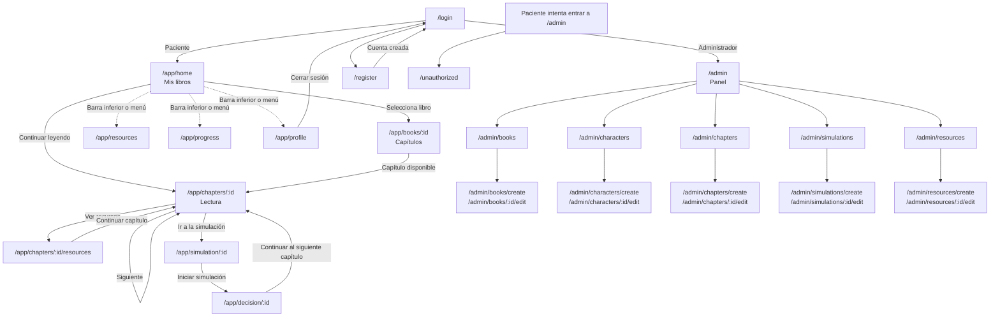

### 4. Navegación adaptada por dispositivo
El layout detecta el tamaño de pantalla para ajustar la interfaz sin duplicar lógica:
- **Dispositivos Móviles:** Se utiliza `IonTabs` anclado en la parte inferior (`IonTabBar`). El administrador abre el menú lateral con el botón de menú (`IonMenuButton`).
- **Versión Web (Escritorio):** A partir de pantallas grandes (`lg`), `IonSplitPane` deja fijo el `IonMenu` lateral y la barra inferior se oculta.

---
## Diferenciación de acceso según roles

La aplicación controla el acceso a las diferentes funcionalidades de acuerdo con el rol del usuario autenticado. Se consideran dos roles principales: **Usuario/Paciente** y **Administrador**.

- Un usuario no autenticado que intente acceder a una ruta protegida (`/app/*` o `/admin/*`) es redirigido a `/login`.
- Un usuario autenticado que visite `/login` o `/register` es redirigido a `/app/home` o `/admin` según su rol.
- Un paciente que intente acceder a rutas administrativas es redirigido a `/unauthorized`.
- Una ruta inexistente redirige a `/login` (o muestra "Página no encontrada" dentro de `/app`).

### Resumen de acceso por rol

| Funcionalidad | Usuario / Paciente | Administrador |
| :--- | :--- | :--- |
| **RF-01: Crear libro** | Sin acceso | Acceso total |
| **RF-02: Editar libro** | Sin acceso | Acceso total |
| **RF-03: Eliminar libro** | Sin acceso | Acceso total |
| **RF-04: Leer capítulo** | Acceso total (lectura) | Acceso total (revisión) |
| **RF-05: Iniciar simulación** | Acceso total | Acceso de prueba |
| **RF-06: Tomar decisión** | Acceso total | Acceso de prueba |
| **RF-07: Reproducir recurso multimedia** | Acceso total | Acceso total |
| **RF-08: Consultar progreso propio** | Solo métricas propias | Solo métricas propias |
| **RF-09: Consultar resumen de la plataforma** | Sin acceso | Acceso total |
| **RF-10: Crear personaje** | Sin acceso | Acceso total |
| **RF-11: Editar personaje** | Sin acceso | Acceso total |
| **RF-12: Eliminar personaje** | Sin acceso | Acceso total |
| **RF-13: Crear capítulo** | Sin acceso | Acceso total |
| **RF-14: Editar capítulo** | Sin acceso | Acceso total |
| **RF-15: Eliminar capítulo** | Sin acceso | Acceso total |
| **RF-16: Crear simulación** | Sin acceso | Acceso total |
| **RF-17: Editar simulación** | Sin acceso | Acceso total |
| **RF-18: Eliminar simulación** | Sin acceso | Acceso total |
| **RF-19: Crear recurso multimedia** | Sin acceso | Acceso total |
| **RF-20: Editar recurso multimedia** | Sin acceso | Acceso total |
| **RF-21: Eliminar recurso multimedia** | Sin acceso | Acceso total |
| **RF-22: Programar recordatorio de lectura** | Acceso total | No aplica |
| **RF-23: Leer sin conexión** | Acceso total | No aplica |

---

### Acceso del Usuario / Paciente

El usuario/paciente tendrá acceso a las funcionalidades relacionadas con la lectura y la experiencia narrativa dentro de la plataforma.

Podrá:

- navegar el catálogo de libros y ver el detalle de cada uno
- leer capítulos y avanzar en la narrativa
- participar en simulaciones y tomar decisiones
- reproducir recursos multimedia de apoyo
- consultar su propio progreso
- activar un recordatorio diario de lectura
- seguir leyendo sin conexión los capítulos que ya abrió
- revisar su perfil y cerrar sesión

---

### Acceso del Administrador

El administrador tendrá acceso a las funcionalidades de gestión de contenido de la plataforma.

Podrá:

- gestionar libros (crear, editar, eliminar)
- gestionar personajes y asociarlos a capítulos
- gestionar los capítulos de cada libro
- gestionar simulaciones con sus opciones de decisión
- gestionar recursos multimedia (videos y audios), con verificación de los videos de YouTube
- revisar la navegación de capítulos y probar simulaciones
- reproducir recursos multimedia
- consultar un resumen global de la plataforma (libros, capítulos, personajes y pacientes registrados)

---

### Control de acceso a rutas

La diferenciación por roles se aplica tanto en la interfaz como en las rutas, mediante tres componentes ubicados en `src/routes/`:

| Guardia | Rutas que protege | Comportamiento |
| :--- | :--- | :--- |
| `PublicOnlyRoute` | `/login`, `/register` | Si ya hay sesión, redirige a `/app/home` o `/admin`. |
| `PrivateRoute` | `/app/*` | Sin sesión, redirige a `/login`. |
| `RoleRoute` | `/admin/*` | Sin sesión, redirige a `/login`. Con otro rol, a `/unauthorized`. |

Desde la EP2 el control también se hace en la API: una petición sin token o con un token inválido responde **401**, y una petición con un rol sin permiso responde **403**, aunque alguien intente saltarse la interfaz (ver [Autenticación y roles](#autenticación-y-roles)).

---
## Flujos de Tareas

---

### Task Flow 1: Lectura y toma de decisión

**Rol:** Usuario / Paciente

**Objetivo:** leer la narrativa de un capítulo, participar en la simulación y tomar una decisión que haga avanzar la historia.

```text
Inicio de sesión (/login)
      ↓
Selecciona libro (/app/home)
      ↓
Selecciona capítulo disponible (/app/books/:id)
      ↓
Lee la historia (/app/chapters/:id)
      ↓
Inicia simulación (/app/simulation/:id)
      ↓
Selecciona una opción y confirma (/app/decision/:id)
      ↓
Ve la consecuencia, se guarda el progreso y continúa al siguiente capítulo
```
---

### Task Flow 2: Revisión de progreso

**Rol:** Usuario / Paciente

**Objetivo:** revisar el avance realizado con las lecturas.

```text
Inicio de sesión (/login)
      ↓
Navega con la barra inferior (móvil) o el menú lateral (web)
      ↓
Visualiza estadísticas y avance por libro (/app/progress)
      ↓
Presiona "Continuar leyendo" o vuelve al inicio
```
---

### Task Flow 3: Creación de contenido narrativo

**Rol:** Administrador

**Objetivo:** registrar un nuevo libro con sus capítulos, personajes, simulaciones y recursos de apoyo.

```text
Inicio de sesión (/login)
      ↓
Accede al panel de administración (/admin)
      ↓
Crea el libro base (/admin/books/create)
      ↓
Agrega los capítulos del libro (/admin/chapters/create)
      ↓
Crea un personaje y lo asocia a un capítulo (/admin/characters/create)
      ↓
Crea la simulación del capítulo con sus opciones (/admin/simulations/create)
      ↓
Agrega videos o audios de apoyo (/admin/resources/create)
      ↓
Guarda y revisa el resultado en la vista del paciente (/app/home)

```
---
## Puntos críticos de interacción

Para este caso de estudio se identifican los siguientes puntos críticos:

1. **El momento de la decisión en la simulación:**
   * Fricción: Riesgo de toques accidentales.
   * Solución: Opciones como tarjetas amplias (`IonCard`). Tocar una tarjeta solo la selecciona y la resalta. La decisión se registra al presionar el botón "Confirmar decisión" en la parte inferior que está deshabilitado hasta elegir una opción.
2. **Capítulos bloqueados:**
   * Fricción: El paciente podría intentar abrir un capítulo sin haber completado el anterior.
   * Solución: Los capítulos muestran su estado (completado, disponible o bloqueado) con ícono y texto. Al tocar uno bloqueado aparece un `IonToast` explicativo.
3. **Errores de inicio de sesión:**
   * Fricción: Un mensaje que diga "correo no registrado" revela quién usa la aplicación.
   * Solución: Mensaje genérico ("Correo o contraseña incorrectos.") y validaciones de formato antes de enviar.
4. **Conexión inestable o sesión vencida:**
   * Fricción: En recintos hospitalarios la conexión puede fallar ([Supuestos](#supuestos-utilizados)) y el token de sesión dura 2 horas.
   * Solución: Si la API no responde, la aplicación muestra el mensaje "No pudimos conectar con el servidor. Revisa tu conexión e inténtalo de nuevo". Si el token venció, el interceptor de Axios cierra la sesión y lleva al login en vez de dejar la pantalla a medias.
---
### Justificación Técnica

### Usabilidad
Minimizar la carga cognitiva del paciente, manteniendo estructuras predecibles (Layouts constantes), controles al alcance del dedo (`IonTabs`).

### Eficiencia de interacción
El uso de React Router con `IonRouterOutlet` permite mantener el estado de navegación de Ionic sin recargar el DOM. El botón "Continuar leyendo" lleva al último capítulo en un solo clic.

### Claridad estructural
Las vistas se organizan mediante componentes contenedores (Layouts) según el rol del usuario autenticado: `UserLayout` para pacientes y `AdminLayout` para administradores. El código se separa en carpetas `pages`, `components`, `routes`, `services`, `layouts`, `context` y `hooks`.

### Escalabilidad
Encapsular la lógica en Layouts independientes permite hacer crecer el panel de administración sin sobrecargar el área del paciente. Los servicios (`src/services/`) devuelven promesas desde la EP1; en la EP2 se reemplazó su interior por llamadas a la API con Axios y la traducción de los datos quedó en un solo archivo (`mappers.ts`), por lo que las pantallas solo necesitaron ajustes menores. En el backend, cada módulo sigue el mismo patrón (rutas → controlador → servicio), así agregar uno nuevo no afecta a los demás.

### Seguridad
Las validaciones de ruta (`PrivateRoute`, `RoleRoute`, `PublicOnlyRoute`) actúan como primera barrera (frontend). La segunda barrera es la API: cada petición verifica el token y el rol (`verificarToken`, `permitirRoles`), así que saltarse la interfaz no da acceso a nada. Al cerrar sesión la aplicación se recarga para que ninguna vista privada quede montada.

### Decisiones de implementación
- **Prefijo `/app` en las rutas del paciente:** inicialmente el layout con pestañas se puso en la raíz (`/*`), pero en Ionic 9 [[9]](#referencias) esa ruta captura todas las URL y dejaba la página invisible al pasar de `/login` al inicio. Con `/app/*` cada rol tiene su propio prefijo, igual que `/admin/*`.
- **Hook `usePageEnter`:** Este hook recarga los datos cada vez que una página vuelve a estar activa para que el progreso siempre esté actualizado.
- **Nombres en español en la API y en inglés en el frontend:** la API usa los nombres de la base de datos (`titulo`, `sinopsis`) y `frontend/src/services/mappers.ts` los traduce a los tipos de las pantallas (`title`, `synopsis`). Así las pantallas de la EP1 se mantuvieron.
- **Sesión en el navegador:** el token JWT se guarda en `localStorage` para mantener la sesión al recargar la página. Dura 2 horas y, si vence, el interceptor cierra la sesión.

---
## Bocetos UI/UX
[Figma - Prototipo de UI/UX](https://www.figma.com/design/V9QFnXbBVuZYb6xRnxik6c/EP1_Prototipo_Libros_Interactivos?node-id=0-1&t=4Z5sW8yxSsm7sCnD-1)

[Figma - Prototipo navegable](https://www.figma.com/proto/V9QFnXbBVuZYb6xRnxik6c/EP1_Prototipo_Libros_Interactivos?node-id=0-1&p=f&t=4Z5sW8yxSsm7sCnD-0&scaling=contain&content-scaling=fixed&starting-point-node-id=1%3A2&show-proto-sidebar=1)

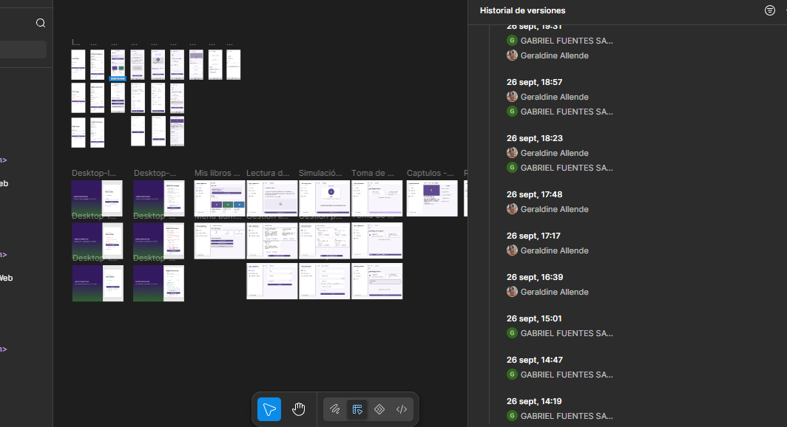

### Criterios de diseño
- **Paleta de colores:** Tonos tranquilizadores con contraste WCAG AA verificado:

  | Uso | Color | Contraste con blanco |
  | :--- | :--- | :--- |
  | Primario (botones, enlaces) | Violeta `#5B4A8B` | 7.5:1 |
  | Secundario | Verde apagado `#3F6E55` | 5.9:1 |
  | Error | Rojo `#B3261E` | 6.5:1 |
  | Fondo | Lavanda claro `#FAF8FD` | — |
  | Texto | `#1F1B2D` | — |
  | Texto secundario | Gris violáceo `#5F5A6B` | 6.6:1 |

- **Tipografía:** Sans-serif limpia (Inter o Roboto). Tamaño base de 16px y lectura de capítulos a 18px.
- **Coherencia e Iconografía:** Uso exclusivo de Ionicons [[10]](#referencias). Sistema de espaciado basado en múltiplos de 8px. Botones de alrededor de 48px de alto y esquinas redondeadas.
- **Navegación:** Barra inferior (`IonTabBar`) en móvil y menú lateral fijo (`IonMenu`) en web.

### Justificación de los campos del formulario de registro
El registro solicita solo la información necesaria para crear y proteger la cuenta del paciente:

| Campo | Obligatorio | Formato y validación | Justificación |
| :--- | :--- | :--- | :--- |
| Nombre de usuario (alias) | Sí | 3 a 20 caracteres: letras, números, `_` o `.` | Identifica al paciente dentro de la app sin usar su nombre real (confidencialidad). |
| Correo electrónico | Sí | Formato `nombre@dominio.cl` | Credencial de acceso y futura recuperación de contraseña. No se muestra a otros usuarios. |
| Contraseña | Sí | Mínimo 8 caracteres, una mayúscula y un número (indicador en tiempo real) | Protege el acceso a información sensible sobre el proceso emocional del paciente. |
| Confirmar contraseña | Sí | Debe coincidir con la contraseña | Evita errores de tipeo al crear la cuenta. |
| Aceptación de términos y privacidad | Sí | Casilla marcada | Consentimiento para el tratamiento de los datos de uso. |

Las mismas reglas de alias, correo y contraseña se validan en el backend (`backend/src/validators/auth.validators.js`), así no se pueden saltar enviando la petición directamente a la API.


**Representación en los formularios de inicio de sesión y registro:**
- Campos obligatorios marcados con `*` y la nota "* Campo obligatorio".
- Formato esperado indicado con textos de ayuda bajo el campo.
- Validación al salir de cada campo y al enviar, con mensajes de error en rojo bajo el campo correspondiente.
- Retroalimentación al enviar: indicador de carga en el botón y `IonToast` de éxito al crear la cuenta.
- Reglas de seguridad de la contraseña visibles, con check verde al cumplirse.
- Error de inicio de sesión ("Correo o contraseña incorrectos.") para no revelar qué correos están registrados.

### Mejoras de UI/UX y rendimiento (EF2)

La aplicación se midió con Lighthouse [[30]](#referencias) en Edge, en una ventana InPrivate, sobre la versión compilada que sirve Docker (`http://localhost:8080`). Las mediciones de "antes" corresponden al commit `09b59f9`, previo a estas mejoras. Además, todas las pantallas se revisaron a mano en anchos de 360, 390, 768, 1280 y 1920 px (RNF-COM-01).

**Mejoras respecto de las entregas anteriores**

| Mejora | Dónde | Para qué |
| :--- | :--- | :--- |
| Carga diferida por sección: el login ya no descarga las pantallas del paciente ni las del administrador | `routes/lazySections.tsx` | Menos JavaScript en la primera carga |
| Los componentes de Ionic que la aplicación no usa quedan fuera del build | `vite.config.ts` | Menos JavaScript en la primera carga |
| Zoom permitido (antes estaba bloqueado) e idioma `es` en la página | `index.html` | Ampliar la pantalla con baja visión [[31]](#referencias); lectores de pantalla en español |
| Contraste AA en textos secundarios, botones de segmento y opciones de una decisión tomada | `theme/` | Cumplir el RNF-ACC-01 (mínimo 4.5:1) |
| Barras de avance con nombre accesible y títulos en orden | Inicio, detalle del libro y recursos | Lectores de pantalla |
| Descripción de la aplicación y `robots.txt` válido | `index.html`, `public/` | SEO |
| Pantallas de administración de capítulos, simulaciones y recursos con el mismo diseño de tarjetas que libros y personajes | `/admin/*` | Consistencia visual |
| Botón *Completar con YouTube* con vista previa del video | Formulario de recursos | Menos escritura y menos errores |
| Aviso sin conexión, aviso de capítulo desbloqueado y recordatorio de lectura | Paciente | Retroalimentación clara |

**Lighthouse (antes → después)**

| Página | Dispositivo | Rendimiento | Accesibilidad | Buenas prácticas | SEO |
| :--- | :--- | :---: | :---: | :---: | :---: |
| `/login` | Móvil | 82 → 85 | 94 → **100** | 100 → 100 | 82 → **100** |
| `/login` | Escritorio | 99 → 100 | 94 → **100** | 100 → 100 | 82 → **100** |
| `/app/home` | Móvil | 84 → 90 | 87 → **100** | 100 → 100 | 82 → **100** |
| `/app/decision/1` | Móvil | 86 → 89 | 90 → **100** | 100 → 100 | 82 → **100** |
| `/admin/resources/create` | Escritorio | 100 → 100 | 90 → **100** | 100 → 100 | 82 → **100** |

El rendimiento de `/login` se midió cargando todo desde cero. Las otras tres páginas se midieron con la sesión iniciada (sin borrar el almacenamiento del navegador), así que su rendimiento es referencial; en ellas lo que se compara es la accesibilidad, las buenas prácticas y el SEO.

**Tiempos de carga de `/login` en móvil** (Lighthouse simula una red 4G lenta y un procesador 4 veces más lento)

| Métrica | Antes | Después |
| :--- | :---: | :---: |
| First Contentful Paint | 3.4 s | 3.2 s |
| Largest Contentful Paint | 3.5 s | 3.4 s |
| Total Blocking Time | 140 ms | **70 ms** |
| Cumulative Layout Shift | 0 | 0 |
| Speed Index | 3.4 s | 3.2 s |

**Cómo se mejoró el rendimiento**
- **Carga diferida por sección** (`frontend/src/routes/lazySections.tsx`): las pantallas del paciente y las del administrador van en archivos aparte, que se descargan al iniciar sesión según el rol. Se dividió por sección y no por pantalla para que la lectura sin conexión (EF1) siga funcionando al cambiar de pantalla. La sección se descarga antes de navegar, así la transición de Ionic no queda en blanco; si la descarga falla, se muestra un mensaje con el botón *Reintentar*.
- **Componentes de Ionic sin usar** (`frontend/vite.config.ts`): `@ionic/react` incluía en el build todos sus componentes. Ahora quedan fuera los que la aplicación no usa, como el calendario, el deslizador, el refresco y el botón flotante.
- **Resultado:** el JavaScript que descarga el login pasó de 342 KB a 269 KB comprimido (−21 %) y el tiempo de bloqueo (*Total Blocking Time*) bajó a la mitad.

**Revisión responsive**

| Pantallas | Anchos | Resultado |
| :--- | :--- | :--- |
| Paciente: login, registro, inicio, libro, capítulo, simulación, decisión, recursos, progreso y perfil | 360, 390, 768, 1280 y 1920 px | Sin desbordes ni textos cortados; botones de 48 px de alto; barra inferior en móvil y menú lateral desde 992 px |
| Administrador: panel, y listas y formularios de libros, personajes, capítulos, simulaciones y recursos | 360, 390, 768, 1280 y 1920 px | Sin desbordes ni textos cortados; formularios en una columna centrada |

| Móvil (390 px) | Web (1280 px) |
| :---: | :---: |
| 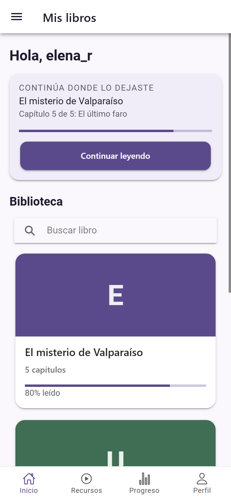 | 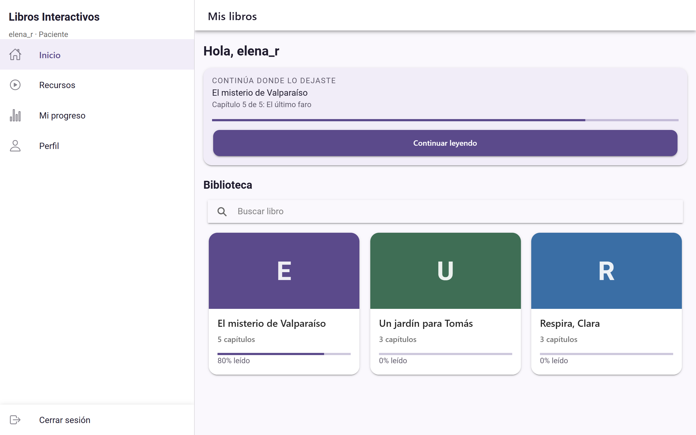 |

**Login en móvil, antes y después**

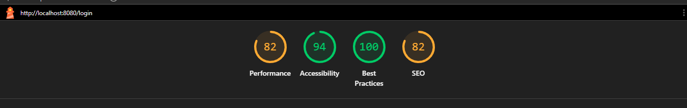

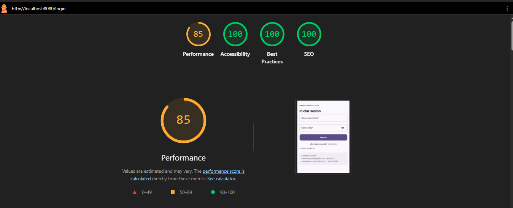

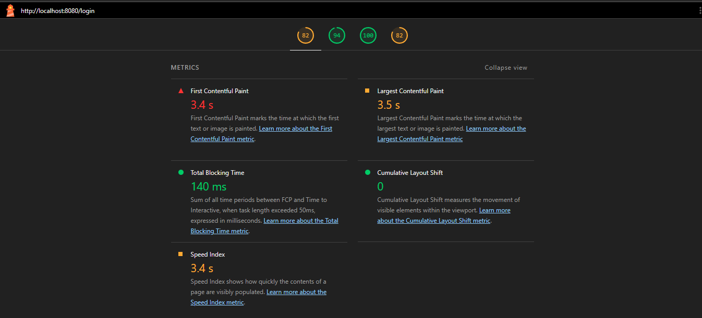

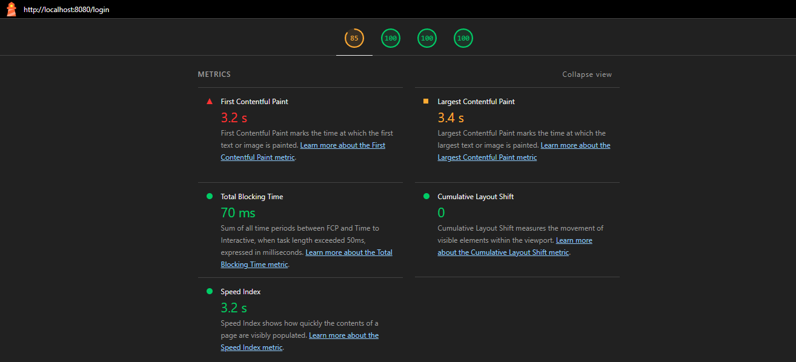

<details>
<summary>Resto de las capturas de Lighthouse</summary>

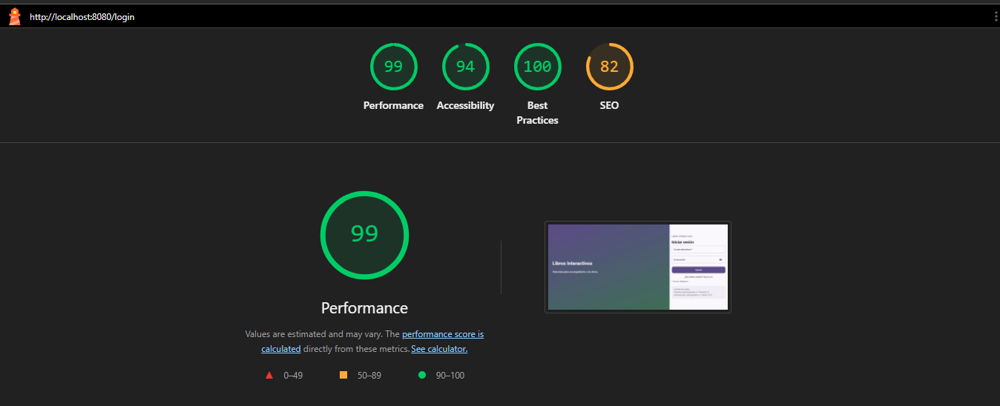

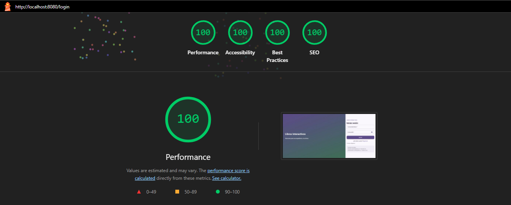

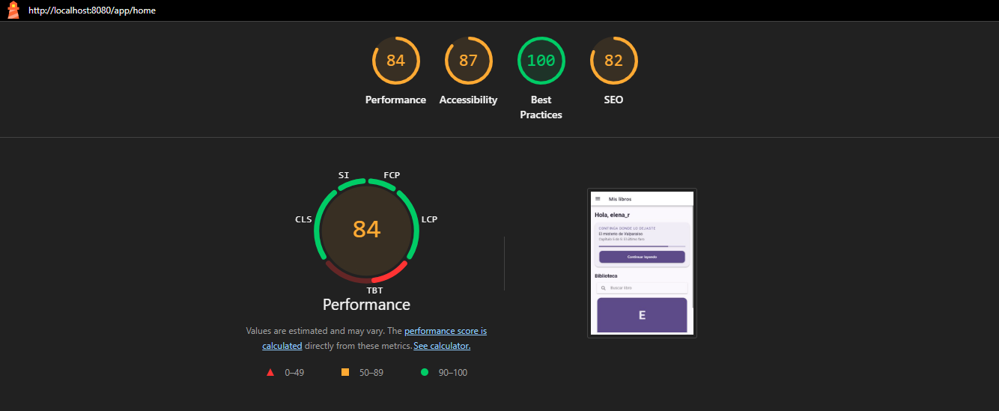

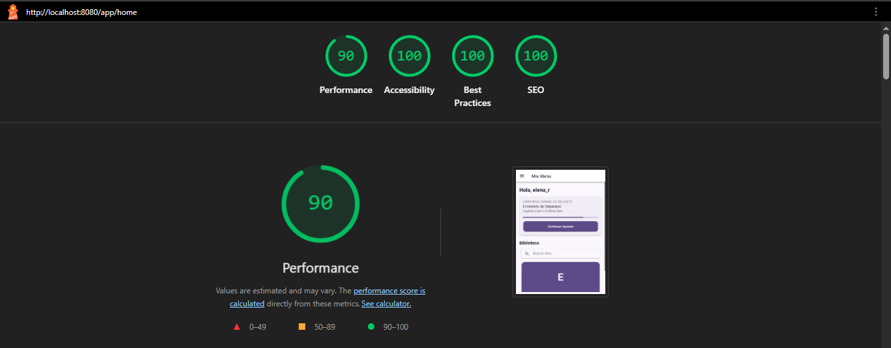

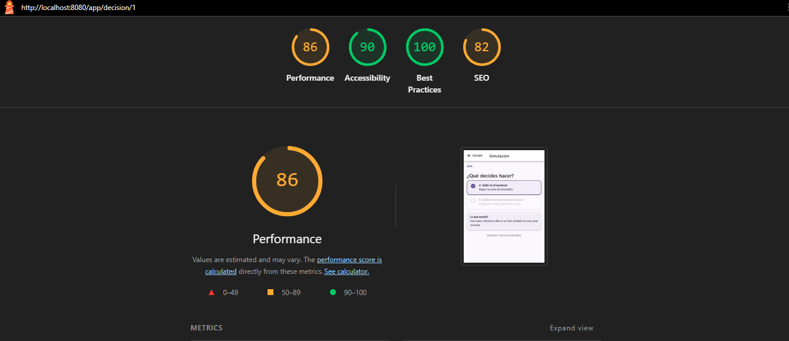

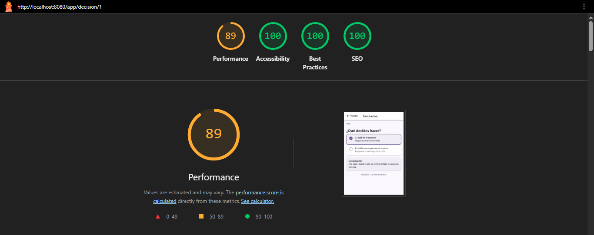

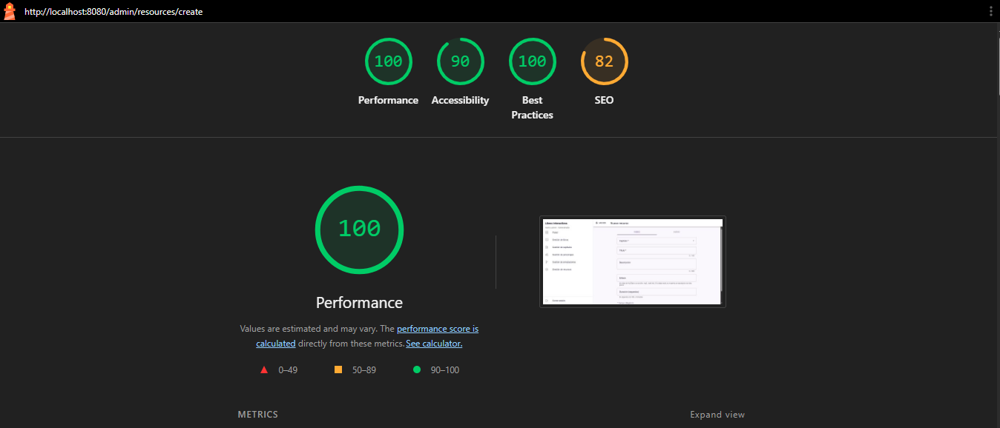

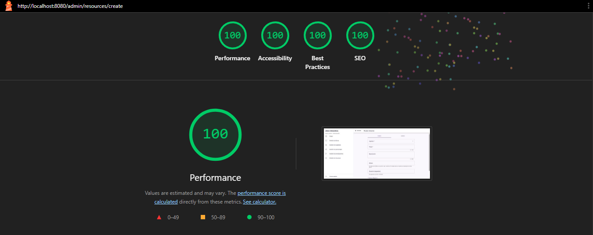

</details>

---
## Backend y API REST (EP2)

El backend está en la carpeta `backend/`. Es una API REST hecha con **Node.js 22 + Express 5** [[11]](#referencias) que guarda los datos en **PostgreSQL**. El frontend se comunica con ella mediante **Axios**.

### Arquitectura del backend

```mermaid
flowchart LR
    F["Frontend Ionic + React<br/>Axios + interceptores"] -->|"HTTP + JSON<br/>Authorization: Bearer token"| A["Express<br/>helmet, cors, express.json"]
    A --> R["routes/<br/>método y URL"]
    R --> M["middlewares/<br/>limiteLogin, verificarToken, permitirRoles, validar"]
    M --> C["controllers/<br/>petición y respuesta HTTP"]
    C --> S["services/<br/>consultas SQL con parámetros"]
    S --> P["config/db.js<br/>pool de conexiones"]
    P --> DB[("PostgreSQL<br/>libros_interactivos")]
```

| Capa | Carpeta | Responsabilidad |
| :--- | :--- | :--- |
| Rutas | `src/routes/` | Asocian cada método y URL con sus middlewares y su controlador. |
| Middlewares | `src/middlewares/` | Limitan los intentos de inicio de sesión (429), verifican el token (401), el rol vigente (403) y la validación de los datos (400). Manejan los errores en un solo lugar. |
| Validadores | `src/validators/` | Reglas de express-validator para el cuerpo, los ids y los filtros de cada módulo. |
| Controladores | `src/controllers/` | Reciben la petición, llaman al servicio y arman la respuesta con su código HTTP. |
| Servicios | `src/services/` | Hablan con la base de datos. No saben nada de HTTP. |
| Utilidades | `src/utils/` | Errores con código HTTP, traducción de errores de PostgreSQL y transacciones. |
| Configuración | `src/config/db.js` | Pool de conexiones a PostgreSQL con los datos del `.env`. |

Todas las respuestas usan el mismo formato: `{ "data": ... }` si todo salió bien y `{ "error": "mensaje" }` si no.

### Base de datos

La base de datos es PostgreSQL y tiene 9 tablas relacionadas. El script [`backend/database/database.sql`](backend/database/database.sql) crea las tablas y carga los datos de prueba: 2 usuarios, 3 libros, 11 capítulos, 4 personajes, 5 simulaciones con 10 opciones y 4 recursos.

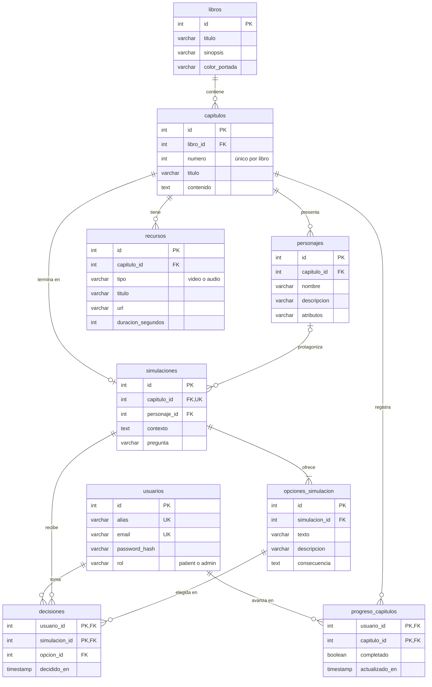

**Reglas de integridad** [[12]](#referencias):
- **Claves foráneas:** al borrar un libro se borran sus capítulos y, con ellos, sus personajes, su simulación, sus recursos y el progreso (`ON DELETE CASCADE`). Si se borra un personaje, la simulación queda sin personaje (`ON DELETE SET NULL`).
- **UNIQUE:** el alias y el correo de cada usuario, el número de capítulo dentro de cada libro y una sola simulación por capítulo.
- **CHECK:** largo mínimo del alias, del título y de la sinopsis; rol `patient` o `admin`; tipo de recurso `video` o `audio`; número de capítulo y duración positivos.
- **Clave foránea compuesta** en `decisiones (opcion_id, simulacion_id)`: garantiza que la opción elegida pertenece a esa simulación.
- **Claves primarias compuestas** en `progreso_capitulos` y `decisiones`: un registro por paciente y capítulo, y una decisión por paciente y simulación.
- **Índices** en las claves foráneas que se usan para filtrar, contar y borrar en cascada. Ver [Optimización de consultas (EF4)](#optimización-de-consultas-ef4).
- Las contraseñas de los usuarios de prueba están guardadas como hash de bcrypt, nunca en texto plano.

### Optimización de consultas (EF4)

Las consultas de la API están en `backend/src/services/`. Se escribieron para que PostgreSQL haga el trabajo y la respuesta lleve solo lo necesario:

| Práctica | Dónde se ve |
| :--- | :--- |
| **Filtros en SQL**, no en JavaScript: las listas aceptan `?libro_id=` o `?capitulo_id=` y se filtran con `WHERE` | `GET /capitulos`, `/personajes`, `/simulaciones` y `/recursos` |
| **Relaciones con `JOIN`** en una sola consulta, sin una consulta extra por cada fila | Un recurso trae su capítulo y su libro; el progreso trae los libros, los capítulos y las decisiones del paciente en una consulta |
| **Totales calculados por PostgreSQL** con `COUNT` | `total_capitulos`, `total_recursos`, `total_opciones` y las estadísticas del panel |
| **Listas livianas:** la lista no trae el contenido largo; el detalle sí | La lista de capítulos no trae `contenido`; la de simulaciones trae `total_opciones` en vez de las opciones |
| **Sin datos sensibles ni innecesarios** | `password_hash` solo se lee para comparar en el login y nunca se envía; la lista de pacientes del panel no incluye correos |
| **Transacciones** en las operaciones de varios pasos | Crear una simulación con sus opciones; reiniciar el progreso de un libro |
| **Respuestas consistentes** | Siempre `{ data }` o `{ error, detalles }`; los errores de PostgreSQL se traducen a mensajes claros |
| **Respuestas comprimidas** | En Docker, nginx comprime con gzip el JSON de la API y los archivos del frontend |

**Índices**

PostgreSQL crea un índice para cada clave primaria y cada `UNIQUE`, pero no para las claves foráneas [[33]](#referencias). Sin índice, buscar las opciones de una simulación o borrar un capítulo obliga a recorrer tablas completas. Por eso `database.sql` agrega 7 índices:

| Índice | Columnas | Para qué |
| :--- | :--- | :--- |
| `idx_opciones_simulacion` | `opciones_simulacion (simulacion_id)` | Opciones de una simulación y `total_opciones` |
| `idx_recursos_capitulo` | `recursos (capitulo_id)` | Recursos de un capítulo y `total_recursos` |
| `idx_personajes_capitulo` | `personajes (capitulo_id)` | Personajes de un capítulo |
| `idx_simulaciones_personaje` | `simulaciones (personaje_id)` | Al borrar un personaje, dejar sus simulaciones sin personaje |
| `idx_progreso_capitulo` | `progreso_capitulos (capitulo_id)` | Al borrar un capítulo, borrar el progreso de los pacientes |
| `idx_decisiones_simulacion` | `decisiones (simulacion_id)` | Al borrar una simulación, borrar sus decisiones |
| `idx_decisiones_opcion` | `decisiones (opcion_id, simulacion_id)` | Al borrar una opción, borrar las decisiones que la eligieron |

Las demás búsquedas ya tenían índice. Por ejemplo, los capítulos de un libro usan el de `UNIQUE (libro_id, numero)` y el progreso de un paciente usa su clave primaria `(usuario_id, capitulo_id)`.

**Medición con `EXPLAIN ANALYZE`** [[32]](#referencias)

Con los datos de prueba (11 capítulos) las tablas son tan pequeñas que PostgreSQL las recorre completas y no se nota la diferencia. Por eso el script [`backend/database/rendimiento-ef4.sql`](backend/database/rendimiento-ef4.sql) carga datos a mayor escala (200 libros, 20.000 capítulos, 80.000 opciones, 60.000 recursos, 2.000 pacientes y 100.000 decisiones), mide las consultas de la API sin los 7 índices y con ellos, y muestra la comparación. Todo ocurre dentro de una transacción que se deshace al final (`ROLLBACK`), así que la base de datos queda igual.

Para ejecutarlo con Docker (PowerShell, desde la raíz del repositorio):

    [Console]::OutputEncoding = [System.Text.Encoding]::UTF8
    docker compose cp backend/database/rendimiento-ef4.sql db:/tmp/rendimiento-ef4.sql
    docker compose exec db psql -U postgres -d libros_interactivos -f /tmp/rendimiento-ef4.sql

| # | Consulta del script | Endpoint de la API |
| :--- | :--- | :--- |
| 1 | Opciones de una simulación | `GET /simulaciones/:id` |
| 2 | Simulaciones de un libro y sus opciones | `GET /simulaciones?libro_id=` |
| 3 | Capítulos de un libro y sus recursos | `GET /capitulos?libro_id=` |
| 4 | Recursos de un capítulo | `GET /recursos?capitulo_id=` |
| 5 | Personajes de un capítulo | `GET /personajes?capitulo_id=` |
| 6 | Borrar una opción ya elegida | `DELETE /simulaciones/:id/opciones/:opcionId` |
| 7 | Borrar un capítulo leído | `DELETE /capitulos/:id` |

Resultado en PostgreSQL 18 (Docker), en milisegundos, mediana de 3 mediciones:

| # | Consulta | Antes | ms | Después | ms | Más rápida |
| :--- | :--- | :--- | ---: | :--- | ---: | ---: |
| 1 | Opciones de una simulación | Seq Scan | 4.140 | Index Scan · `idx_opciones_simulacion` | 0.061 | 68x |
| 2 | Simulaciones de un libro y sus opciones | Seq Scan | 546.495 | Index Only Scan · `idx_opciones_simulacion` | 3.570 | 153x |
| 3 | Capítulos de un libro y sus recursos | Seq Scan | 368.537 | Bitmap Heap Scan · `idx_recursos_capitulo` | 3.546 | 104x |
| 4 | Recursos de un capítulo | Seq Scan | 3.402 | Bitmap Heap Scan · `idx_recursos_capitulo` | 0.165 | 21x |
| 5 | Personajes de un capítulo | Seq Scan | 1.047 | Index Scan · `idx_personajes_capitulo` | 0.146 | 7x |
| 6 | Borrar una opción ya elegida | Borrado en cascada | 5.379 | Borrado en cascada | 0.133 | 40x |
| 7 | Borrar un capítulo leído | Borrado en cascada | 37.795 | Borrado en cascada | 0.761 | 50x |

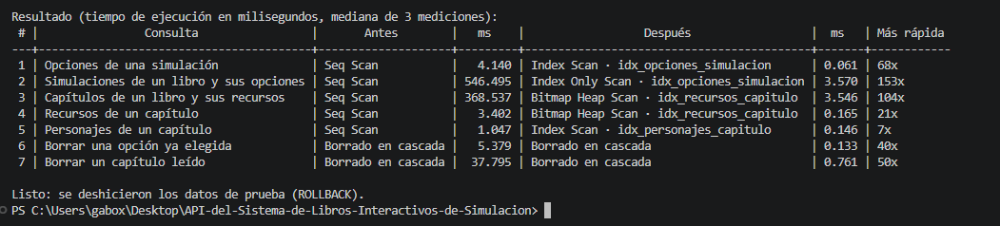

Cómo leer la tabla: `Seq Scan` recorre la tabla completa; `Index Scan`, `Index Only Scan` y `Bitmap Heap Scan` usan el índice que aparece después del punto. Las consultas que más mejoran son las que cuentan opciones o recursos por cada capítulo de un libro (2 y 3): sin índice, PostgreSQL recorre la tabla completa una vez por cada capítulo.


### API REST

La URL base es `http://localhost:3000/api`. La documentación completa de cada endpoint (reglas de los campos, ejemplos de petición y respuesta, y códigos de error) está en **[`backend/docs/endpoints.md`](backend/docs/endpoints.md)**.

| Módulo | Endpoints | Acceso |
| :--- | :--- | :--- |
| Estado | `GET /health` | Público |
| Autenticación | `POST /auth/register` · `POST /auth/login` · `GET /auth/me` | Público (`/me` requiere sesión) |
| Libros | `GET /libros` · `GET /libros/:id` · `POST /libros` · `PUT /libros/:id` · `DELETE /libros/:id` | Ver: con sesión. Crear, editar y eliminar: admin |
| Capítulos | Las mismas 5 rutas en `/capitulos` (filtro `?libro_id=`) | Ver: con sesión. Crear, editar y eliminar: admin |
| Personajes | Las mismas 5 rutas en `/personajes` (filtros `?capitulo_id=` y `?libro_id=`) | Ver: con sesión. Crear, editar y eliminar: admin |
| Simulaciones | Las mismas 5 rutas en `/simulaciones`, más `POST /simulaciones/:id/opciones` · `PUT /simulaciones/:id/opciones/:opcionId` · `DELETE /simulaciones/:id/opciones/:opcionId` | Ver: con sesión. Crear, editar y eliminar: admin |
| Recursos | Las mismas 5 rutas en `/recursos` (filtros `?capitulo_id=` y `?libro_id=`) | Ver: con sesión. Crear, editar y eliminar: admin |
| Progreso | `GET /progreso` · `PUT /progreso/capitulos/:id` · `DELETE /progreso/libros/:id` | Cada usuario, solo el suyo |
| Decisiones | `GET /decisiones` · `PUT /decisiones/:simulacionId` · `DELETE /decisiones/:simulacionId` | Cada usuario, solo las suyas |
| Estadísticas | `GET /estadisticas` · `GET /estadisticas/pacientes` | Admin |

**Códigos HTTP usados:** `200` consulta o edición, `201` creado, `204` eliminado, `400` datos inválidos, `401` sin token o con token inválido, `403` rol sin permiso, `404` no encontrado, `409` dato repetido o acción que no corresponde (por ejemplo, completar un capítulo con el anterior pendiente), `429` demasiados intentos fallidos de inicio de sesión y `500` error inesperado (sin detalles internos).

### Autenticación y roles

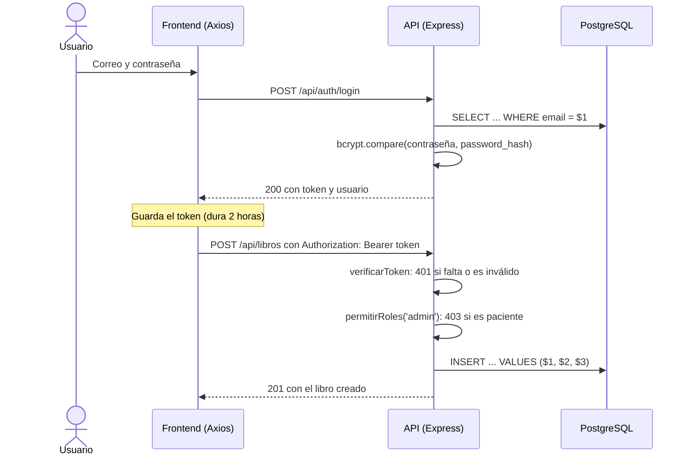

- El **registro público solo crea pacientes**: aunque el cuerpo de la petición diga `"rol": "admin"`, la API lo ignora. Los administradores se crean directamente en la base de datos (`UPDATE usuarios SET rol = 'admin' WHERE email = '...';`).
- El token JWT [[13]](#referencias) lleva solo el `id` y el `rol` del usuario, firmados con `JWT_SECRET`. Nunca lleva la contraseña y vence en 2 horas (`JWT_EXPIRES_IN`).
- `verificarToken` responde **401** si el token falta, fue alterado o venció, o si el usuario ya no existe. Después **lee el rol vigente desde la base de datos**, no el que quedó guardado en el token: si a un administrador le quitan el rol, la siguiente petición a una ruta de administración responde **403** aunque su token siga vigente.
- `permitirRoles('admin')` responde **403** si el rol no corresponde. Estas reglas protegen la API aunque alguien no use la interfaz.

### Seguridad de la API

| Riesgo | Medida aplicada |
| :--- | :--- |
| Robo de contraseñas | bcrypt con costo 10 [[14]](#referencias). La base de datos solo guarda el hash. |
| Suplantación de usuario o de rol | JWT firmado con una clave secreta aleatoria, con vencimiento, aceptando solo el algoritmo `HS256`. El servidor no arranca si `JWT_SECRET` tiene menos de 32 caracteres o es el valor de ejemplo. |
| Acceso sin permiso | `verificarToken` (401) y `permitirRoles` (403) en cada ruta protegida. El rol se lee desde la base de datos en cada petición, así un administrador degradado pierde el acceso de inmediato. |
| Fuerza bruta en el inicio de sesión | Después de 5 intentos fallidos en 15 minutos para el mismo correo desde la misma IP, la API responde `429` sin revisar la contraseña [[22]](#referencias)[[23]](#referencias). Los inicios correctos no suman, y se cuenta por IP y correo para que un ataque contra una cuenta no bloquee a otros pacientes que comparten la red del hospital. |
| Inyección SQL | Todas las consultas usan parámetros (`$1`, `$2`...) [[15]](#referencias)[[19]](#referencias), y los ids y filtros se validan como números antes de llegar a la base de datos. |
| Datos inválidos | express-validator en cada cuerpo, id y filtro [[16]](#referencias). Las reglas coinciden con las restricciones de las tablas, y la base de datos también valida el formato del correo, que esté en minúsculas y el color `#RRGGBB` con restricciones `CHECK` [[12]](#referencias), por si un dato llega sin pasar por la API. |
| Reglas de negocio solo en la interfaz | El desbloqueo progresivo de capítulos también se valida en la API: completar un capítulo cuando el anterior del mismo libro está pendiente responde `409`. |
| Ver o modificar datos de otro paciente | El progreso y las decisiones usan el id que viene en el token, nunca uno enviado por el cliente. |
| Campos no permitidos | Los servicios solo guardan los campos esperados (por ejemplo, el registro ignora `rol`). |
| Filtración de información | Los errores 500 no muestran detalles internos, el login usa un mensaje genérico y las estadísticas de pacientes muestran solo el alias. |
| Cabeceras y orígenes | helmet agrega cabeceras HTTP de seguridad a las respuestas de la API [[20]](#referencias). CORS solo acepta los orígenes de `CORS_ORIGIN` (uno o varios, separados por coma), con los métodos y encabezados que usa el frontend; si la variable falta, no acepta ninguno y nunca responde "cualquier origen" (`*`). |
| XSS (código escondido en un texto) | Los textos se guardan tal cual y React los muestra siempre como texto, nunca como HTML: el frontend no usa `dangerouslySetInnerHTML` [[35]](#referencias). Los enlaces de los recursos solo pueden ser videos de YouTube o archivos de audio o video de `/media/` o con `https://`; un enlace `javascript:` o `data:` responde `400`. |
| Scripts de otros sitios y clickjacking | En Docker, nginx envía una política de seguridad de contenido (CSP) [[34]](#referencias): el navegador solo ejecuta los archivos `.js` de la aplicación, solo muestra videos de `youtube-nocookie.com` y no deja que otro sitio muestre la aplicación dentro de un iframe. También envía `X-Content-Type-Options`, `X-Frame-Options`, `Referrer-Policy` y `Permissions-Policy` (`frontend/security-headers.conf`). Para que la CSP no necesite excepciones se quitó `@vitejs/plugin-legacy`, que agregaba scripts dentro del HTML para navegadores antiguos en los que Ionic ya no funciona. |
| Robo del token en el navegador | El token vence en 2 horas y se borra al cerrar sesión o cuando la API responde `401`. La CSP impide que un script inyectado se ejecute y pueda leerlo. |
| Peticiones enormes | El cuerpo JSON acepta hasta 100 KB, más que el capítulo más largo permitido; uno más grande responde `413`. |
| Creación masiva de cuentas | Máximo 20 cuentas nuevas por hora desde la misma IP (`429`). Los registros rechazados no suman, así un grupo de pacientes del mismo hospital puede registrarse. |
| Contenido sin cifrar | Los audios y videos de otros sitios deben usar `https://`. |
| Operaciones a medias | Se usan transacciones al crear una simulación con sus opciones y al reiniciar el progreso de un libro. |
| Uso indebido de la clave de YouTube | Solo el administrador puede consultar `/api/youtube`. La clave está en `.env`, restringida a la YouTube Data API v3 en Google Cloud, y viaja en un encabezado, no en la URL. |
| Secretos en el repositorio | `.env` está en `.gitignore`. Solo se sube `.env.example`, con valores de ejemplo. |

**Pruebas de seguridad (EF3):** la carpeta **13. Seguridad (EF3)** de la colección de Insomnia prueba una inyección SQL en el login y en un filtro, un texto con `<script>` y `DROP TABLE` que se guarda como texto sin dañar la tabla, enlaces `javascript:` y `http://` rechazados, un token sin firma (`alg: none`) rechazado, que el perfil no devuelva `password_hash` y que un sitio no permitido no reciba permiso de CORS. Además, con la CSP activa, un `<script>` o un atributo `onerror` agregados a la página no se ejecutan, y un script de otro sitio no se descarga.

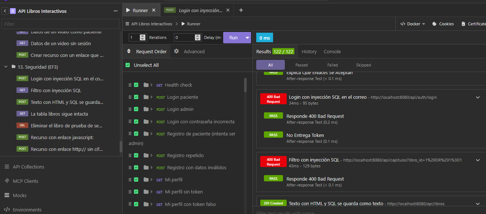

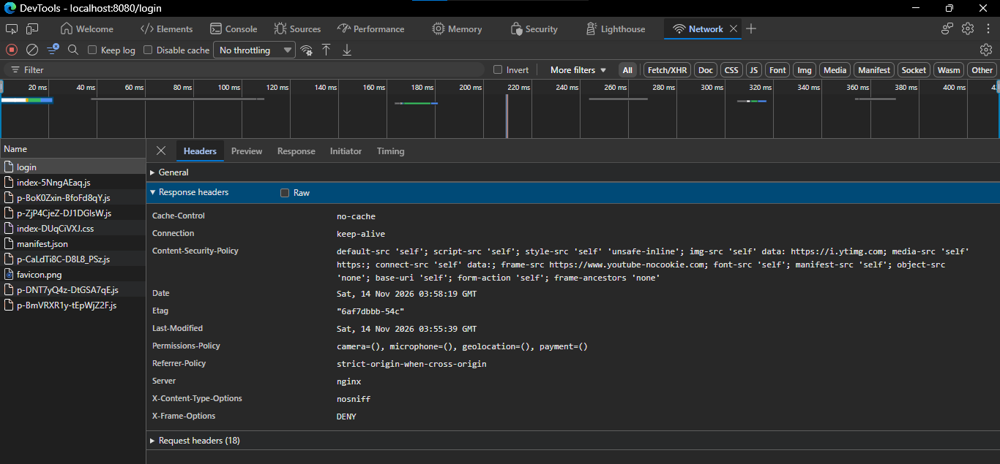

### Integración con el frontend

- **`frontend/src/services/api.ts`:** cliente Axios con la URL base (`VITE_API_URL`, por defecto `http://localhost:3000/api`) y dos interceptores [[17]](#referencias):
  - **De petición:** agrega `Authorization: Bearer <token>` a cada llamada.
  - **De respuesta:** convierte los errores de la API en mensajes para el usuario (por ejemplo, el primer error de validación). Si recibe un **401** en una petición con sesión, cierra la sesión y vuelve a `/login`.
- **`session.ts`** guarda el token y el usuario en el navegador. **`mappers.ts`** traduce los datos de la API a los tipos que usan las pantallas.
- Los servicios mantienen las mismas funciones que en la EP1, ahora conectadas a la API. Los datos simulados (`data/mockData.ts`) se eliminaron.

| Pantalla | Endpoints que usa |
| :--- | :--- |
| Inicio de sesión / Registro | `POST /auth/login` · `POST /auth/register` |
| Mis libros (`/app/home`) | `GET /libros` · `GET /capitulos` · `GET /progreso` |
| Detalle de libro | `GET /libros/:id` · `GET /capitulos?libro_id=` · `GET /progreso` |
| Lectura de capítulo | `GET /capitulos/:id` · `GET /capitulos?libro_id=` · `GET /progreso` · `PUT /progreso/capitulos/:id` |
| Simulación | `GET /simulaciones/:id` · `GET /capitulos/:id` · `GET /personajes/:id` |
| Toma de decisión | `GET /simulaciones/:id` · `GET /simulaciones?libro_id=` · `GET /capitulos?libro_id=` · `PUT /decisiones/:simulacionId` · `PUT /progreso/capitulos/:id` |
| Recursos | `GET /recursos` (o `?capitulo_id=`) |
| Mi progreso | `GET /libros` · `GET /capitulos` · `GET /progreso` |
| Panel de administración | `GET /estadisticas` |
| Gestión de libros | `GET`, `POST`, `PUT` y `DELETE` en `/libros` |
| Gestión de personajes | `GET`, `POST`, `PUT` y `DELETE` en `/personajes` · `GET /capitulos` |
| Gestión de capítulos | GET /libros · GET, POST, PUT y DELETE en /capitulos |
| Gestión de simulaciones | GET /libros · GET /capitulos · GET /personajes · GET, POST, PUT y DELETE en /simulaciones y en /simulaciones/:id/opciones |
| Gestión de recursos | GET /libros · GET /capitulos · GET, POST, PUT y DELETE en /recursos |

**Evidencia de integración:** peticiones del frontend a la API con el token JWT (DevTools → Network) y una decisión tomada en la aplicación guardada en PostgreSQL.

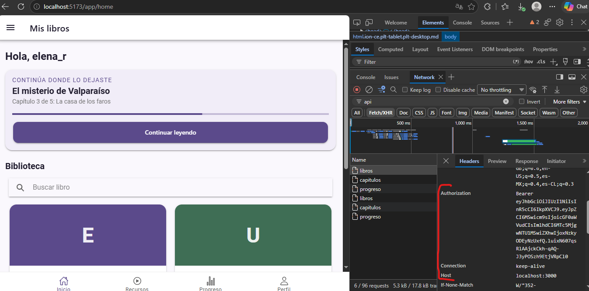

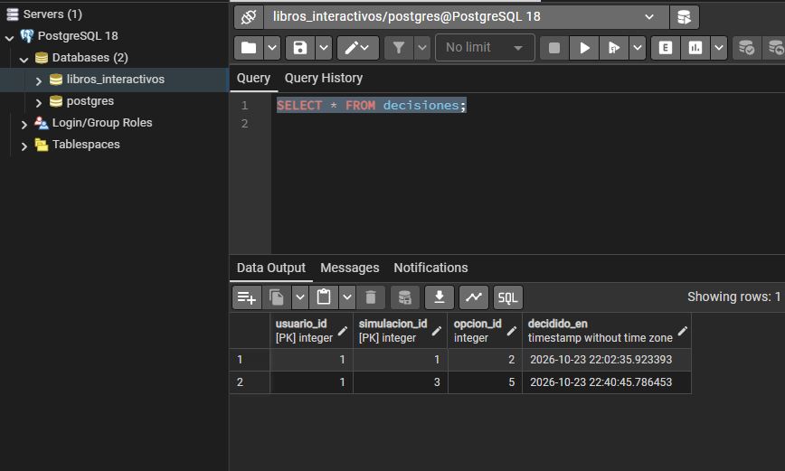

### Servicio externo: YouTube Data API (EF5)

Casi todos los recursos multimedia de la aplicación son videos de YouTube. Para que el administrador no deje enlaces rotos ni tenga que escribir la duración a mano, la API se integra con la **YouTube Data API v3** de Google [[24]](#referencias).

| Momento | Qué hace la API |
| :--- | :--- |
| Al crear o editar un recurso con un enlace de YouTube | Consulta el video. Si no existe, es privado o su dueño no permite reproducirlo fuera de YouTube, responde `400` y no guarda nada. Si existe, guarda su **duración real**. |
| En el formulario de recursos, botón **Completar con YouTube** | `GET /api/youtube/video?url=...` (solo administrador) devuelve título, canal, miniatura y duración, y el formulario se completa solo. |
| Siempre | Solo acepta enlaces que el reproductor de la app sabe usar: un video de YouTube o un archivo de audio o video (`.mp3`, `.m4a`, `.ogg`, `.wav`, `.mp4`, `.webm`). |

**Cómo se maneja la integración:**
- **Clave en variable de entorno:** `YOUTUBE_API_KEY` va en `backend/.env` (y en el `.env` de la raíz para Docker), nunca en el código. Se envía en el encabezado `X-Goog-Api-Key`, no en la URL, y en Google Cloud está restringida para usar solo la YouTube Data API v3.
- **Errores:** si YouTube no responde en 5 segundos, se agotó la cuota o la clave no es válida, la API responde `503` con un mensaje claro y el detalle técnico queda solo en la terminal del servidor.
- **Cuota:** cada consulta gasta 1 de las 10.000 unidades gratuitas diarias [[25]](#referencias). Los videos consultados se guardan en caché durante 1 hora para no gastar cuota repetida.
- **Sin clave:** la aplicación sigue funcionando, pero los videos no se verifican (la API lo avisa al iniciar) y `GET /api/youtube/video` responde `503`.

| Código | Cuándo |
| :--- | :--- |
| `200` | Se encontró el video (`GET /api/youtube/video`) |
| `400` | El enlace no es de YouTube, el video no existe o es privado, o su dueño no permite insertarlo |
| `401` / `403` | Sin sesión / la sesión no es de un administrador |
| `503` | YouTube no responde, se agotó la cuota, la clave no es válida o falta `YOUTUBE_API_KEY` |

El código está en `backend/src/services/youtube.service.js`, `backend/src/routes/youtube.routes.js` y `frontend/src/pages/admin/AdminResourceFormPage.tsx`. La carpeta **12** de la colección de Insomnia prueba estos casos.

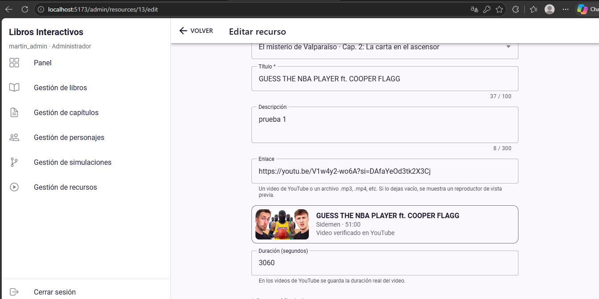

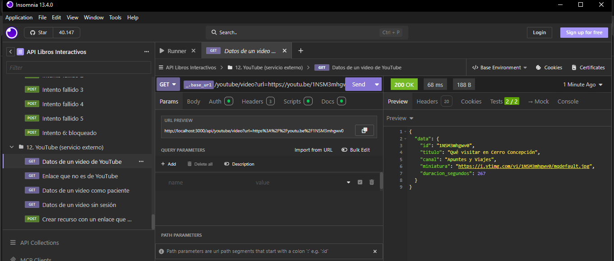

### Notificaciones y almacenamiento local (EF1)

El paciente suele leer en el hospital o durante su tratamiento, donde el wifi se corta y puede pasar días sin abrir la aplicación. Por eso se agregaron avisos y una copia local de la lectura.

**Notificaciones**

| Aviso | Cuándo aparece | Cómo funciona |
| :--- | :--- | :--- |
| Recordatorio de lectura | Todos los días, a la hora que el paciente elige en **Perfil** | Notificación del sistema (*¿Seguimos con la historia?*) con la API de notificaciones del navegador [[26]](#referencias). El permiso se pide solo al activarlo, si el paciente lo niega, la app explica cómo permitirlo. |
| Capítulo desbloqueado | Al terminar un capítulo o confirmar una decisión | Aviso en pantalla, por ejemplo *Desbloqueaste el capítulo 4: Pedro, el guardián*. No aparece al releer un capítulo ya completado. |
| Sin conexión | Cuando se pierde internet o la API no responde | Aviso bajo el encabezado: *Sin conexión. Puedes seguir leyendo los capítulos que ya abriste.* Desaparece cuando vuelve la conexión [[27]](#referencias). |

**Almacenamiento local**

- Cada respuesta de la API con libros, capítulos, simulaciones, personajes y progreso se guarda en `localStorage` [[28]](#referencias) (`frontend/src/services/offlineCache.ts`). Si la API no responde por falta de red, la pantalla usa la última copia guardada.
- La copia se usa **solo sin conexión**: los errores de la API (403, 404, 409) se muestran igual que antes.
- Si algo nunca se abrió con conexión, se muestra *Sin conexión: todavía no está guardado en tu dispositivo*, en vez de una pantalla que carga sin fin. Los videos y audios no se guardan, porque necesitan internet.
- **Privacidad:** la copia es de cada usuario y se borra al cerrar sesión, porque el dispositivo puede ser compartido (por ejemplo, una tablet del hospital). Solo se mantiene la preferencia del recordatorio.
- Sin conexión no se guardan decisiones ni avance: la app muestra el mensaje de error y el paciente puede intentarlo cuando vuelva internet.

**Cómo probarlo**

1. Como paciente, abrir un capítulo. En DevTools (F12) y **Network**, cambiar *No throttling* por **Offline**. Volver al libro y abrir el mismo capítulo: se lee desde la copia. Abrir un libro que no se haya abierto: aparece *todavía no está guardado*.
2. En **Perfil**, activar *Recordarme leer cada día*, permitir las notificaciones y tocar **Probar notificación**. Para probar la hora, elegir un minuto después de la hora actual y esperar.

**Limitaciones (trabajo futuro):** no hay *service worker*, así que la aplicación debe haberse abierto con conexión (recargar la página sin internet no funciona). El recordatorio llega mientras la aplicación esté abierta en el navegador, aunque sea en otra pestaña o minimizada. Con Capacitor y su plugin Local Notifications [[29]](#referencias), el aviso llegaría también con la aplicación cerrada.

**Pruebas:** `services/offlineCache.test.ts` (7 pruebas) y `services/reminderService.test.ts` (9 pruebas) con Vitest. Se ejecutan con `npm run test.unit -- --run` dentro de `frontend/`.

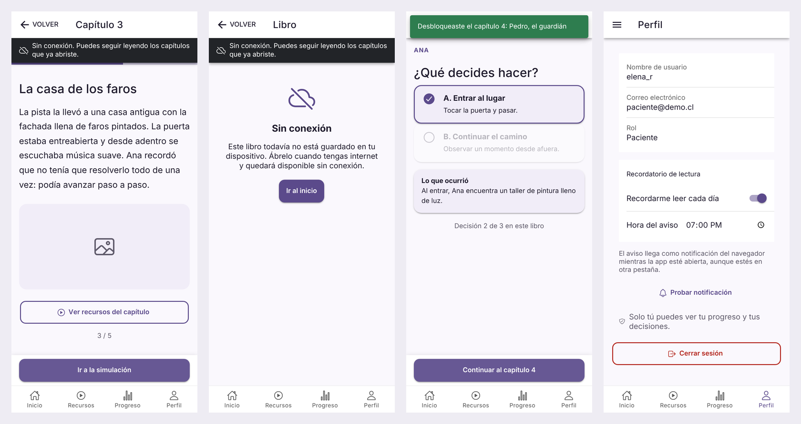

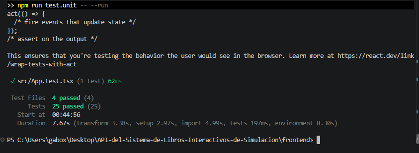

### Pruebas con Insomnia

La colección [`backend/docs/insomnia-libros-interactivos.json`](backend/docs/insomnia-libros-interactivos.json) se importa en Insomnia [[18]](#referencias). Tiene **101 peticiones** en 14 carpetas, con los casos correctos y los de error de cada módulo, y **122 pruebas automáticas** que revisan el código HTTP y, en algunas, el contenido de la respuesta.

- Las peticiones obtienen el token solas desde **Login paciente** o **Login admin**, así que no hay que copiarlo a mano.
- Las peticiones de editar y eliminar usan el id del registro creado en la misma carpeta.
- Al terminar, los datos quedan como estaban: lo que una carpeta crea, lo elimina al final de esa misma carpeta.

| Carpeta | Qué prueba |
| :--- | :--- |
| 0. Estado del servidor | Que la API y la base de datos responden. |
| 1. Autenticación | Login, registro (que no permite crear administradores), contraseña incorrecta, perfil sin token y token falso. |
| 2 a 6. Libros, capítulos, personajes, simulaciones y recursos | CRUD completo, 403 para el paciente, validaciones (400), no encontrado (404), datos repetidos (409) y la transacción de simulación con opciones. |
| 7 y 8. Progreso y decisiones | Datos propios del paciente, opción de otra simulación, reinicio de un libro y completar un capítulo con el anterior pendiente (409). |
| 9. Estadísticas | Solo administrador (403 para el paciente). |
| 10. Errores generales | Ruta inexistente, JSON mal formado e intento de inyección SQL en el id. |
| 11. Límite de intentos de login | Cinco intentos fallidos con el mismo correo y el sexto bloqueado (429). Si se vuelve a ejecutar antes de 15 minutos, todos responden 429. |
| 12. YouTube (servicio externo) | Datos de un video (200, o 503 sin `YOUTUBE_API_KEY`), enlace que no es de YouTube (400), paciente (403), sin sesión (401) y recurso con un enlace que no es audio, video ni YouTube (400). |
| 13. Seguridad (EF3) | Inyección SQL en el login y en un filtro (400), texto con `<script>` y `DROP TABLE` guardado como texto, enlaces `javascript:` y `http://` (400), token sin firma (401), perfil sin `password_hash` y CORS para un sitio no permitido. |

**Cómo ejecutarla:** en Insomnia, **Import** → elegir el archivo. Después, desde el menú de la colección, **Run** (Collection Runner) ejecuta todas las peticiones en orden y muestra cuántas pruebas pasaron.

**Prueba manual del rol vigente:** con el token de **Login admin**, **Estadísticas generales** responde `200`. En pgAdmin se ejecuta `UPDATE usuarios SET rol = 'patient' WHERE email = 'admin@demo.cl';` y, sin volver a iniciar sesión, la misma petición responde `403`. Al terminar se restaura con `UPDATE usuarios SET rol = 'admin' WHERE email = 'admin@demo.cl';`.

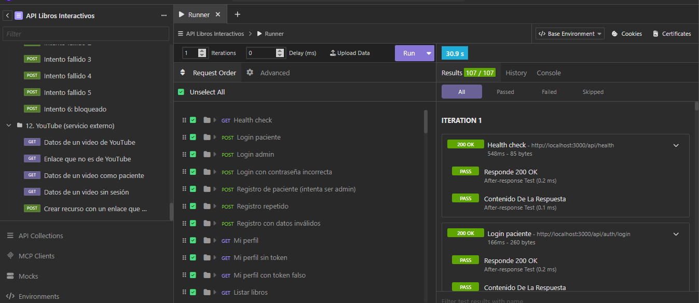

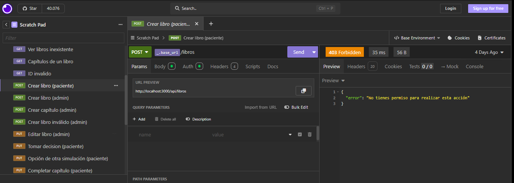

El frontend también tiene pruebas automáticas con Vitest (`npm run test.unit -- --run` dentro de `frontend/`): 25 pruebas en 4 archivos. `frontend/src/services/api.test.ts` (8 pruebas) revisa los interceptores de Axios sin llamar a la API real: que se envíe el token, que los errores 400, 409 y 429 y la falta de conexión se conviertan en mensajes claros, y que un 401 con sesión la cierre y vuelva al login. Además hay pruebas end-to-end de rutas y roles con Cypress (npm run test.e2e, con el backend y el frontend corriendo).

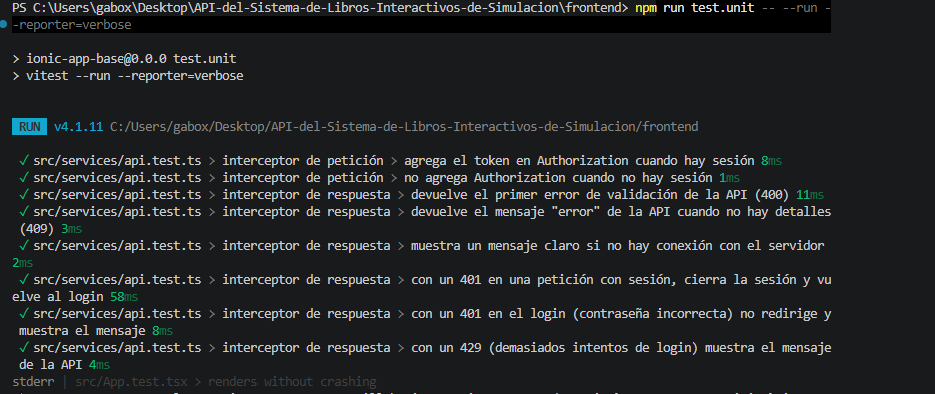
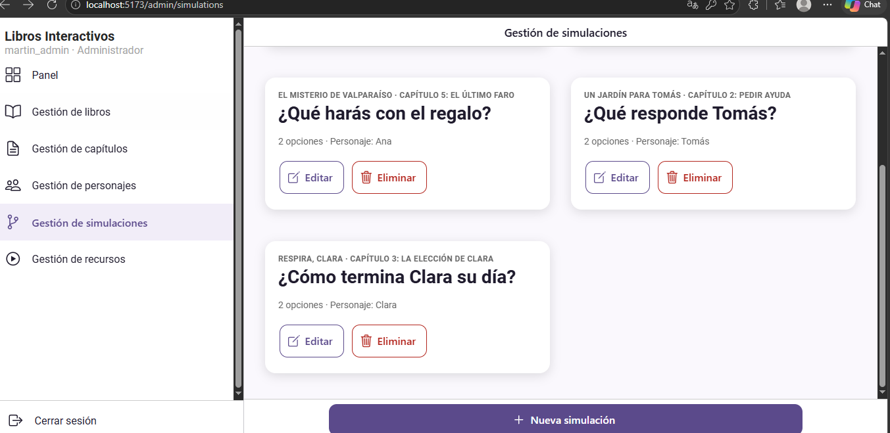
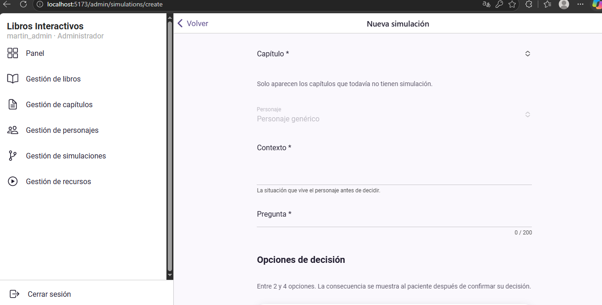

---
## Librerías usadas con React (Ionic)

### Librerías principales

| Librería | Versión | Propósito |
|---|---|---|
| `react` / `react-dom` | 19.0.0 | Construcción de la interfaz mediante componentes. |
| `@ionic/react` | ^9.0.0 | Estructura de vistas y componentes de interfaz de Ionic. |
| `@ionic/react-router` | ^9.0.0 | Integración de Ionic con React Router (`IonReactRouter`, `IonRouterOutlet`). |
| `react-router-dom` | ^6.30.0 | Navegación entre las diferentes vistas de la aplicación. |
| `ionicons` | ^8.1.0 | Íconos de la interfaz. |
| `axios` | ^1.20.0 | Cliente HTTP para llamar a la API, con interceptores para el token y los errores. |

### Backend (Node.js + Express)

| Librería | Versión | Propósito |
|---|---|---|
| `express` | ^5.3.0 | Servidor HTTP y rutas de la API REST [[11]](#referencias). |
| `pg` | ^8.23.1 | Conexión a PostgreSQL y consultas con parámetros [[19]](#referencias). |
| `bcryptjs` | ^3.0.3 | Encriptación de contraseñas [[14]](#referencias). |
| `jsonwebtoken` | ^9.0.3 | Creación y verificación de los tokens JWT [[13]](#referencias). |
| `express-rate-limit` | ^8.7.1 | Límite de intentos fallidos de inicio de sesión [[22]](#referencias) y de cuentas nuevas. |
| `express-validator` | ^7.3.2 | Validación de los datos de entrada [[16]](#referencias). |
| `helmet` | ^8.3.0 | Cabeceras HTTP de seguridad [[20]](#referencias). |
| `cors` | ^2.8.6 | Permite que solo el frontend llame a la API. |
| `dotenv` | ^18.0.8 | Carga las variables del archivo `.env`. |

### Herramientas de desarrollo

| Herramienta | Propósito |
|---|---|
| TypeScript ~5.9 | Tipado estático del código. |
| Vite | Servidor de desarrollo y compilación. |
| Vitest y Testing Library | Pruebas unitarias. |
| Cypress | Pruebas end-to-end de rutas y roles. |
| ESLint | Revisión de estilo del código. |
| PostgreSQL 18 y pgAdmin 4 | Base de datos y su administración. |
| Insomnia 13 | Pruebas de la API REST [[18]](#referencias). |
| `node --watch` | Reinicia el backend al guardar un archivo (`npm run dev`). |

## Tecnologías
- **Ionic Framework 9**
- **React 19 + TypeScript**
- **React Router 6**
- **Axios** (cliente HTTP con interceptores)
- **Node.js 22 + Express 5** (API REST)
- **PostgreSQL** (base de datos relacional)
- **JWT + bcrypt** (autenticación y contraseñas)
- **Insomnia** (pruebas de la API)
- **YouTube Data API v3** (servicio externo: verifica los videos y obtiene su duración)
- **Docker + Docker Compose** (despliegue local con contenedores) y **nginx** (sirve el frontend y reenvía /api)
- **Figma** (prototipo UI/UX)
- **Capacitor** (empaquetado móvil proyectado, Android 10+ / iOS 16.4+)

---

## Instalación y configuración

**Requisitos:**

| Herramienta | Versión | Uso |
| :--- | :--- | :--- |
| Node.js y npm | 22 LTS (o 20.19 o superior) | Ejecutar el backend y el frontend |
| PostgreSQL | 16 o superior (el equipo usa la 18) | Base de datos |
| pgAdmin 4 | Opcional | Crear y revisar la base de datos |
| Insomnia | Opcional | Probar la API |
| Docker Desktop | Con Docker Compose v2 | Levantar todo con contenedores (alternativa a la instalación manual) |

La versión de la EP2 (backend, frontend integrado y script SQL) está en la rama `backend`:

```bash
git clone https://github.com/Al3xiiss/API-del-Sistema-de-Libros-Interactivos-de-Simulacion.git
cd API-del-Sistema-de-Libros-Interactivos-de-Simulacion
git checkout backend
```

### 1. Base de datos (PostgreSQL)

**Con pgAdmin:**
1. Clic derecho en **Databases → Create → Database...**, nombre `libros_interactivos` → **Save**.
2. Clic derecho en `libros_interactivos` → **Query Tool**. Abre el archivo `backend/database/database.sql` (ícono de carpeta) y ejecútalo con `F5`.
3. Para comprobarlo, ejecuta `SELECT COUNT(*) FROM libros;`. Debe dar `3`.

**Con la terminal (psql):**

```bash
psql -U postgres -c "CREATE DATABASE libros_interactivos;"
psql -U postgres -d libros_interactivos -f backend/database/database.sql
```

El script se puede volver a ejecutar cuando se quiera: borra las tablas y vuelve a cargar los datos de prueba.

### 2. Backend

```bash
cd backend
npm install
cp .env.example .env        # en Windows (CMD o PowerShell): copy .env.example .env
```

Luego hay que completar el archivo `.env`:

| Variable | Descripción | Ejemplo |
| :--- | :--- | :--- |
| `PORT` | Puerto de la API | `3000` |
| `DB_HOST` | Servidor de PostgreSQL | `localhost` |
| `DB_PORT` | Puerto de PostgreSQL | `5432` |
| `DB_NAME` | Nombre de la base de datos | `libros_interactivos` |
| `DB_USER` | Usuario de PostgreSQL | `postgres` |
| `DB_PASSWORD` | Contraseña de ese usuario | La de tu instalación de PostgreSQL |
| `CORS_ORIGIN` | URL del frontend que puede llamar a la API | `http://localhost:5173` |
| `JWT_SECRET` | Clave secreta para firmar los tokens. **Mínimo 32 caracteres**: con una más corta o con el valor de ejemplo, el servidor no arranca | Una cadena aleatoria de 64 caracteres (ver abajo) |
| `JWT_EXPIRES_IN` | Duración del token | `2h` |
| `YOUTUBE_API_KEY` | Clave de la YouTube Data API v3. Opcional: sin ella, los videos de YouTube no se verifican | La que se crea en Google Cloud (APIs y servicios → Credenciales → Clave de API) |

Para generar `JWT_SECRET`:

```bash
node -e "console.log(require('crypto').randomBytes(32).toString('hex'))"
```

El archivo `.env` no se sube al repositorio, porque está en `.gitignore`. Cada integrante tiene el suyo.

Para iniciar la API:

```bash
npm run dev
```

Si todo está bien, la terminal muestra `Conectado a PostgreSQL` y `API escuchando en http://localhost:3000/api`. Para comprobarlo, abre `http://localhost:3000/api/health`.

| Comando (en `backend/`) | Qué hace |
|---|---|
| `npm run dev` | Inicia la API y la reinicia cada vez que se guarda un archivo |
| `npm start` | Inicia la API sin reinicio automático |

### 3. Frontend

En **otra terminal**, sin cerrar la del backend:

```bash
cd frontend
npm install
npm run dev
```

La aplicación queda disponible en `http://localhost:5173`. Por defecto usa la API en `http://localhost:3000/api`. Si la API está en otra dirección, copia `frontend/.env.example` como `frontend/.env` y cambia `VITE_API_URL`.

## Ejecución y uso

Para usar la aplicación tienen que estar listas las tres partes: la base de datos creada, el backend corriendo (`localhost:3000`) y el frontend corriendo (`localhost:5173`).

| Comando (en `frontend/`) | Qué hace |
|---|---|
| `npm run dev` | Servidor de desarrollo en `http://localhost:5173` |
| `npm run build` | Compila TypeScript y genera la versión de producción en `dist/` |
| `npm run test.unit` | Pruebas unitarias (Vitest) |
| `npm run test.e2e` | Pruebas end-to-end (Cypress; requieren el backend y el frontend corriendo) |
| `npm run lint` | Revisión de estilo con ESLint |

### Cuentas de prueba

Las cuentas vienen incluidas en `database.sql`:

| Rol | Correo | Contraseña |
|---|---|---|
| Paciente | `paciente@demo.cl` | `Paciente123` |
| Administrador | `admin@demo.cl` | `Admin12345` |

También se puede registrar un paciente nuevo en `/register`. Para volver a los datos iniciales, ejecuta de nuevo `database.sql`.

Para crear otro administrador, primero hay que registrarlo como paciente y luego cambiar su rol en la base de datos: `UPDATE usuarios SET rol = 'admin' WHERE email = 'correo@ejemplo.cl';`. Después tiene que volver a iniciar sesión, porque el rol viaja dentro del token.

### Cómo probar la separación por roles
1. Sin sesión, abrir `http://localhost:5173/app/home` → redirige a `/login`.
2. Iniciar sesión como paciente → llega a `/app/home` con la barra inferior (móvil) o el menú lateral (web).
3. Como paciente, escribir `/admin` en la barra de direcciones → redirige a `/unauthorized`.
4. Cerrar sesión e iniciar como administrador → llega a `/admin` con el menú de gestión.
5. Para ver la versión móvil en el computador, usar el modo dispositivo de DevTools (`F12` → ícono de celular).
6. En la API, con la colección de Insomnia: **Crear libro como paciente** responde `403` y **Mi perfil sin token** responde `401`.

## Despliegue con Docker

La aplicación completa (base de datos, API y frontend) se levanta con contenedores, sin instalar Node.js ni PostgreSQL en el equipo. Solo se necesita **Docker Desktop** con Docker Compose v2.

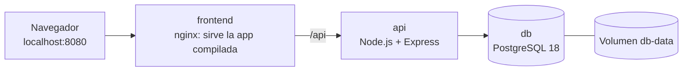

| Servicio | Imagen | Puerto en el equipo | Función |
| :--- | :--- | :--- | :--- |
| `db` | `postgres:18-alpine` | `127.0.0.1:5433` (solo para pgAdmin) | Base de datos. La primera vez ejecuta `backend/database/database.sql`. |
| `api` | `backend/Dockerfile` | No se publica | API REST. Solo se llega a ella a través de nginx. |
| `frontend` | `frontend/Dockerfile` | `8080` | nginx sirve el frontend compilado y reenvía `/api` a la API. |

**Decisiones de la configuración:**
- **Imágenes livianas y seguras:** se usan imágenes Alpine. La API instala solo dependencias de producción (`npm ci --omit=dev`) y se ejecuta con el usuario `node`, no como root. El frontend se construye en dos etapas: Node compila y la imagen final solo tiene nginx con la carpeta `dist`.
- **Un solo punto de entrada:** el navegador solo habla con `localhost:8080`. nginx reenvía `/api` al contenedor `api`, así no hay problemas de CORS y ni la API ni la base de datos quedan expuestas.
- **Orden de arranque:** con `depends_on` y `healthcheck`, la API espera a que PostgreSQL esté listo y nginx espera a que la API responda en `/api/health`.
- **Secretos fuera de las imágenes:** `.env` está en `.dockerignore` y en `.gitignore`. Las claves se entregan como variables de entorno al iniciar los contenedores.
- **IP real en el límite de login:** nginx envía la IP del usuario en `X-Forwarded-For` y la API confía en ese proxy con `TRUST_PROXY=1`.
- **Optimización:** nginx comprime las respuestas con gzip y deja en caché por un año los archivos de `assets/`, que cambian de nombre en cada build.

### Variables de entorno

Se definen en un archivo `.env` en la raíz del repositorio, a partir de la plantilla `.env.example`. Este archivo no se sube al repositorio.

| Variable | Descripción | Valor |
| :--- | :--- | :--- |
| `DB_PASSWORD` | Contraseña de PostgreSQL dentro del contenedor | Letras y números |
| `JWT_SECRET` | Clave para firmar los tokens (mínimo 32 caracteres) | Una cadena aleatoria (ver abajo) |
| `YOUTUBE_API_KEY` | Clave de la YouTube Data API v3 (opcional) | La misma de `backend/.env` |

Para generar `JWT_SECRET` sin tener Node.js instalado:

```bash
docker run --rm node:22-alpine node -e "console.log(require('crypto').randomBytes(32).toString('hex'))"
```

Las demás variables de la API (`DB_HOST=db`, `CORS_ORIGIN`, `TRUST_PROXY`, etc.) ya están en `docker-compose.yml`. Si falta `DB_PASSWORD` o `JWT_SECRET`, Docker Compose se detiene e indica cuál falta.

### Cómo levantarlo

```bash
# 1. Variables de entorno (una sola vez). En PowerShell: Copy-Item .env.example .env

cp .env.example .env

# Editar .env y completar DB_PASSWORD y JWT_SECRET

# 2. Construir las imágenes y levantar los tres servicios
docker compose up --build -d

# 3. Revisar el estado: db y api deben quedar "healthy"
docker compose ps
```

Después, abrir **http://localhost:8080** e iniciar sesión con las [cuentas de prueba](#cuentas-de-prueba). La API responde en `http://localhost:8080/api/health`. Para usar la colección de Insomnia contra Docker, crear un sub-ambiente **Docker** con `base_url` = `http://localhost:8080/api`. Para revisar la base con pgAdmin: servidor `localhost`, puerto `5433`, usuario `postgres` y la contraseña de `DB_PASSWORD`.

| Comando | Uso |
| :--- | :--- |
| `docker compose ps` | Estado de los contenedores |
| `docker compose logs api` | Registros de un servicio (`db`, `api` o `frontend`) |
| `docker compose stop` / `docker compose start` | Apagar y encender sin borrar nada |
| `docker compose up --build -d` | Reconstruir después de cambiar el código |
| `docker compose down` | Eliminar los contenedores (los datos quedan en el volumen) |
| `docker compose down -v` | Eliminar también la base de datos |

`database.sql` solo se ejecuta cuando el volumen está vacío. Si se modifica el script, hay que ejecutar `docker compose down -v` y volver a levantar.

### Evidencia de despliegue local

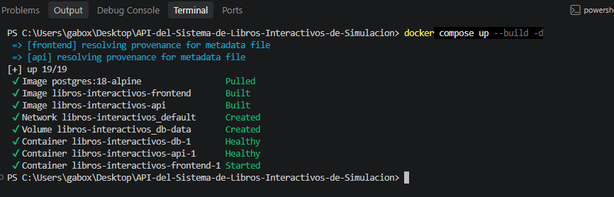

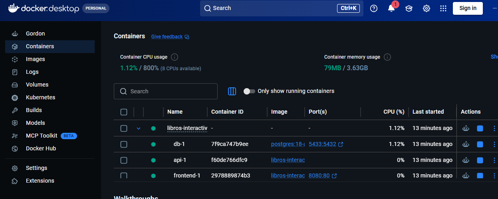

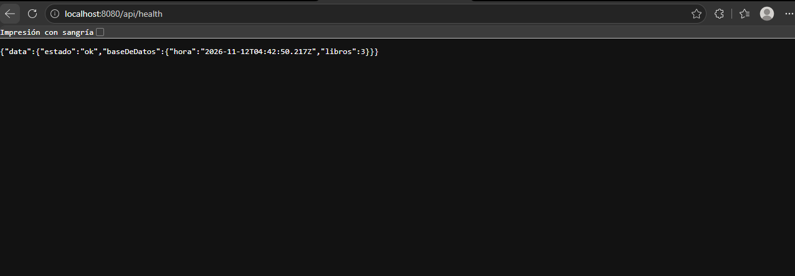

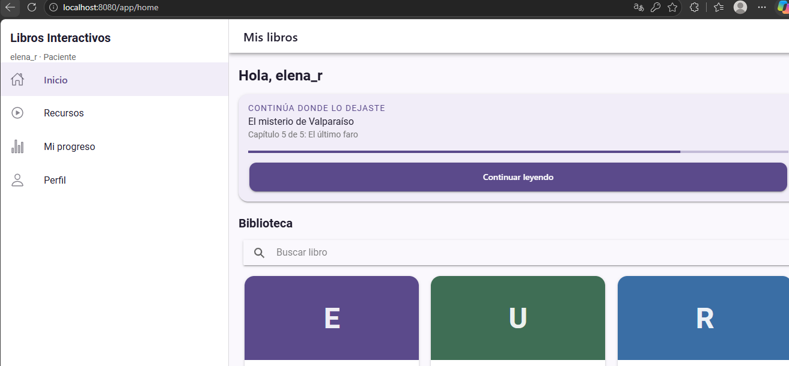

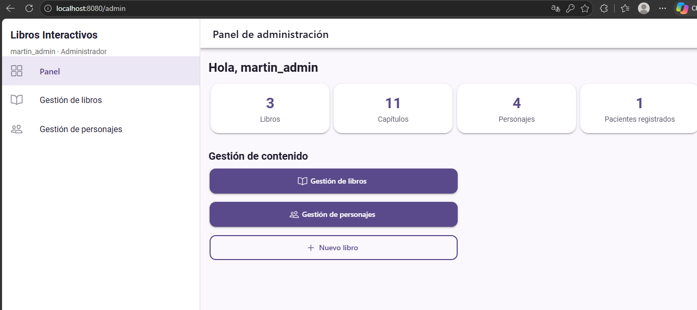

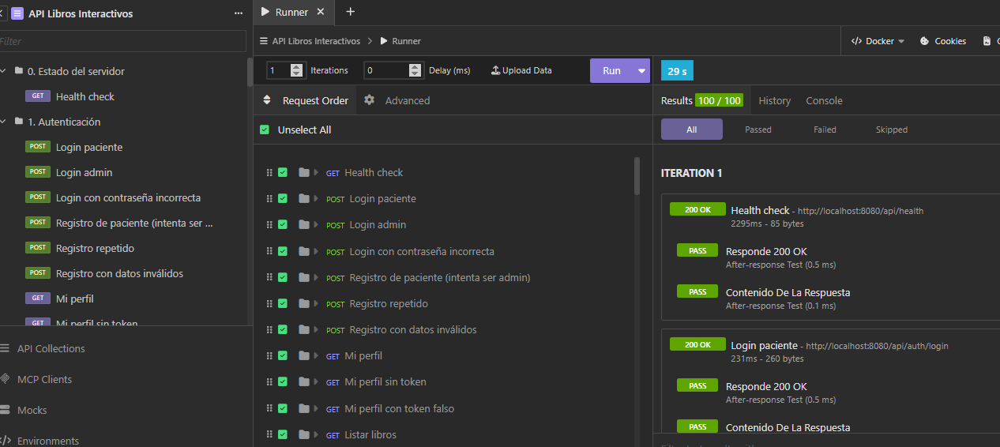

---

## Estructura del proyecto

```text
.
├── README.md
├── img/                         Imágenes del README
├── docker-compose.yml           Levanta db, api y frontend
├── .env.example                 Variables de Docker Compose (copiar como .env)
├── backend/
│   ├── database/
│   │   ├── database.sql         Tablas, restricciones, índices y datos de prueba
│   │   └── rendimiento-ef4.sql  Medición de los índices con EXPLAIN ANALYZE (EF4)
│   ├── docs/
│   │   ├── endpoints.md         Documentación de la API
│   │   ├── insomnia-libros-interactivos.json   Colección de pruebas
│   │   └── evidencias/          Capturas de las pruebas
│   ├── src/
│   │   ├── server.js            Punto de entrada: carga el .env, prueba la BD y levanta el servidor
│   │   ├── app.js               Express: helmet, CORS, JSON, rutas y manejo de errores
│   │   ├── config/              db.js (pool de conexiones a PostgreSQL)
│   │   ├── routes/              Rutas de cada módulo e index.js, que las une bajo /api
│   │   ├── middlewares/         auth.js (verificarToken, permitirRoles), limiteLogin.js, limiteRegistro.js,
│   │   │                        validate.js, errorHandler.js
│   │   ├── validators/          Reglas de validación de cada módulo
│   │   ├── controllers/         Reciben la petición y arman la respuesta
│   │   ├── services/            Consultas SQL con parámetros y youtube.service (YouTube Data API)
│   │   └── utils/               httpError, pgErrors (errores de PostgreSQL), transaccion
│   ├── .env.example             Plantilla de variables de entorno
│   ├── Dockerfile               Imagen de la API
│   └── package.json
└── frontend/
    ├── .env.example             URL de la API (opcional)
    ├── Dockerfile               Compila con Node y sirve con nginx
    ├── nginx.conf               Sirve el frontend y reenvía /api a la API
    ├── security-headers.conf    Cabeceras de seguridad y política CSP que envía nginx (EF3)
    ├── cypress/                 Pruebas end-to-end
    └── src/
        ├── App.tsx              IonApp + IonReactRouter + IonSplitPane (menú lateral en web)
        ├── routes/              AppRoutes (mapa de rutas), guardias (PrivateRoute, RoleRoute, PublicOnlyRoute)
        │                        y lazySections (carga diferida de las secciones)
        ├── layouts/             UserLayout (IonTabs del paciente) y AdminLayout (rutas /admin/*)
        ├── pages/
        │   ├── public/          LoginPage, RegisterPage
        │   ├── user/            Home, BookDetail, Chapter, Simulation, Decision, Resources, Progress, Profile
        │   ├── admin/           AdminHome, AdminBooks, AdminBookForm, AdminCharacters, AdminCharacterForm,
        │   │                    AdminChapters, AdminChapterForm, AdminSimulations, AdminSimulationForm,
        │   │                    AdminResources, AdminResourceForm
        │   └── common/          Unauthorized, NotFound
        ├── components/          AppMenu, PageHeader, BookCard, ChapterListItem, DecisionOptionCard,
        │                        MediaPlayer, AdminItemCard, EmptyState, OfflineBanner, OfflineState, SectionLoader
        ├── services/            api (Axios e interceptores), session, mappers, authService, bookService,
        │                        characterService, adminContentService, progressService, statsService, storage,
        │                        offlineCache (lectura sin conexión), reminderService (recordatorio de lectura)
        ├── hooks/               usePageEnter (recarga datos al volver a una página), useOnlineStatus,
        │                        useReadingReminder
        ├── types/               Tipos del dominio
        ├── utils/               Validaciones de formularios
        └── theme/               Paleta (variables.css) y estilos globales (global.css)
```

---
## Uso de herramientas de IA
Conforme a lo permitido por la pauta, el equipo utilizó asistentes de inteligencia artificial como **apoyo**:

- **EP1:** para revisar la documentación frente a la rúbrica y generar una base inicial del código del frontend.
- **EP2:** para guiar paso a paso la construcción del backend (servidor, base de datos, autenticación y CRUD) y generar una base del código de los módulos, de la integración con Axios, de la colección de Insomnia y de la documentación de la API.

- **EF:** para guiar paso a paso las correcciones de seguridad de la API, la configuración de Docker (Dockerfiles, nginx y docker-compose) y las mejoras EF1 a EF5: notificaciones y lectura sin conexión, carga diferida y correcciones de accesibilidad, índices y script de medición, CORS, límites y política CSP, integración con YouTube, y pruebas de Insomnia y Vitest. También para redactar y revisar la documentación del README. El equipo ejecutó y probó todo en sus equipos (Docker, Lighthouse, Insomnia y el navegador).

El código fue revisado, adaptado, probado y modificado por el equipo, que también ejecutó las pruebas en Insomnia y en el navegador. Los bocetos y prototipos de Figma se construyeron manualmente.

---
## Referencias
1. Organización Mundial de la Salud. *Cáncer* (nota descriptiva). https://www.who.int/es/news-room/fact-sheets/detail/cancer
2. Organización Panamericana de la Salud. *Cáncer*. https://www.paho.org/es/temas/cancer
3. Organización Panamericana de la Salud. *Cuidados paliativos: guías para el manejo clínico*. https://www.paho.org/es/documentos/cuidados-paliativos-guias-para-manejo-clinico
4. Ministerio de Salud de Chile. *Plan Nacional de Cáncer 2022-2027*. https://www.minsal.cl/plan-nacional-de-cancer/
5. Tired of Cancer. *Untire: digital therapy for cancer-related fatigue*. https://tiredofcancerapp.com/ — Protocolo de estudio: https://pubmed.ncbi.nlm.nih.gov/32130185/
6. OWise. *OWise – Cancer support app*. https://owise.uk/
7. Headspace. *Meditación y mindfulness*. https://www.headspace.com/
8. W3C. *Web Content Accessibility Guidelines (WCAG) 2.1 — Contrast (Minimum)*. https://www.w3.org/TR/WCAG21/#contrast-minimum
9. Ionic Framework. *React Navigation*. https://ionicframework.com/docs/react/navigation
10. Ionic. *Ionicons*. https://ionic.io/ionicons
11. Express. *Express: framework web para Node.js*. https://expressjs.com/
12. PostgreSQL. *Constraints* (documentación oficial). https://www.postgresql.org/docs/current/ddl-constraints.html
13. IETF. *RFC 7519: JSON Web Token (JWT)*. https://datatracker.ietf.org/doc/html/rfc7519
14. OWASP. *Password Storage Cheat Sheet*. https://cheatsheetseries.owasp.org/cheatsheets/Password_Storage_Cheat_Sheet.html
15. OWASP. *SQL Injection Prevention Cheat Sheet*. https://cheatsheetseries.owasp.org/cheatsheets/SQL_Injection_Prevention_Cheat_Sheet.html
16. express-validator. *Documentación*. https://express-validator.github.io/docs/
17. Axios. *Interceptors*. https://axios-http.com/docs/interceptors
18. Insomnia. *Documentación*. https://docs.insomnia.rest/
19. node-postgres. *Queries* (consultas con parámetros). https://node-postgres.com/features/queries
20. Helmet. *Helmet.js*. https://helmetjs.github.io/
21. Vite. *Build Options: build.target*. https://vite.dev/config/build-options#build-target
22. express-rate-limit. *Documentación*. https://www.npmjs.com/package/express-rate-limit
23. OWASP. *Authentication Cheat Sheet* (protección contra ataques automatizados). https://cheatsheetseries.owasp.org/cheatsheets/Authentication_Cheat_Sheet.html
24. Google for Developers. *YouTube Data API: Videos: list*. https://developers.google.com/youtube/v3/docs/videos/list
25. Google for Developers. *YouTube Data API: Getting Started* (cuota de uso). https://developers.google.com/youtube/v3/getting-started
26. MDN Web Docs. *Notifications API*. https://developer.mozilla.org/en-US/docs/Web/API/Notifications_API
27. MDN Web Docs. *Navigator: onLine property*. https://developer.mozilla.org/en-US/docs/Web/API/Navigator/onLine
28. MDN Web Docs. *Window: localStorage property*. https://developer.mozilla.org/en-US/docs/Web/API/Window/localStorage
29. Capacitor. *Local Notifications Capacitor Plugin API*. https://capacitorjs.com/docs/apis/local-notifications
30. Chrome for Developers. *Introduction to Lighthouse*. https://developer.chrome.com/docs/lighthouse/overview
31. W3C. *Understanding Success Criterion 1.4.4: Resize Text*. https://www.w3.org/WAI/WCAG21/Understanding/resize-text.html
32. PostgreSQL. *Using EXPLAIN*. https://www.postgresql.org/docs/current/using-explain.html
33. PostgreSQL. *Constraints: Foreign Keys* (índices en las columnas que hacen referencia). https://www.postgresql.org/docs/current/ddl-constraints.html#DDL-CONSTRAINTS-FK
34. MDN Web Docs. *Content Security Policy (CSP)*. https://developer.mozilla.org/en-US/docs/Web/HTTP/CSP
35. OWASP. *Cross Site Scripting Prevention Cheat Sheet*. https://cheatsheetseries.owasp.org/cheatsheets/Cross_Site_Scripting_Prevention_Cheat_Sheet.html